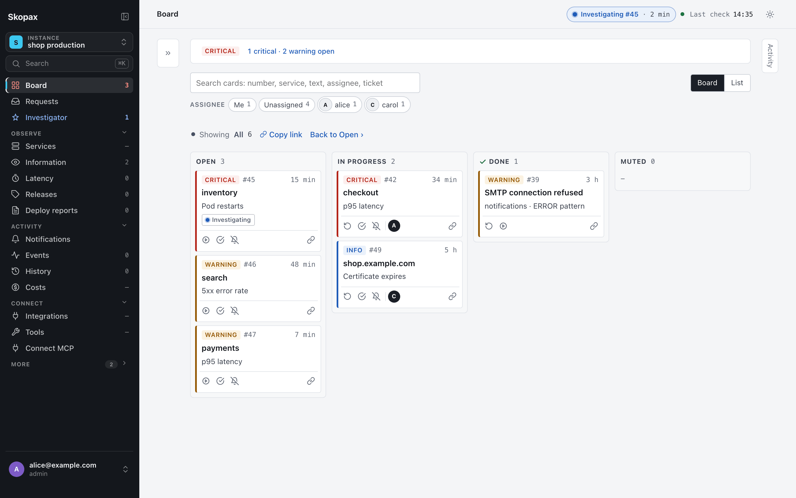
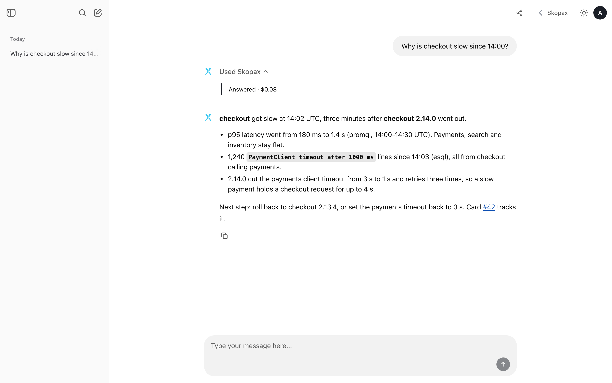
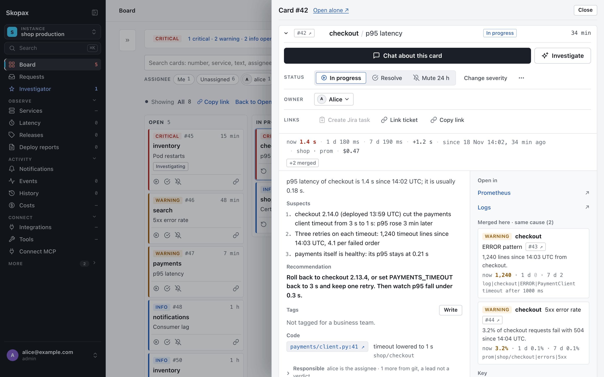
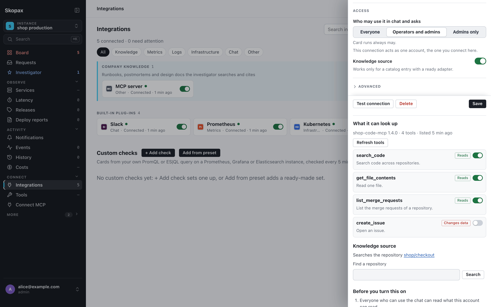

# Skopax

**The AI lookout for your production systems.**

Every team has that one person who always knows why things are happening and what to do. Skopax is that person, for the whole team, at any hour.

<picture>
<source media="(prefers-color-scheme: dark)" srcset="docs/images/board-dark.png">
<source media="(prefers-color-scheme: light)" srcset="docs/images/board-light.png">

</picture>

Its AI investigator keeps an eye on production. When something breaks, it reads your metrics, logs and recent deploys, then tells you why it broke and what to do next, in plain words. You can also chat with it about prod on its own chat page, ask it in Slack, or reach it from your own AI assistant over MCP.

Behind it, alerts and errors are grouped into one card per problem, so the team can see who is on it.

The name comes from the Greek *skopos*, "lookout": the one who stands on a high place, scans the horizon and calls out what is coming.

Status: 0.1.0 is the first stable release. From here, settings and the plug-in contract follow semantic versioning: before 1.0, no breaking change ships without a note in [CHANGELOG.md](CHANGELOG.md).

## What it looks like

The Chat page, where you ask about prod in plain words and the answer names the metrics and logs it read:

<picture>
<source media="(prefers-color-scheme: dark)" srcset="docs/images/chat-dark.png">
<source media="(prefers-color-scheme: light)" srcset="docs/images/chat-light.png">

</picture>

A card opened from the Board, with the investigator's suspects, recommendation, code lead and note, and the cards merged under it:

<picture>
<source media="(prefers-color-scheme: dark)" srcset="docs/images/card-dark.png">
<source media="(prefers-color-scheme: light)" srcset="docs/images/card-light.png">

</picture>

The Integrations page, where every connection uses the same form; here an outside MCP server with the tools it may use:

<picture>
<source media="(prefers-color-scheme: dark)" srcset="docs/images/integrations-dark.png">
<source media="(prefers-color-scheme: light)" srcset="docs/images/integrations-light.png">

</picture>

## Quickstart

With Docker Compose, from a clone of this repository. The first line makes the secret key once and writes it to `.env`, which Compose reads on every start and passes to Skopax, so run that line only once:

    echo SKOPAX_SECRET_KEY="$(openssl rand -hex 32)" >> .env
    docker compose up --build

Then open http://localhost:8080. The compose file builds the image from the clone and starts it with a MongoDB.

Or run the published image with a MongoDB of your own. The first line makes the secret key once:

    SKOPAX_SECRET_KEY="$(openssl rand -hex 32)"
    docker network create skopax
    docker run -d --name skopax-mongo --network skopax -v skopax-mongo:/data/db mongo:8.0.4
    docker run -d --name skopax --network skopax -p 127.0.0.1:8080:8080 \
      -e MONGO_URI=mongodb://skopax-mongo:27017/skopax \
      -e SKOPAX_BASE_URL=http://localhost:8080 \
      -e SKOPAX_SECRET_KEY="$SKOPAX_SECRET_KEY" \
      ghcr.io/skopax/skopax:0.1.0

Keep that key, for example in your password manager (`echo "$SKOPAX_SECRET_KEY"` prints it; with Compose it stays in `.env`), and pass the same value on every start. With another key, Skopax cannot open the integration secrets sealed with the old one, so each has to be entered again, and everyone has to sign in again (see [Settings](docs/configuration.md#settings)).

The image is built for `linux/amd64` and `linux/arm64`. From 0.1.0, Docker Hub has a mirror of each release, `docker.io/skopax/skopax`; release candidates are published to GHCR only. Read the setup code with `docker logs skopax` instead of `docker compose logs skopax` below. [Operations](docs/operations.md#the-image) has more on the image.

Run one Skopax per MongoDB database: that is the supported shape in v0.1. Several pods of one Skopax share their database safely, but two separate copies on one database can, for example, post a retried route message twice.

## First run

A new install has no accounts, so every page sends you to `/setup`.

- Read the setup code from the container logs: `docker compose logs skopax`. Look for `Skopax setup: open ... and enter the code XXXX-XXXX`. Enter the code, an email, a name and a password (12 to 256 characters) to create the first admin.
- Or skip the form: set `SKOPAX_ADMIN_EMAIL` and `SKOPAX_ADMIN_PASSWORD` in the environment before the first start. That account is created as an admin. Do this when nobody opens a browser, for example in a script or a CI job: until a first admin exists, every API route answers 503, even with the bootstrap token `SKOPAX_TOKEN`.

Admins add more people, change roles, manage API tokens and set up single sign-on in Admin > Access & sign-in (see [Sign in with SSO](docs/sign-in.md#sign-in-with-sso)).

Next, add a first integration: [Add Prometheus](docs/setup.md#add-prometheus) walks through it, and [Run the demo](docs/setup.md#run-the-demo) starts a Prometheus to try it on.

## Documentation

The full guide is in [docs/](docs/README.md):

- [Setup](docs/setup.md): the page, Admin, the first integration and the demo.
- [Configuration](docs/configuration.md): settings, the config file and settings sources, branding and languages.
- [Sign-in](docs/sign-in.md): single sign-on, roles, local accounts and the MCP server.
- [Integrations](docs/plugins.md): the plug-ins that ship with Skopax, their instances and outside MCP servers.
- [Extending Skopax](docs/extending.md): writing a plug-in, starting from the example in `examples/hello-plugin`, with two fuller examples next to it: `examples/couchbase-plugin` and `examples/managed-redis-plugin`.
- [Operations](docs/operations.md): the image, agent mode, the probe, proxies and recovery.
- [Development](docs/development.md): the tests, continuous integration, the licence gate and releases.

## Contributing

Issues and pull requests are welcome. Contributions come in under Apache-2.0, the licence they go out under, and every commit carries a `Signed-off-by` line under the Developer Certificate of Origin 1.1 (`git commit -s`). There is no separate agreement to sign. A pull request title follows Conventional Commits, such as `fix: ...` or `feat(slack): ...`.

- [CONTRIBUTING.md](CONTRIBUTING.md): what we accept, the project rules and the sign-off.
- [CODE_OF_CONDUCT.md](CODE_OF_CONDUCT.md): the Contributor Covenant 2.1. Report a conduct problem to hello@skopax.io.
- [Development](docs/development.md): setting up, running the tests and CI.

## Security

Do not open a public issue for a security problem. Report it privately with GitHub private vulnerability reporting: the **Security** tab of https://github.com/skopax/skopax, then **Report a vulnerability**. [SECURITY.md](SECURITY.md) says what to include, what to expect and which versions get fixes.

## License

Skopax is licensed under the Apache License 2.0. See [LICENSE](LICENSE) and [NOTICE](NOTICE). Bundled icons and their licences are listed in [THIRD_PARTY_NOTICES.md](THIRD_PARTY_NOTICES.md).

The image carries its licence material in `/usr/share/doc/skopax/`: `LICENSE`, `NOTICE`, `THIRD_PARTY_NOTICES.md`, and the lists the image build generates, `third-party-python.md` (every Python distribution in the image, with its licence and licence texts) and `third-party-debian.md` (every Debian library copied in, with its package, licence and copyright file). The build fails on a dependency whose licence is not allowed; see [The licence gate](docs/development.md#the-licence-gate). The Python interpreter in the image is CPython 3.15, under the PSF-2.0 licence, with its licence text at `/usr/local/lib/python3.15/LICENSE.txt`.

The Skopax name, the Beam X logo and the Skopax wordmark are reserved by [TRADEMARKS.md](TRADEMARKS.md). The logo files themselves are Apache-2.0 like the code. A fork may change the code under Apache-2.0, but when you distribute it or offer it as a service, it must use its own name and drop the logo.
