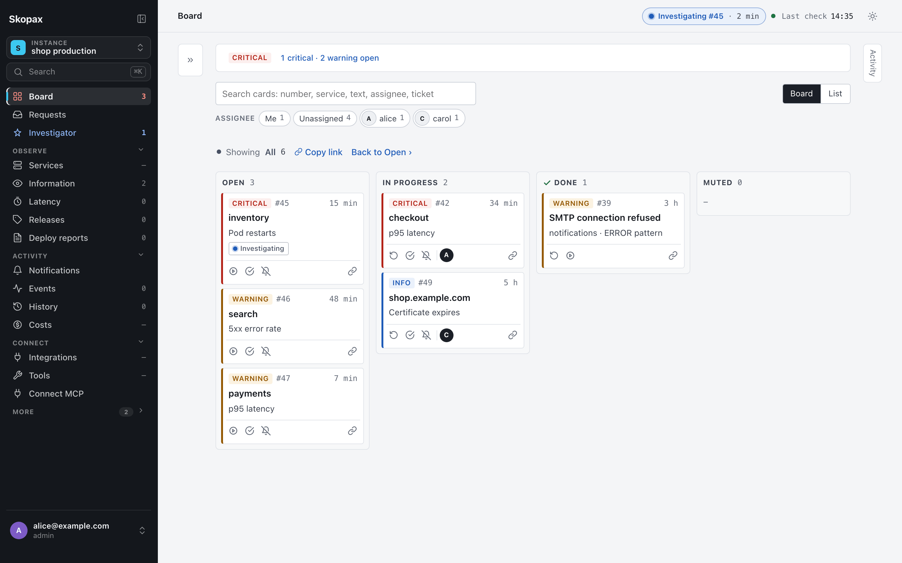

# Skopax documentation

Start with the [quickstart](../README.md#quickstart) and [First run](../README.md#first-run) on the front page. These pages cover the rest.

<picture>
<source media="(prefers-color-scheme: dark)" srcset="images/board-dark.png">
<source media="(prefers-color-scheme: light)" srcset="images/board-light.png">

</picture>

- [Setup](setup.md): [The page](setup.md#the-page), [Admin](setup.md#admin) (with the [feature switches](setup.md#feature-switches) and the [Anthropic key](setup.md#the-anthropic-key)), [Add Prometheus](setup.md#add-prometheus), [Run the demo](setup.md#run-the-demo) and [Offline](setup.md#offline).
- [Configuration](configuration.md): [Settings](configuration.md#settings), [Branding](configuration.md#branding), [Settings sources](configuration.md#settings-sources) and [Languages](configuration.md#languages).
- [Sign-in](sign-in.md): [Sign in with SSO](sign-in.md#sign-in-with-sso), [Roles](sign-in.md#roles), [Local accounts and SSO](sign-in.md#local-accounts-and-sso), [MCP](sign-in.md#mcp) and [Headless setup](sign-in.md#headless-setup).
- [Integrations](plugins.md): [Plug-ins](plugins.md#plug-ins), [Instances](plugins.md#instances), [Observability plug-ins](plugins.md#observability-plug-ins), [Code, tickets and chat](plugins.md#code-tickets-and-chat), [Web, app and marketing plug-ins](plugins.md#web-app-and-marketing-plug-ins) and [Outside MCP servers](plugins.md#outside-mcp-servers).
- [Custom checks](custom-checks.md): [A check](custom-checks.md#a-check), [How a check runs](custom-checks.md#how-a-check-runs), [Bounds](custom-checks.md#bounds), [Preview](custom-checks.md#preview), [A worked example](custom-checks.md#a-worked-example) and [Presets](custom-checks.md#presets) (Couchbase, Managed Redis).
- [Extending Skopax](extending.md): [The example plug-in: Hello](extending.md#the-example-plug-in-hello) and [Writing a plug-in](extending.md#writing-a-plug-in).
- [Operations](operations.md): [The image](operations.md#the-image), [Upgrades](operations.md#upgrades), [Agent mode](operations.md#agent-mode), [Probe](operations.md#probe), [Behind a proxy or ingress](operations.md#behind-a-proxy-or-ingress), [Outbound gateway](operations.md#outbound-gateway), [Lost setup code](operations.md#lost-setup-code) and [Lost admin password](operations.md#lost-admin-password).
- [Development](development.md): [Set up](development.md#set-up), [The code](development.md#the-code), [The tests](development.md#the-tests), [Continuous integration](development.md#continuous-integration), [The licence gate](development.md#the-licence-gate) and [Releases](development.md#releases).

For contributing, security reports and the licence, see [CONTRIBUTING.md](../CONTRIBUTING.md), [SECURITY.md](../SECURITY.md) and [LICENSE](../LICENSE).
