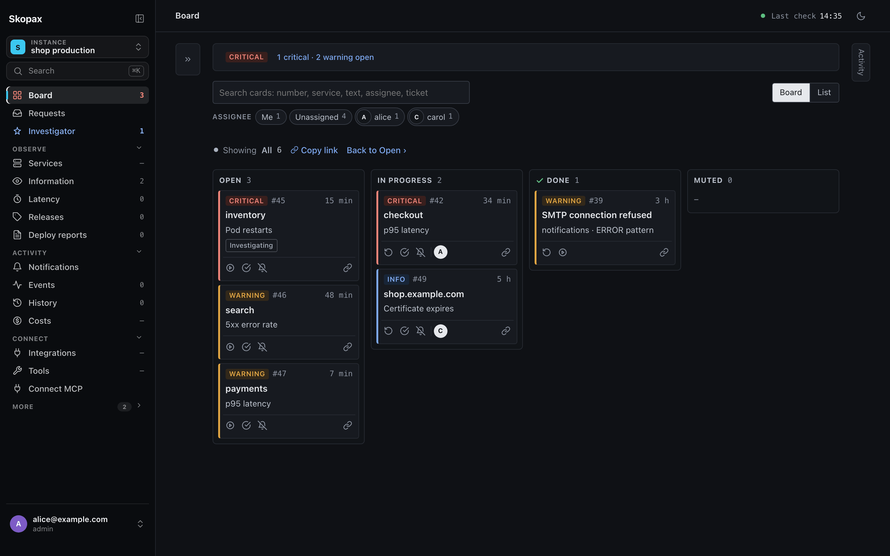

# Skopax

**The open-source AI lookout for your production systems.** Skopax watches the services and tools your team already runs, turns real problems into cards on a shared board, posts them to Slack or Teams, and can help investigate with your own AI key.

- **35+ built-in plug-ins:** Prometheus, Kubernetes, Elasticsearch, Grafana, Kafka, Redis, Cloudflare, GitHub, GitLab, Jira, Confluence and more, plus custom PromQL and ES|QL checks.
- **One board for the team:** cards with owners, tags, a full history and links; info findings stay on a separate Information page.
- **Tag responsibles:** pick people per tag, new cards are auto-assigned to them in turn, and a daily Slack report names them.
- **Slack and Teams:** cards posted to the right channel as they happen, a daily tag report, business-day timers.
- **Optional AI investigator:** reads the same sources with your Anthropic or OpenAI key to suggest causes and next steps; a running investigation shows live on the card and in the top bar.
- **Self-hosted:** your data stays in your MongoDB; single sign-on (OIDC), roles, API tokens and MCP.
- **Extensible:** add your own plug-ins on top of this image.

## Quick start

You need a MongoDB. Make the secret key once and keep it:

    SKOPAX_SECRET_KEY="$(openssl rand -hex 32)"
    docker network create skopax
    docker run -d --name skopax-mongo --network skopax -v skopax-mongo:/data/db mongo:8.0.4
    docker run -d --name skopax --network skopax -p 127.0.0.1:8080:8080 \
      -e MONGO_URI=mongodb://skopax-mongo:27017/skopax \
      -e SKOPAX_BASE_URL=http://localhost:8080 \
      -e SKOPAX_SECRET_KEY="$SKOPAX_SECRET_KEY" \
      skopax/skopax:{minor}

For website screenshots and page scan (Website plug-in, optional) add a browser service next to it and set Browser URL on the Website instance to `http://skopax-browser:9222`:

    docker run -d --name skopax-browser --network skopax --shm-size 1g chromedp/headless-shell:157.0.8103.15

Then open http://localhost:8080. A Docker Compose file and all settings are in the [README](https://github.com/skopax/skopax#quickstart).

## Tags

- `{version}` exact release, `{minor}` latest patch of {minor}, `latest` newest release
- Images for `linux/amd64` and `linux/arm64`
- The same images are on GitHub Container Registry: `ghcr.io/skopax/skopax`

## Links

- Source and docs: https://github.com/skopax/skopax
- Changelog: https://github.com/skopax/skopax/blob/main/CHANGELOG.md
- Website: https://skopax.io
- Licence: Apache-2.0
