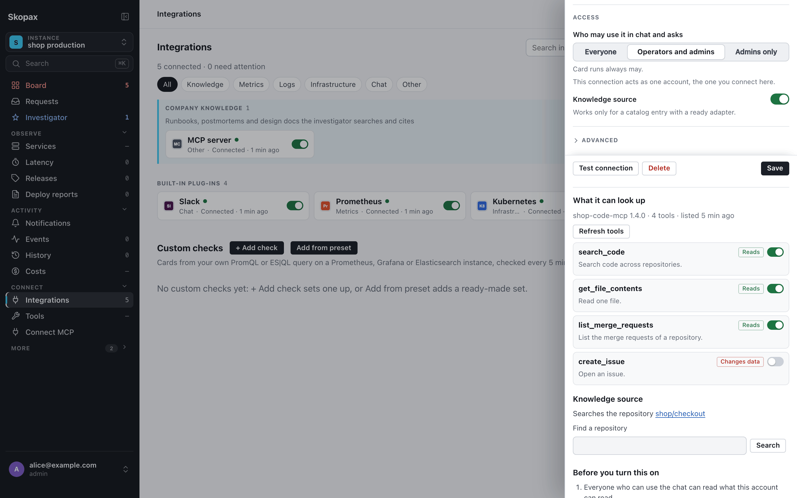

# Integrations

The plug-ins that ship with Skopax, their instances, and outside MCP servers.

## Plug-ins

Prometheus, Kubernetes, the observability plug-ins, GitLab, GitHub, Jira, Confluence, SharePoint and OneDrive, Argo CD, Slack, Microsoft Teams, Email route, Mail server, the web, app and marketing plug-ins and the MCP server plug-in ship with Skopax (see [Add Prometheus](setup.md#add-prometheus), [Observability plug-ins](#observability-plug-ins), [Code, tickets and chat](#code-tickets-and-chat), [Web, app and marketing plug-ins](#web-app-and-marketing-plug-ins) and [Outside MCP servers](#outside-mcp-servers)). Others are found in two ways:

- installed packages that register a `skopax.plugins` entry point;
- `SKOPAX_PLUGINS`, a comma-separated list of module paths, each with a `PLUGIN` object.

Connect > Integrations shows a tile for each connected plug-in, with its health and an on/off switch, and "+ Add integration" lists the plug-ins that can be set up. A plug-in is on unless an admin switched it off, and one that needs instances does nothing until it has an enabled, valid instance.

Admins read and change integrations through `/api/admin/plugins`. Everyone else who is signed in reads them through `GET /api/integrations`, which every role may call and which answers 401 without a login. It lists the same plug-ins with only what the read-only page shows, which is what is connected and nothing more: each plug-in's name, category, short description, icon, edition, origin, on or off, health as a state with one fixed sentence (Connected, Needs attention: an admin can see the details, Off), never the problem text, whether it is a knowledge source, and how many instances it has and how many of those are on. It carries no instance names, fields, values, secrets, checks, thresholds, tools, setup steps or failure reasons, and the page opens nothing when a row is clicked. Every write route stays admin-only.

Below the tiles, Custom checks turns a PromQL query on a Prometheus or Grafana instance, or an ES|QL query on an Elasticsearch instance, into cards without a plug-in (see [Custom checks](custom-checks.md)).

A plug-in that is installed as a package or loaded from `SKOPAX_PLUGINS` shows as Custom in Connect > Integrations, with a Custom chip to list only those; built-in plug-ins carry no mark.

A plug-in that is a company knowledge source (see [Company knowledge](#company-knowledge)) shows a small Knowledge badge on its tile, in its own category like any other tile, and a Knowledge chip right after All lists exactly the tiles that carry it. The badge has states: Knowledge when the investigator can search it, muted Knowledge off while the plug-in is switched off, and a warning Knowledge needs setup when an instance still needs its knowledge field (such as the Docs field of GitHub) or the plug-in has a problem shown on its tile; its tooltip says what to do. Confluence, SharePoint and OneDrive, Jira and GitHub carry it, and so does an MCP server once a connection has its Knowledge source on. A plug-in shows once, so counts and the Knowledge chip count it once. With no custom tile the tiles are one plain grid. "+ Add integration" lists plug-ins in their own categories too, with the same Knowledge badge on every entry that can be a knowledge source.

Editions are `community` and `enterprise`. Skopax runs as `community` unless a plug-in's entitlement hook says otherwise. A plug-in that needs another edition is listed under "+ Add integration" with its edition but cannot be set up or switched on, and it contributes nothing. A plug-in that needs a different Skopax version is listed there too, but cannot be set up; the reason shows when you point at it, and it contributes nothing. A plug-in that fails to load or breaks one of the plug-in rules contributes nothing either; the notices strip in Admin names it and says why. Plug-ins add no web routes.

A plug-in page is a `Panel` with a `label`, a `script` and a sidebar `group`: `main`, `observe` (the default), `activity`, `connect` or `more`. While the plug-in serves, the page is a row at the end of that group, tagged plug-in and drawn with the plug-in's own icon. The label is 1 to 24 printable characters on one line, with spaces at either end dropped. The tab id is lower-case letters, digits and dashes, 2 to 31 characters; it is not a built-in page and not a page tab another plug-in already declared. A plug-in that breaks one of these rules is not loaded, and the notices strip in Admin shows why.

The page gets an empty `<section id="panel-<tab>">`, and the plug-in's script fills it. The script is loaded with the page, before the section exists, so it listens on `document` for the `skopax:page` event. The event fires once per page, right after its section is added: when the page first learns the plug-in list, or later when the plug-in starts serving. Its `detail` holds `tab` (the tab id) and `section` (the element). If the plug-in stops serving, the row and the section are removed.

Each time the board paints, once at page load and again after every live update, it fires a `skopax:state` event on `document`. Its `detail.state` is the board state, with each section a plug-in writes under its own name (`state.<section>`). The first one fires before any `skopax:page`, so a panel script keeps the latest `detail.state` and renders from it on `skopax:page` and again on every `skopax:state`.

A panel script defines its own helpers, such as escaping and time formatting, and reads nothing else of the page; the one page value it may read is `BRAND.version`.

A panel on a built-in tab only points a tile at that page, so it has no script, fragment or label. Fragments are served but not loaded into the page in this version.

## Instances

A plug-in can have several instances, for example one Prometheus per cluster. One instance per plug-in is the primary. It is the default for tools that take a `cluster` input, and its cards and the names of its checks carry no instance name. The first instance becomes the primary, a source can flag one with `primary: true`, and an admin can move the flag.

Other instances mark their cards with their name as the `cluster`.

Two instances never share a card. The primary's card keys have no instance part (`err|shop/checkout-service`); a card of another instance carries the instance name after `@` (`err|shop/checkout-service@east`), and its ran keys end in `-<name>`. Each instance's pass clears only its own cards. A check reads its own open cards through `ctx.open_cards()` with the keys it raised, without the `@<name>` part; `contract.card_key(raised, ctx.instance)` gives the key such a card is stored under (`contract.KEY_SEGMENT` is the `@`), for a card that names another of its plug-in's cards. Turning an instance off, or deleting it, closes its open cards at once, without a "back to normal" message, and leaves the others alone.

Changing an address of an instance (any field of kind `url`, or the relay of a remote agent) asks for its secrets again: a save that moves the address without re-entering each stored secret that is shown in the form is refused with "Enter the secret again for the new address", and a stored secret of a hidden field (another auth mode) is dropped. An optional link address beside the address the plug-in reads, such as the `ui-url` of Prometheus or Elasticsearch, moves no secret; a required address always asks, even when it is also used for links (Website's `url`, which receives `scan-headers`). A text field that lists hosts a secret goes to counts as an address when its plug-in marks it with `Field(..., address='hosts')`: adding a host, or renaming one, asks again, and removing one does not (Website's `hosts`). The plug-in can name the parser it reads the field with (`hosts_of(value, config)`, which also gets the instance's other values); then an edit that brings a stored host into use, such as splitting two hosts joined by a space, dropping one of more hosts than the plug-in reads, or removing a Website login host that covered its `url` host or one of its `hosts`, asks too. A change of trust asks the same way: a `ca` that is set, changed or cleared, or `ca-pinned` switched off, asks for the secrets that go to that address, with its own sentence ("Enter the secret again for the new certificate setting"), because the pasted certificate decides who receives them. The same certificate sent again with other line breaks is no change, and switching `ca-pinned` on asks for nothing. Clearing an address marked `address='alone'`, whose reads no other address takes over, asks for nothing (Website's `browser-url`); moving it still asks. For an agent-read field `<plugin>.url` only the secrets of that plug-in are asked for. Instances from a settings source keep their own rule, and so does `mcp-tools`.

Instance names are lowercase letters, digits and hyphens, up to 20 characters, and are unique within a plug-in. Some names are reserved, and Admin refuses them with a sentence that names the name:

- `primary`, `all`, `no-data`, the names of core's own passes (`manual`, `slack-posts`, `selfreview`, `certs`, `jira-links` and `custom-checks`) and every check id and ran key of a plug-in that loaded, each alone or followed by a hyphen: with a check `tick`, neither `tick` nor `tick-east` can name an instance of any plug-in;
- within one plug-in, a name `n` when `<id>-<n>` is another check id or ran key of that plug-in. With twin checks `tick` and `tick-cache`, the names `cache` and `cache-*` are refused, so that each pass name belongs to one instance.

A stored instance whose name has become reserved is parked with a reason, and a reserved name in the environment or the config file stops the start.

An instance a settings source defines is edited at its source only in the fields the source owns, and Admin shows those read-only. When the source gives no secret for the instance, it owns none of its fields. When it gives a secret, it owns that secret, every address (`url` field) it gives a value for, and the addresses that secret is sent to: the plug-in's own `url` fields and the relay of a remote agent, which carry every secret of the instance, and for a secret of another plug-in's agent read also the address fields of that read. A field the source gives no value for and that carries none of its secrets, such as `elastic.logging-url` or `langfuse.url` on a Kubernetes agent instance whose source gives only the agent's URL and token, stays free: Admin and a plug-in migration can set it. Once the source gives a value for that field, it owns it again and its value wins.

Every instance of a plug-in with read tools has the field Available in questions (`questions`, under Advanced): Card runs + everyone's questions (`everyone`, the default), Card runs + operator and admin questions (`operators`) or Card runs only (`none`). Card runs always read the connection; the field picks whose questions may read it too, meaning a Slack ask, a chat message or a page ask. Follow-up and settle reviews and deploy assessments always may as well. A refused instance is left out of the tool and its `instance` choices, a call naming it is refused, and the answer says the connection is not available in questions. `operators` refuses a viewer and an asker whose role is unknown, and an API-token ask counts as a viewer; an MCP ask goes by its token's role. Jira, read through core tools, has the field too. In a question, a refused instance's pass-table rows, the knowledge of a plug-in whose every instance is refused, and indices that only a refused instance adds to an Elasticsearch read are left out as well. MCP servers keep their own field, Who may use it in chat and asks, whose choices are Card runs + everyone's questions (`viewer`), Card runs + operator and admin questions (`operator`, the default), Card runs + admin questions (`admin`) and Card runs only (`cards`); an ask with no known role counts as a viewer there too.

A plug-in can limit how many instances it takes. Admin then refuses one more with a sentence that names the limit. Instances from the environment, the config file or a plug-in source take the slots first, and one beyond the limit, wherever it was added, is parked with the same sentence.

## Observability plug-ins

Besides Prometheus and Kubernetes, Skopax ships plug-ins for Capacity, Redis, Batch jobs, Kafka, Grafana, Zabbix, CloudWatch, Elasticsearch, Loki, Varnish, CSP reports, PMM, Cloudflare, Airbyte and Langfuse. Each does nothing until an admin adds an instance in Connect > Integrations. A check runs every 15 minutes unless its entry says otherwise, and its id is also its pass name in Admin and in `GET /api/state`. Rule sets are tuned in Admin > Settings, under the plug-in's name, by the ids given here. Links to a service's own pages (Kibana, Grafana, PMM dashboards, the Airbyte timeline) are added only for an `https://` address.

### Severities

A card is Critical, High, Warning or Info, in that order (`crit`, `high`, `warn`, `info`). Slack, Teams and mail mark them with a red, orange, yellow and blue circle, and the page colours them the same way.

- **High** is for problems users feel now. The built-in checks raise High for: ERROR log spikes, 5xx, gateway and ingress error spikes (Prometheus `err`, `5xx`, `gw-err`, `ing-5xx`; a share above 2 % of the requests is still Critical), traffic down by more than 70 % (`traffic-drop`), Elasticsearch and Loki ERROR log patterns (`log`) and failed APM transactions (`apm-fail`), Cloudflare edge 5xx shares at the warning rule (`edge-conn`, `edge-5xx`), a failed GitHub deployment (`github-deploy`), a failed Argo CD sync (`argo`), a broken Google Ads link (`ad-link`), a page scan card whose page is gone (404, 410 or 5xx), Langfuse step errors and traffic down (`lf-errors`, `lf-traffic`), Umami events and pageviews down by more than half (`umami-redirect`, `umami-pageviews`) and Crashlytics crash and ANR spikes (`crash-rate`). Their Critical rules are unchanged.
- **Leaning to High** (0.5.9). Two Warning checks move to High when the numbers say users feel it. An Elasticsearch or Loki WARN log pattern (`log|<service>|WARN|...`) is High when it is new (0 a day and a week ago) with at least 100 lines in the last 60 min, or when it grows to at least 10 times the day baseline or the week baseline (either one; a baseline of 0 does not count) with at least 50 lines; otherwise it stays Warning (50 lines or more) or Info. A Prometheus latency card (`avg-latency`, `p95-route`, `p95-ingress`) is High when the last hour is at least 3 times its baseline over at least 500 requests; otherwise it stays Warning. The thresholds are fixed constants in `skopax/severity.py` (`WARN_LOG_NEW_MIN` 100, `WARN_LOG_GROWTH_TIMES` 10, `WARN_LOG_GROWTH_MIN` 50, `LATENCY_TIMES` 3, `LATENCY_MIN_REQUESTS` 500), not settings. A latency card stores its request count as `requests`. APM p95 stays Info and Langfuse turn time (`lf-latency`) stays Warning.
- **Warning** stays for forecasts, slow growth, cost and housekeeping: disk and heap headroom, certificates, latency below the High rule, replicas, restarts, lag, cache hit ratio, CSP, GA4, store ratings, new crashes, typos and layout, quality gates, access and setup cards.
- **Alert labels.** A Prometheus, Alertmanager or Grafana alert takes its severity from its `severity` label: `critical` is Critical; `warning`, `high`, `major` and `error` are High; `low` and `minor` are Warning; `info`, `none`, any other value or no label is Info. Before 0.5.8, `warning` read as Warning and `high`, `major` and `error` as Info.
- **Alerts kept at Warning** (`alerts.warn`, Admin > Settings > Cards, or `SKOPAX_ALERTS_WARN`): alert names whose `warning` label stays Warning instead of High, for noisy forecast-style alerts, such as `*Forecast*, CephPoolGrowthForecast`. A name may use `*`, `?` and `[...]` and is matched with case on the alert name; at most 100 names. Only a `warning` label is kept down: `critical`, `high`, `major` and `error` alerts are never lowered. Such a card says why in its text: "Warning: listed in Alerts kept at Warning." Empty by default.
- **Doubling.** A card whose value doubles since it was last pushed moves one level up (a card whose value is its age, in minutes, hours or a duration, is pushed again but keeps its level), Warning to High and High to Critical, and is pushed as escalated. It keeps the higher level while it lives; a card resolved and then firing again starts from its check's level. A severity set by hand is never moved.
- **Custom checks and plug-ins** can use `high` as well (see [Custom checks](custom-checks.md) and [Extending](extending.md)).

### Reading through another instance

Capacity, Redis and Kafka read through a Prometheus instance; Varnish and CSP read through an Elasticsearch instance. Each has a field, `prometheus` or `elasticsearch`, that lists that plug-in's instances, and you pick the one that holds the series or the logs. The reader uses that instance's address, credential and CA certificate and stores none of its own.

- The boxes under the chosen instance's "What it watches" do not stop a reader: with `prom` switched off on Prometheus `main`, Capacity, Redis and Kafka still read through `main`. To stop a reader, switch off its own check or its instance.
- If the chosen instance is switched off, deleted or parked, only the reader's pass fails, with a text that names that instance, and the reader's cards stay open until it reads again.
- Grafana and Kafka leave out what a Prometheus instance already watches, but only while that instance's `prom` check is on. Grafana skips the datasources whose URL is the URL of such an instance. Kafka does not count the pod restarts in the namespaces that the Prometheus instance it reads through already watches, while that instance's `kube` profile is also on. When that check is switched off, Grafana and Kafka raise those cards themselves, and when it is switched on again their copies close at their next pass.

### When a credential lacks a permission

A read that the service refuses (HTTP 401 or 403, or the service's own permission error) never counts as "nothing there".

- **The pass** stays ok for the parts it could read, and its status ends in `no access to <part>, <part>`. The cards of a refused part stay open, because the pass cannot tell whether they still hold.
- **A warn card** per instance and refused part names what to add: `<Plug-in> cannot read <part>: the <credential> lacks <permission>`. The credential is named as the plug-in calls it (token, password, API key, keys, application, client id and secret). When the service's documentation names no permission, the card says "the needed permission". For a 401 the card reads `the <credential> is invalid or lacks <permission>`, because an expired or revoked credential and a missing permission answer alike. With no credential set, the card says `<Plug-in> cannot read <part>: the server requires credentials and none are set`. Two checks of one plug-in that read the same refused part each raise their own card, and both close together.
- **The card closes** at the first pass that reads the part again, or once the part is switched off or left out by the instance's settings. A pass where the part failed for another reason, such as a timeout or an HTTP 5xx, keeps the card, so a flaky service never clears a real refusal.
- **Test connection** fails with a fixed sentence that names the part and the permission when a part the switched-on checks read answers 403; parts that only switched-off checks read are not tried. A 401 keeps the credentials text, except right after the plug-in's own login or token request succeeded with the same credentials, where it gives the `is invalid or lacks` sentence. With no credential set, a 401 says the service requires credentials and none are set.
- **A tool call** that is refused returns an error that names the missing permission, never an empty answer.
- **Connect > Integrations** shows an instance with a refused part as No access, a warning, not as healthy. A pass that failed stays an error.
- **On the board** every access card type (`no-access`, and the `access`, `umami-access` and `dengage-access` cards of the web, app and marketing plug-ins) shows under one No access type and group; the card keys keep their own types. The investigator never picks an access card for a run of its own; someone can still ask about one.
- **The core pass `jira-links`**, which reads through Jira, uses the same forms (`jira-links:access:issues`, `error: issues: <reason>`), and its card also closes when Jira or Jira links is switched off.

The permissions each plug-in needs are listed in its entry below.

### Quiet, capped and failed passes

An ok pass says `ok`, or `ok` and, after a middle dot, one or more of these tails, in this order: the `no data` forms, then the `read` forms, then `no access to`. A pass where one part failed says `error: <part>: <reason>` and may carry the same tails.

- `no data`: every part it reads answered with nothing, for example a Prometheus without redis_exporter series or an Elasticsearch without APM indices. The pass opens no card and closes none.
- `no data for <part>, <part>`: some parts answered with nothing. Their cards stay open; the other parts are judged as usual. A plug-in whose pass has a single ran key, such as Langfuse, cannot hold one part's cards apart, so its pass still closes them; Langfuse holds its turn cards when a set `turn-name` matches nothing.
- `read <n> of <m> <things>`: the read stopped at a cap. What was not read keeps its cards. `<things>` may name where they were read, such as `alerts in <datasource>`.
- `read <n> <things>, more not read`: the same, when the service gives no total.
- `no access to <part>, <part>`: see above.
- `browser down`: the headless browser service did not answer (see [The browser service](#the-browser-service)). Admin and the tile show it as a warning, browser down; a refused part beside it shows as No access.

When a part failed for another reason, the parts that were read still close their cards; the failed part's cards stay. Self-review, Admin and the page count it as failed. A check that reads logs and finds a field it needs missing from the index opens a warn card `<Plug-in> logs lack the field <name>`; the card closes at the first pass that finds it. Test connection of Varnish and CSP names the missing field too.

### Second instances

Each instance has its own cards. The primary's card keys and pass names carry no instance name, so they stay as they were when a second instance is added. Another instance's card keys end in `@<name>` and its pass names in `-<name>`: Capacity `east` runs the pass `capacity-east`, and its cards never close or replace the primary's.

### Reserved instance names

The check ids and ran keys of these plug-ins cannot name an instance of any plug-in, alone or followed by a hyphen: `prom`, `kube`, `alert`, `capacity`, `redis`, `kafka`, `grafana`, `zabbix`, `cloudwatch`, `cloudwatch-logs`, `loki`, `nodes`, `logs`, `apm`, `logflow`, `varnish`, `varnish-cache`, `csp`, `pmm`, `qan`, `mongo`, `cf`, `edge`, `airbyte`, `langfuse`, `sonarqube` and `ghdeploy`. A Varnish instance also cannot be named `cache` or `cache-<anything>`. `no-data` is reserved for every plug-in.

### Prometheus

- **Set it up:**

  1. Enter the base address of the Prometheus API in `URL`, for example `https://prometheus.example.com`. Skopax reads `/api/v1`; the checks need series from Micrometer, KrakenD, ingress-nginx, kube-state-metrics or `kafka_exporter`, as set in `Profiles`.
  2. Authentication `None`: nothing else to do. `Username and password`: Prometheus checks it only if started with `--web.config.file` holding `basic_auth_users` (bcrypt hashes); enter that user in `Username` and `Password`.
  3. Authentication `Bearer token`: Prometheus does not check bearer tokens itself, so use it only behind a proxy that does; paste the token into `Token`. Press `Test connection` to see the Prometheus version.

  Vendor guide: [Prometheus: basic authentication](https://prometheus.io/docs/guides/basic-auth/)

- **Fields:** `url`, `ui-url` (the address people open for graph links), `auth` (`none`, `bearer` with `token`, or `basic` with `username` and `password`), `ca`, `namespaces` (a pattern, default `.*`) and `profiles`.
- **Profiles** pick the metric families the check reads, as a comma list: `spring` (Micrometer HTTP, log and Hikari metrics), `krakend` (KrakenD gateway), `ingress` (ingress-nginx), `kube` (kube-state-metrics restarts, pod states, nodes and image changes) and `kafka` (consumer lag). All five are on by default, and an empty list means all five. Alerts are always read. Switching `kube` off also stops image-change detection, so Releases, the deploy rows and the warm-up after a deploy get nothing from this instance.
- **Ingress exclusion pattern** (`ingress-exclude`, a regular expression) leaves out ingresses whose name matches it from the `ingress` profile. Empty, the default, leaves none out.
- **Check** `prom` (ran keys `prom`, `kube`, `alert`; sections `services`, `deploys`, `routes`). **Tool** `promql`. **Rules** `prometheus.rates`. Its tile is on the Services page. Latency cards (`avg-latency`, `p95-route`, `p95-ingress`) open at Warning when the last hour passes twice the baseline, and are High at 3 times the baseline over at least 500 requests (see [Severities](#severities)).
- **Access:** the token or password must be allowed to query the API. A refused read is the part `metrics`.

### Capacity

Volume, autoscaler, JVM heap and host disk headroom, read through a Prometheus instance.

- **Set it up:**

  1. No credential of its own: Capacity reads through a Prometheus instance. Add that Prometheus instance first and pick it in `Prometheus`; it signs in as set there.
  2. That Prometheus must hold `kubelet_volume_stats_*` (volumes), `kube_horizontalpodautoscaler_*` (autoscalers), `jvm_gc_live_data_size_bytes` and `jvm_gc_max_data_size_bytes` (JVM heap) and node_exporter `node_filesystem_*` (host disks). A part with no series gives no data.
  3. Host disks of machines Prometheus does not scrape: add the PMM instance first and pick it in `Host disks from PMM`.

  Vendor guide: [Prometheus: HTTP API](https://prometheus.io/docs/prometheus/latest/querying/api/)

- **Fields:** `prometheus`; `jvm` (default on) reads the heap of Micrometer services; `host-disks` (default on) reads the disks that node_exporter reports in `node_filesystem_*` series; `volume-selector` adds label matchers to the `kubelet_volume_stats_*` series (empty by default); `fs-selector` holds the `node_filesystem_*` matchers, by default leaving out pseudo file systems and container mounts.
- Switching `jvm` or `host-disks` off closes that part's cards at the next pass. On a Kubernetes Prometheus, node root disks are usually covered by the cluster's own DiskPressure checks, so you may switch `host-disks` off there.
- **Host disks from PMM:** `disks-pmm` names a PMM instance whose metrics data source holds the `node_filesystem_*` series of hosts that Prometheus does not scrape. The disks are then read from there, with the same `fs-selector`, and everything else still from Prometheus. Empty (the default) reads them from Prometheus. A PMM that cannot be read fails only the host disks part, with the reason in the status; a refusal opens the access card for `dbdisk`, naming the PMM token. `host-disks` off ignores it. Test connection also asks that PMM.
- **Check** `capacity` (section `capacity`). **Rules** `capacity.rules`. **Pages** Disk, JVM and Capacity.
- **Access:** reads with the Prometheus instance's credential. Refused parts are `volumes`, `hpa`, `heap` and `dbdisk`.

### Redis

Redis instances from redis_exporter and the Redis calls of each service from Lettuce client series.

- **Set it up:**

  1. No credential of its own: Redis reads through a Prometheus instance. Add that Prometheus instance first and pick it in `Prometheus`; it signs in as set there.
  2. That Prometheus must hold the redis_exporter series (`redis_up`, `redis_memory_used_bytes` and others) and, for the Redis calls of each service, the `lettuce_seconds_*` series of the Lettuce client. Use `Selector` to narrow what is read.

  Vendor guide: [redis_exporter](https://github.com/oliver006/redis_exporter)

- **Fields:** `prometheus`; `selector`, label matchers added to every Redis query, such as `env="prod"` (empty reads every series).
- **Friendly names:** `peer-names` holds comma-separated `address=name` entries, such as `10.0.4.12:6379=sessions-cache, 10.0.4.13=queue`. The address a service calls, which Lettuce reports as `net_sock_peer_addr`, is shown as the name on the Services table, on cards and in the tool; an entry without a port matches any port. Empty shows the address. Test connection refuses an entry it cannot read, and a duplicate address keeps its first entry.
- **Check** `redis` (section `redis`). **Tool** `redis`. **Rules** `redis.rules`. **Page** Redis.
- **Access:** reads with the Prometheus instance's credential. Refused parts are `exporter` and `app`.

### Batch jobs

Scheduled batch jobs, such as nightly exports or invoice runs, read from one timer per job in Prometheus: jobs that fail, jobs that did not run when they usually do, and jobs that got slow, each against the same hour 1 and 7 days earlier.

- **Set it up:**

  1. No credential of its own: Batch jobs reads through a Prometheus instance. Add that Prometheus instance first and pick it in `Prometheus`; it signs in as set there.
  2. That Prometheus must hold one timer per job run, a summary or histogram such as `batch_job_duration_seconds` with its `_count`, `_sum` and `_max` series and a label each for the group, the job and the result of a run. Set `Metric`, the three labels and `Failure values` to the names your jobs write, and use `Selector` to narrow what is read.
  3. Optional: set `Job graph link` and `Job logs link` to a dashboard and a log search with `{job}` and `{namespace}` in them, and `Known causes` to what your team already knows about a job. Test connection counts the jobs and groups it sees.

  Vendor guide: [Prometheus: metric types](https://prometheus.io/docs/concepts/metric_types/)

- **Fields:** `prometheus`; `metric` (default `batch_job_duration_seconds`, read as its `_count`, `_sum` and `_max` series); `group` (default `namespace`), `job` (default `job_name`) and `result` (default `result`), three different label names; `failure` (default `failure`), the result values of a failed run joined by `|`; `selector`, label matchers added to every query, such as `env="prod"` (empty reads every job). Prometheus renames a label called `job` on scraped series to `exported_job`, and relabelling often replaces `namespace`, unless the scrape sets `honor_labels: true`, so check the names on a real series. A value that is not a name, a list of words or a list of label matchers fails the pass and Test connection before any query.
- **Job links:** `graph-url` and `logs-url` are optional address templates for one job, such as `https://grafana.example.com/d/jobs?var-ns={namespace}&var-job={job}`. `{job}` is the job and `{namespace}` the value of the group label, both URL-encoded. Each must be an `http` or `https` address with a host, no user name and no placeholder in the host. The host may hold only letters, digits, dots and hyphens, plus an optional port, so a backslash, an underscore, an encoded character or an IPv6 address there is refused. Save, the pass and Test connection refuse a link that breaks these rules. The filled links end the card text (`Job graph: ...`, `Job logs: ...`), so the opened card, the board and the investigator all get them, and an `https` one is also a link in the Links of the card on the board; an `http` one stays in the text only. The host of each also counts as an allowed link host, so the investigator may cite it in Slack. A card about a whole group drops a link that needs `{job}`. Never put a token or other secret in a link template: the filled links reach everyone who sees the card, Slack posts and the AI model.
- **Known causes:** `known-causes` holds `pattern: note` entries joined by `;`, such as `nightly-export*: usually the warehouse lock, retry after 02:00; billing/send-invoices: the mail relay is slow on Mondays`. A pattern with `*`, `?` and `[...]` matches the job name with case, or `group/job` when it holds a `/`; the first entry that matches wins. A pattern holds at most 200 characters, a note at most 300 and the whole field at most 1000; an entry without both is refused. A note may not hold a `;` or a line break: the `;` starts a new entry, and a line break gets the whole field refused. The note goes on each card of that job as its known cause: the card shows it, and the investigator reads it as a hint from your team, scanned apart from the card text (see [Known cause](extending.md#checks-keys-and-sections)). A card about a whole group takes none.
- **Rules** (`batch-jobs.rules`): a failing job is critical when every run in 60 minutes failed and at least 3 did, a warning when at least 2 runs failed and they are at least 20 % of its runs, and info for one failed run of a rare job (at most 4 runs in 24 hours). A missed job ran in the same 60 minutes a day ago and a week ago, less the last 10 drift minutes of that hour, but not in the last 60 minutes; it is critical when it ran at least 4 times in the whole same hour on both days, and at 3 missed jobs in one group one card for the group replaces the cards per job. A slow job's average run takes twice the slower of its two baselines and at least 60 seconds longer; it warns from 50 % of its interval (24 hours divided by its runs in 24 hours), is info from 10 % and raises nothing below that.
- **Cards:** `batch-jobs-failing`, `batch-jobs-missed` and `batch-jobs-slow`, keyed `batch-jobs|<instance>|<group>/<job>|<kind>`, and `batch-jobs|<instance>|<group>|missed` for a group card. A `%`, `/` or `|` in a group or job is written as `%25`, `%2F` or `%7C`. Each card links a Prometheus graph of its own query when the Prometheus instance's UI address is `https`.
- **Check** `batch-jobs`, every 10 minutes (section `batch-jobs`). **Page** Batch jobs. No series of the metric in the last 60 minutes, a failing Prometheus or a spent 120-second budget fail the pass and clear no card. The investigator queries with the core `promql` tool.
- **Access:** reads with the Prometheus instance's credential. A refused read is the part `batch job metrics`.
- **From the example:** the same plug-in shipped earlier only as `examples/batch-jobs-plugin`, with the same id, field keys, check, rules and card keys, so instances and open cards made with the example carry over to the built-in. The example now registers as `example-batch-jobs`; remove an installed copy of the old example once the built-in serves.

### Kafka

Brokers, partitions, consumer groups and the Kafka calls of each service, from kafka_exporter and Spring Kafka series.

- **Set it up:**

  1. No credential of its own: Kafka reads through a Prometheus instance. Add that Prometheus instance first and pick it in `Prometheus`; it signs in as set there.
  2. That Prometheus must hold the kafka_exporter series (`kafka_consumergroup_lag_sum`, `kafka_brokers` and others) and, for the calls of each service, the `spring_kafka_*` timers. Use `Preset` strimzi for Strimzi clusters, otherwise kafka-exporter.

  Vendor guide: [kafka_exporter](https://github.com/danielqsj/kafka_exporter)

- **Fields:** `prometheus`; `preset`, `kafka-exporter` (default; clusters grouped by the exporter job) or `strimzi` (clusters grouped by namespace, with broker disks and pod restarts); `namespaces`, a pattern for the namespaces of the Kafka clusters (default `.*`). A preset changes only label and metric names, never thresholds. Under `kafka-exporter` the status adds that broker disks need the `strimzi` preset.
- **Check** `kafka` (section `kafka`). **Tool** `kafka`. **Rules** `kafka.rules`. **Page** Kafka.
- **Access:** reads with the Prometheus instance's credential. Refused parts are `clusters`, `groups` and `app`.

### Grafana

Alerts firing on the Prometheus datasources of Grafana, and read tools for the traces of its Tempo datasources.

- **Set it up:**

  1. In Grafana open Administration > Users and access > Service accounts > Add service account. Give it a display name and the Viewer role, then Create.
  2. Open the new service account and choose Add service account token. Name it, leave the expiry as you prefer, and choose Generate token.
  3. Paste the token into `Token`. It needs `datasources:read`, `datasources:query` on each Prometheus datasource and on each Tempo datasource whose traces the investigator may read, and `alert.rules:read`. Viewer alone may not reach every datasource; if `Test connection` or a card names a missing right, add it by role or datasource permission.
  4. Enter the Grafana address in `URL` (also used for links to alert rules). Press `Test connection`.

  Vendor guide: [Grafana: service accounts](https://grafana.com/docs/grafana/latest/administration/service-accounts/)

- **Fields:** `url` (also used for links to the alert rules), `token` (a service account token), `ca` and `skip-datasources` (comma-separated datasource names). Grafana reads at most 12 datasources a pass and says `read <n> of <m> datasources` past that. A datasource it stops watching, because it is skipped or because a Prometheus instance now covers it, has its cards closed at the next pass.
- **Check** `grafana` (sub-keys `grafana:<datasource>`; section `grafanaAlerts`). **Tools** `grafana_alerts`, `tempo_search` and `tempo_trace`.
- **Access:** `datasources:read` to list the datasources (part `datasources`), `datasources:query` on each datasource read (the part is its name) and, for the Grafana-managed alerts the tool shows, `alert.rules:read`.
- **Traces:** `tempo_search` and `tempo_trace` read the datasources of type `tempo` through the Grafana datasource proxy, with the same URL, token and CA as the rest of the plug-in; no new instance is needed, and the datasources in `skip-datasources` are not read. Both are read only (GET) and at most 5 calls each per run. `datasource` is a part of the datasource name; it can be left out when Grafana has one Tempo datasource, and with several the answer lists their names. `tempo_search` takes a TraceQL `query` (at most 1000 characters), `minutes` (default 60, at most 1440), `at` (unix seconds, at most 30 days back) and `limit` (default 20, at most 50) and returns for each trace its id, root service and name, start (UTC), duration and up to 5 matched spans. `tempo_trace` takes a hex `trace_id` (1 to 32 characters, such as one from a log line) and returns the span count, services, duration and error span count, then at most 100 spans, error spans first and then the slowest, each with up to 15 attributes; it asks Tempo for `/api/v2/traces/<id>` and falls back to `/api/traces/<id>` when that answers 404. Span names, attribute keys and values are cut (values at 200 characters) and masked like log lines, and the answer says what was cut. A Tempo that answers 404 to the search is read as one without TraceQL search, never as no traces. Needs a Tempo with TraceQL search (2.x) and `datasources:query` on the Tempo datasource; a refused read names the missing right.

### Zabbix

A card for each active Zabbix problem, one per trigger, from the Zabbix JSON-RPC API (Zabbix 6.0 LTS and later) with a read-only API token, and read tools for problems, hosts and item history. It takes one instance per Zabbix.

The Zabbix page in the left menu (section `zabbixPage`, read by the `zabbix` check after a pass that read the problems) shows the hosts of the watched host groups by group, with interface availability and error text, maintenance and open problems by severity, and the open problems at or above the lowest severity with the card of the trigger and a link to the event in Zabbix (`https://` only). It filters by host group, severity and text and switches between instances. It reads at most 300 hosts and lists 200 problems, and past about 200 KB per instance trims problems below High first, then hosts, and High and Disaster problems last; a failed or refused page read is named on the page, keeps the last rows with the time they were read, and leaves the cards alone. The host group filter places a problem by the first host of its trigger and only finds hosts among the 300 read.

- **Set it up:**

  1. In Zabbix create a user (or pick one) whose user group has Read access to the host groups to watch, and whose user role allows the API (Users > User roles > API access).
  2. Open Users > API tokens > Create API token, pick that user, set an expiry if you like, and choose Add. Copy the token at once: Zabbix shows it once.
  3. Paste the token into `Token` and the Zabbix frontend address into `URL` (the address you open in the browser; the API is `<URL>/api_jsonrpc.php`).
  4. Zabbix 6.0 works too: Skopax reads the version first (`apiinfo.version`, sent without the token) and, below 6.4, also sends the token as `auth` in the request body, as that version expects. From 6.4 on the token goes only in the `Authorization: Bearer` header.
  5. Optionally narrow it with `Host groups`, `Tags` and `Lowest severity`, then press `Test connection`. It names the version and how many problems the instance watches.

  Vendor guide: [Zabbix: API tokens](https://www.zabbix.com/documentation/current/en/manual/web_interface/frontend_sections/users/api_tokens)

- **Fields:** `url` (the frontend address, also used for links to the problem view), `token` (an API token), `host-groups` (comma-separated host group names; empty watches every group the user can read; a name Zabbix does not know is named in the status, and when none of the names is known the pass fails instead of watching everything), `tags` (comma-separated problem tags as `name` or `name:value`; a problem with any of them is watched; empty watches all), `min-severity` (Not classified, Information, Warning, Average, High or Disaster; default Warning), `ca` and `ca-pinned` (as for PMM). Every call is a read (`apiinfo.version`, `problem.get`, `trigger.get`, `host.get`, `hostgroup.get`, `event.get`, `history.get`, `item.get`); the client refuses any other method before it sends it. Redirects are not followed (set `URL` to the final address), and an answer may be at most 8 MB.
- **Check** `zabbix` (section `zabbixProblems`). Every 15 minutes it reads the unresolved, not suppressed problems at or above the lowest severity. One card per trigger, keyed `zabbix|<host>|<trigger description>|<trigger id>` with the technical host name and the trigger's raw description, so two triggers with the same description keep their own cards; several open problems of one trigger give one card at the most severe. When Zabbix gives no trigger row, the key reads `zabbix|-|trigger <id>|<id>`, never the problem name. A problem or event whose id is not all digits is left out. Disaster is Critical, High is High, Average and Warning are Warning, Information and Not classified are Info. An acknowledged problem keeps its card and says "acknowledged in Zabbix". The problem's tags and operational data are in the card text, and a `service` or `component` tag fills the card's service (otherwise the host). Problem names, host names, tags and operational data are masked for secrets, and a text that reads like instructions to an AI is replaced by a held marker, also in the key and in the server's error text in the pass status. A card clears at the first pass that no longer sees its problem; a pass that fails keeps the cards. Past 500 problems only the newest 500 are read, the status says `read 500 problems, more not read`, no card clears, and one warning is logged when the cap is first hit.
- **Already active when connected:** a problem that started more than 1 hour before the instance was connected still opens its card, but the card says `Already active when Zabbix was connected (since <start>)`, is not investigated or auto-assigned on its own, is left out of the warning digest and is not posted by Slack, Teams or email routes; a person can press Investigate, and a later escalation, or a reopen with a new start, behaves as usual. The instance counts as connected when it was created in Admin or switched on after more than a day off, or at its first pass that read anything, whichever is earlier. A card with several problems starts at its newest one, and a problem that started within that hour or later is handled as always (see [Already active at connection](extending.md#checks-keys-and-sections)).
- **Tools** `zabbix_problem` (by event id, trigger id or a part of the name: up to 5 problems with severity, start, acknowledged or resolved, operational data, 10 tags, the last 3 acknowledgements, the trigger and the hosts), `zabbix_host` (up to 3 hosts with status, maintenance, 20 host groups, 10 interfaces with their availability and error, and the open problem count) and `zabbix_history` (the newest values of one item, by item id or host and key, over at most 24 hours: up to 100 numbers or 40 text values).
- **Access:** the token's user needs API access and Read on the host groups. A refused token (`Not authorized`, HTTP 401 or 403) gives the `no access to problems` card and keeps the problem cards open.

### CloudWatch

A card for each AWS CloudWatch alarm in ALARM (metric and composite alarms), an optional Logs Insights error count per log group, and read tools for alarms, metrics and logs. Requests are signed with AWS Signature Version 4 by Skopax itself, with no AWS SDK. One instance reads one region of one account; add an instance per region.

- **Set it up on EKS with IRSA (recommended):**

  1. Make an IAM policy with the actions below.
  2. Make an IAM role for the Skopax service account (IAM roles for service accounts): its trust policy accepts the cluster's OIDC provider for `system:serviceaccount:<namespace>:<service account>`, and it carries the policy.
  3. Annotate the Skopax service account with `eks.amazonaws.com/role-arn: <role ARN>` and restart Skopax. EKS then sets `AWS_ROLE_ARN` and `AWS_WEB_IDENTITY_TOKEN_FILE` in the pod.
  4. Add a CloudWatch instance with only `Region` set (leave the key fields empty) and press `Test connection`. It names the credential source, never a key.

  Vendor guide: [AWS: IAM roles for service accounts](https://docs.aws.amazon.com/eks/latest/userguide/iam-roles-for-service-accounts.html)

- **Set it up with access keys:** make an IAM user with the policy, make an access key for it, and paste `Access key ID` and `Secret access key`. A `Session token` is only for temporary keys, which expire; prefer IRSA or a long-lived key of a user that can only read. Either way, `Role ARN` optionally names a role to assume with `sts:AssumeRole` (for example one in another account); the policy then belongs on that role, and the first identity needs `sts:AssumeRole` on it.
- **IAM policy** (read only; leave out the `logs:` actions when Logs Insights stays off):

  ```json
  {
    "Version": "2012-10-17",
    "Statement": [
      {
        "Effect": "Allow",
        "Action": [
          "cloudwatch:DescribeAlarms",
          "cloudwatch:DescribeAlarmHistory",
          "cloudwatch:GetMetricData",
          "logs:DescribeLogGroups",
          "logs:StartQuery",
          "logs:GetQueryResults",
          "logs:StopQuery"
        ],
        "Resource": "*"
      }
    ]
  }
  ```

  `logs:StopQuery` only stops a query Skopax started that ran too long. `logs:StartQuery` can be narrowed to the log group ARNs you name.
- **Credentials**, in this order: the instance's `Access key ID` and `Secret access key` (with `Session token` if given); else IRSA through `AWS_ROLE_ARN` and `AWS_WEB_IDENTITY_TOKEN_FILE`, exchanged with an unsigned `sts:AssumeRoleWithWebIdentity` call at the regional STS endpoint; then, if `Role ARN` is set, `sts:AssumeRole` from those. EKS Pod Identity (`AWS_CONTAINER_CREDENTIALS_FULL_URI`) is not supported yet: use IRSA or access keys. Temporary credentials are kept in memory until 5 minutes before they expire. Keys, secrets and tokens never reach logs, cards, the pass status or Test connection, and AWS error texts are masked for them.
- **Fields:** `region` (such as `eu-west-1`), `access-key-id`, `secret-access-key`, `session-token`, `role-arn`, `alarm-prefixes` (comma-separated alarm name prefixes, at most 10; empty watches every alarm), `insufficient-data` (off by default; on also opens a card for an alarm in INSUFFICIENT_DATA, Warning at most), `severity-map`, `log-groups` (comma-separated log group names, a name ending in `*` is a prefix; empty keeps Logs Insights off), `error-query` and `log-min-lines` (default 20). Every call goes to `monitoring.<region>.amazonaws.com`, `logs.<region>.amazonaws.com` or `sts.<region>.amazonaws.com` (`.amazonaws.com.cn` in the China regions), uses only the actions above (the client refuses any other before it sends it), follows no redirect, and an answer may be at most 8 MB.
- **Check** `cloudwatch` (section `cloudwatchAlarms`). Every 15 minutes it reads the metric and composite alarms in ALARM with `DescribeAlarms`, 100 a page, at most 500 in all. One card per alarm, keyed `cloudwatch|<region>|<alarm name>` (a held name keys as `alarm <hash of the ARN>`). Severity comes from `severity-map`, word=level pairs matched against the words of the alarm name and description, the highest match winning; the default `crit=crit, critical=crit, warn=warn, warning=warn` gives Critical for crit or critical, Warning for warn or warning, and High for anything else (`*=level` changes that default). The service is the first of the alarm's dimensions that names one (`ServiceName`, `FunctionName`, `DBInstanceIdentifier`, `DBClusterIdentifier`, `ClusterName`, `LoadBalancer`, `TargetGroup`, `QueueName`, `TableName` and more). The card text has the state reason, the description, the metric, threshold and periods or the composite rule. Alarm names, descriptions and reasons are masked for secrets, and a text that reads like instructions to an AI is replaced by a held marker. A card clears at the first pass that no longer sees its alarm in ALARM; a pass that fails keeps the cards. Past 500 alarms the status says `read 500 alarms, more not read`, no card clears, and one warning is logged when the cap is first hit.
- **Already active when connected:** an alarm card starts when the alarm entered its state (`StateTransitionedTimestamp`, else `StateUpdatedTimestamp`), so an alarm in ALARM since more than 1 hour before the instance was connected opens quietly, as for [Zabbix](#zabbix).
- **Check** `cloudwatch-logs` (section `cloudwatchLogs`). Off while `log-groups` is empty. Otherwise every 15 minutes it runs one Logs Insights query over the last 15 minutes of at most 50 log groups, waits at most 8 seconds for it and stops it after that (the pass then fails and keeps its cards). The default query counts the lines matching `error`, `exception` or `fatal` per log group, with the latest one as a sample; an own `error-query` returns `@log` and a count `n` per log group (and optionally `sample`), and may not pick its log groups with `SOURCE`. A named log group that does not exist is left out and named in the status (`no log group named ...`), and the other log groups are still read. A log group at or above `log-min-lines` opens one card keyed `cloudwatch-logs|<region>|<log group>`: Warning, or High at ten times `log-min-lines`. There is no baseline, so a log group that always logs errors keeps its card; raise `log-min-lines` or narrow the query. The section shows the bytes each pass scanned.
- **Page** CloudWatch. Per instance: the region with its ALARM, INSUFFICIENT_DATA and OK counts; the alarms in ALARM or INSUFFICIENT_DATA (at most 200, about 60 KB) with type, reason, since, card and AWS console link (`console.amazonaws.cn` for `cn-*` regions); and per watched log group the error lines of the last 15 minutes and of about the last hour, with the latest sample lines (about 40 KB). A name that was masked or held gets no console link. Filters pick the region, the state and a text; a switcher picks the instance. The page reads only what the checks stored: for the counts the alarm check reads at most 10 more `DescribeAlarms` pages a pass (`N+` when cut), which never opens or holds a card, and the hour adds up the Logs check's own runs, so the page starts no Logs Insights query.
- **Cost:** CloudWatch API calls are billed per request, and Logs Insights per GB of log data scanned. The alarm check makes a few calls a pass. For the page counts it also makes up to 10 `DescribeAlarms` calls every 15 minutes per instance. The Logs check scans the last 15 minutes of the named log groups every 15 minutes, so name small log groups, and keep `log-groups` empty to keep it off. The `cloudwatch_logs` tool scans at most 3 hours.
- **Tools** `cloudwatch_alarm` (one alarm by name: type, state, reason, description, definition, the last 10 history items with `DescribeAlarmHistory`, and for a single-metric alarm its metric over 3 hours), `cloudwatch_metric` (one metric with dimensions, stat and period, over at most 24 hours and 200 points) and `cloudwatch_logs` (a Logs Insights query over the configured log groups only, at most 3 hours back and 100 rows, waiting at most 15 seconds).
- **Access:** a refused action (`AccessDenied`) gives the `no access to alarms` or `no access to logs` card and keeps the other cards open; Test connection names the missing action. It also says so when the region has no endpoint, the token has expired, the key is unknown or this server's clock is more than 5 minutes off.

### Kubernetes nodes

The Kubernetes plug-in's node and agent heartbeat.

- **Set it up:**

  1. Mode `This cluster`: Skopax reads with the service account of its own pod. Bind that account to a ClusterRole that allows get and list on nodes and pods, get on `pods/log`, list on events, get on deployments and daemonsets and list on replicasets.
  2. A Role per namespace covers pods, events and rollouts, but the node checks and the node read need nodes, and pods and events in all namespaces, so those stay in a ClusterRole.
  3. Mode `Through an agent`: run the agent image in the other cluster with `SKOPAX_MODE=agent`, `SKOPAX_AGENT_TOKEN` and a service account with the same permissions. Enter the agent address in `URL` and its token in `Token`.
  4. `Relay` (advanced): name another agent instance that passes the calls to this agent. Press `Test connection`.

  Vendor guide: [Kubernetes: using RBAC authorization](https://kubernetes.io/docs/reference/access-authn-authz/rbac/)

Example RBAC for mode `This cluster` (and for an agent's service account); change the names and namespace to yours:

```yaml
apiVersion: rbac.authorization.k8s.io/v1
kind: ClusterRole
metadata:
  name: skopax-reader
rules:
  - apiGroups: [""]
    resources: ["nodes", "pods"]
    verbs: ["get", "list"]
  - apiGroups: [""]
    resources: ["pods/log"]
    verbs: ["get"]
  - apiGroups: [""]
    resources: ["events"]
    verbs: ["list"]
  - apiGroups: ["apps"]
    resources: ["deployments", "daemonsets"]
    verbs: ["get"]
  - apiGroups: ["apps"]
    resources: ["replicasets"]
    verbs: ["list"]
---
apiVersion: rbac.authorization.k8s.io/v1
kind: ClusterRoleBinding
metadata:
  name: skopax-reader
subjects:
  - kind: ServiceAccount
    name: skopax
    namespace: skopax
roleRef:
  apiGroup: rbac.authorization.k8s.io
  kind: ClusterRole
  name: skopax-reader
```

- **Check** `nodes`, every 5 minutes, runs once, on the primary Kubernetes instance, and reaches every Kubernetes instance from there, so its keys are `nodes:<agent>` whichever instance is primary. Every Kubernetes instance that is switched on is pinged, whatever its own "What it watches" says; switch the instance off to stop it. Switching an agent off, deleting it, parking it or moving it to `in-cluster` closes its node card at the next pass. Turned back on, it starts like a new agent: an agent that has never answered gets its card after 24 hours, one that answered before after 5 minutes down. Section `nodes`; page Nodes.
- In Connect > Integrations, an agent instance shows the health of its row in that heartbeat: Healthy with the time of the last pass, a warning when its cluster cannot be read, an error with the reason when the agent is down, and pending until the first pass has run. When the primary's `nodes` check is switched off, the agent instances show no health of their own.
- **Access:** `list on nodes` in each cluster (part `nodes of <instance>`). An in-cluster primary raises the warn card; an agent whose own cluster read is refused shows `cluster not read` on its Nodes row instead of a card.
- **Local instance:** inside a cluster the environment adds the in-cluster primary `local`; `SKOPAX_KUBE_LOCAL_NAME` names it otherwise (see [Agent mode](operations.md#agent-mode)).

### Elasticsearch

New and growing error and warning log patterns, APM latency and failures, and the log flow per namespace, read with ES|QL.

- **Set it up:**

  1. In Kibana open the API keys page, choose Create API key and pick a user key. Creating it needs the `manage_own_api_key` or `manage_api_key` privilege.
  2. Under access configuration use custom privileges: read on the `Log index` (default logs-*), the `APM index` (default traces-apm*,traces-*.otel-*, which covers classic APM and OTel-native traces) and the `Log flow index` if you set one. Add the cluster privilege monitor if you want `Test connection` to show the version.
  3. Copy the encoded key and paste it into `API key`. If the APM data is in another cluster, enter its address in `APM URL` and its own key in `APM API key`; empty means the log cluster and its key.
  4. Enter the cluster address in `URL`. A cluster without security needs no key. Press `Test connection`.

  Vendor guide: [Elastic: API keys](https://www.elastic.co/docs/deploy-manage/api-keys/elasticsearch-api-keys)

- **Fields:** `url` and `api-key` for the log cluster; `apm-url` and `apm-api-key` for the APM cluster, each defaulting to the log cluster's; `ca`; `ui-url` (Kibana) and `data-view` for the Discover links on cards and rows.
- **Log fields** default to ECS names: `log-index` `logs-*`, `apm-index` `traces-apm*,traces-*.otel-*`, `namespace-field` `kubernetes.namespace`, `service-field` `service.name`, `level-field` `log.level`, `message-field` `message` and `error-field` `error.message`. When the log index has not mapped the error field, the logs check reads the message only and Test connection says so.
- **`index-namespace`:** for setups with one index per namespace, a pattern with a group named `ns` takes the namespace from the index name, for example `logs-(?P<ns>[a-z0-9-]+)-.*` (empty by default, which reads `namespace-field`).
- **APM data in two shapes:** `apm-index` is a comma-separated list of index patterns. A pattern with `.otel-` or `.otel*` in it, such as `traces-*.otel-*`, holds OpenTelemetry spans that Elastic 8.16 and later store OTel-native (sent through the Elastic Distribution of OpenTelemetry (EDOT) collector or the managed OTLP endpoint); every other pattern, such as `traces-apm*`, holds classic APM transactions. The `apm` check sends one ES|QL query per shape, so neither shape needs the other's fields:
  - classic APM: transactions are `processor.event == "transaction"`, requests are `transaction.type == "request"`, a failure is `event.outcome == "failure"`, the duration is `transaction.duration.us` (microseconds) and the service is `service.name`;
  - OTel-native: transactions are root spans (no `parent_span_id`) and spans with `kind` `Server` or `Consumer`, requests are `kind == "Server"`, a failure is `status.code == "Error"`, the duration is `duration` (nanoseconds) and the service is `resource.attributes.service.name`.
  Both shapes give the same cards (`apm|<service>|p95`, `apm|<service>|fail`) in milliseconds. For a service found in both shapes, each signal is taken on its own: the p95 card comes from the slow shape with more transactions in the last hour, and the failure card from the failing shape with more transactions, so a failure in either shape still opens its card. A shape whose indices do not exist is left out, and the pass reads no data only when neither shape exists. While one shape returns data, a refused read (HTTP 401 or 403) of the other is treated as an absent shape and opens no card. Otherwise a refused read opens the access card; when no shape answers at all, and shapes that only look missing are put down to a missing read privilege only when the key can read none of them, so a key made for `traces-apm*` alone keeps working. Any other error of either shape fails the pass and keeps its cards. An install with classic APM only on the default `apm-index` sends the classic query unchanged, plus an OTel-native query that answers at once as an absent index, and gets the same cards; set `apm-index` to `traces-apm*` to skip the second query. Test connection reads each shape with one `size: 0` search and adds `APM data: OTel-native` or `APM data: classic APM and OTel-native` when it finds OTel-native traces. When it finds no APM data at all, it says `no index matches ... yet` and adds a hint such as `(the API key would also need read on traces-*.otel-*)` for a pattern the key cannot read; it fails only when the key can read no shape, or a shape refuses outright. The API key needs read on `traces-*.otel-*` for the OTel-native part.
- **Options on the checks**, each empty by default, and an empty option changes nothing:
  - `logflow-index` is the index the log flow check reads; empty reads `log-index`. Test connection reads each index its checks need and names the one the key cannot read.
  - `message-mask` is a pattern whose matches are replaced by `<masked>` in the first 400 characters of a log line before the logs check groups lines, so a request body or an id no longer makes every line its own pattern. Elasticsearch runs it (Java syntax) and Test connection tries it there. A pattern that cannot be read, that matches an empty text or that backtracks badly on a test string is left out and Test connection says so; the check keeps running unmasked. A mask that passes that check but that Elasticsearch rejects fails the logs pass, and its status names `message-mask`.
  - `apm-p95-overrides` holds comma-separated `service=times:floor_ms` entries, such as `checkout=3:500, search=4, batch=:1000`, that replace the factor and the floor of the `elasticsearch.apm` rule set for one service; a missing part keeps the rule set value. The query reads with the loosest value and each service is judged by its own. Test connection names the entries it ignores.
  - `discover-columns` lists extra log fields, at most 10, that every Discover link shows after the level, service, message and error columns.
- **Log patterns:** an ERROR pattern opens High (Critical when new with 50 lines or more); a WARN pattern opens at Warning with 50 lines or more in the hour, and is High when new with at least 100 lines or at least 10 times the day or the week baseline (either one; a baseline of 0 does not count) with at least 50 lines (see [Severities](#severities)).
- **Checks** `logs` (section `logTop`), `apm`, and `logflow`, which runs every 10 minutes (section `logflow`). **Tool** `esql`, which also serves agent reads; its `cluster` input is `logs` or `apm`. Each query waits at most 55 seconds, so a query that times out over more than one day and its one retry on the last day both fit in the tool's 120 seconds; the narrowed answer carries its note above the rows and is cut to 200 rows like any other answer. **Rules** `elasticsearch.apm` and `elasticsearch.logflow`. **Page** Logs. With a Kibana URL set, cards about a service gain a link to its logs, and deploy reports a Logs link over the deploy window.
- **A cluster only an agent can reach:** add it as its own Elasticsearch instance, for example `test`, with its `url` and `api-key`, and set `Through agent node` (`via-node`, under Advanced) to the Kubernetes agent instance that reaches it. Skopax then never calls the cluster itself: the esql tool and Test connection go through that agent, which gets the instance's URL and key pushed into its memory for each read and keeps them apart from other instances. Such an instance runs no `logs`, `apm` or `logflow` checks, so a test cluster opens no cards, and needs an API key. The model picks it with `instance: test, cluster: logs`. Over a node some esql hints are missing: the closest index names and columns, the retry on the day before a missing daily index, and the narrowed retry when the query times out on the agent side. The Elasticsearch fields on the Kubernetes instance itself (`elastic.logging-url` and the others) are the old way; they serve the reads that name no instance.
- **Loki on the same logs:** Loki writes the same `log|...` keys; the first of the two to open a card keeps it while it is open (see [Loki](#loki)).
- **Access:** the read privilege on the log index (logs and log flow) and on each pattern of the APM index, `traces-apm*` and `traces-*.otel-*` by default (APM). The cluster's `monitor` privilege is optional; without it Test connection shows no version. Refused parts are `logs` and `apm`.

### Loki

New and growing error log patterns per service, read from Grafana Loki with LogQL metric and log queries, and read tools for log lines, counts and labels. It takes one instance per Loki (or per tenant), and the cards read like the Elasticsearch log cards.

- **Set it up:**

  1. Self-hosted Loki: enter its base address in `URL`, such as `https://loki.example.com` (the API is `<URL>/loki/api/v1`). Loki has no sign-in of its own; pick the one of the proxy in front of it in `Authentication` (`None`, `Bearer token` or `Username and password`).
  2. Multi-tenant Loki (`auth_enabled: true`): enter the tenant id in `Tenant`; it is sent as the `X-Scope-OrgID` header with every call. A single-tenant Loki needs no tenant. When `Tenant` is empty and Loki answers HTTP 401 about a missing org id, Test connection and the pass say to set `Tenant`; with a tenant set, a 401 is a refused credential. One tenant per instance: a `|` (Loki's form for reading several tenants) is refused when the instance is saved; add one instance per tenant instead.
  3. Grafana Cloud: open your stack, Loki, Details. The URL is shown there and the user is the number shown as User. Create an access policy token with the `logs:read` scope and use it as `Password`, with `Username and password` as `Authentication`. No tenant is needed. Where `/ready` or the build info is not served (HTTP 404), Test connection skips it and shows no version.
  4. Enter a `Selector`, the LogQL stream selector to watch, such as `{namespace=~"prod-.*"}`. Every query the check and the tools send stays inside it.
  5. Optionally set `Service label`, `Level label` and `Lowest severity`, then press `Test connection`. It reads `/loki/api/v1/status/buildinfo` and `/ready`, then the streams of the selector over the last hour (`/loki/api/v1/series`), and names the version and how many streams match (or that more match than one 8 MB answer lists).

  Vendor guide: [Grafana Loki: HTTP API](https://grafana.com/docs/loki/latest/reference/loki-http-api/)

- **Fields:** `url`, `tenant`, `auth` with `token` or `username` and `password`, `selector` (required; a stream selector only, with at least one matcher that narrows the streams, checked when it is saved), `service-label` (default `app`; a line without it uses `service_name`), `level-label` (empty by default; such as `level` or `detected_level`), `error-pattern` (the line filter for error lines when no level label is set; empty means `(?i)(error|exception|fatal|panic)`, run by Loki in RE2 syntax), `min-severity` (`Error` or `Warning`; Warning also watches warning lines and needs a level label), `ca` and `ca-pinned` (as for PMM). Every call is a `GET`; redirects are not followed (set `URL` to the final address), and an answer may be at most 8 MB.
- **Error lines:** with a level label, the lines whose label reads `error`, `err`, `fatal`, `critical`, `crit`, `panic`, `emerg` or `alert` (any case) are errors and `warn` or `warning` are warnings; without one, the lines that match the error pattern are errors and no warnings are read.
- **Check** `loki` (section `lokiTop`). Every 15 minutes it counts the error lines of the last 60 minutes per service with `topk(200, sum by (<service label>, service_name) (count_over_time(<selector> <filter> [1h])))`. For up to 10 services with at least 5 error lines (30 warning lines), the most first, it reads the newest 200 lines of the hour, groups them by a normalised pattern (the `msg`, `message`, `error` or `log` field of a JSON line, or `msg=` of a logfmt line, else the line; with a leading timestamp cut and timestamps, UUIDs, hex ids, IP addresses and numbers of 4 digits or more replaced, cut at 90 characters) and counts its top 3 patterns exactly, with up to 3 literal parts of the pattern as line filters, over the last hour, the same hour a day ago and a week ago (three instant queries). A pattern that opened a card in the last pass but is not among this pass's top 3 is counted again the same way (up to 10), so a card does not clear only because the sample moved. The log pattern rules of Elasticsearch apply, and so do its keys, `log|<service>|<ERROR or WARN>|<pattern>`, so routes and tags written for log cards apply. A pattern with no literal part of 4 characters is shown in the section as estimated from the sample and opens no card. Log lines, patterns and label values are masked for secrets, and a text that reads like instructions to an AI is replaced by a held marker, in the key too; a planted service name reads `-`. A card clears at the first pass that no longer sees its pattern. A pass that fails, runs out of its 150 seconds (`ran out of its 150 s`), reads only part of the services (`read <n> of <m> services`, `<m>+` at 200 series; one warning logged) keeps every card and the section rows of the services it did not read. Two patterns that mask to the same text give one card with the higher count. When no line at all arrived in the hour (one line read with `limit=1`), the pass says `no data` and keeps the cards.
- **Tools** `loki_query` (a LogQL log query, one stream selector and a pipeline, over at most 60 minutes and up to 30 days back: up to 100 lines, newest first, cut at 300 characters, with up to 15 labels per stream), `loki_count` (`count_over_time` or `rate` of the instance selector, narrowed by an optional stream selector without a pipeline, a `contains` text (`|=`) and a `regex` (`|~`), by up to 3 labels, over at most 1440 minutes: up to 50 series, the largest first) and `loki_labels` (the label names of the selector's streams, or the values of one label, over at most 24 hours: up to 100). Every tool query is the instance selector AND the query's own matchers; a matcher that contradicts it, such as `{namespace="other"}` under `{namespace=~"prod-.*"}`, a second selector, a range, a `#` comment, a line break or an unbalanced parenthesis in the pipeline is refused before anything is sent; `loki_count` builds its query itself from these parts.
- **Loki and Elasticsearch on the same logs:** both write `log|...` keys. The first of them to open a card keeps it while it is open (firing): an item of the other for the same key changes nothing on it (not its source, counts or severity, no escalation), and only its owner's pass clears it. Once its owner has cleared it, the other may report the key again: it reopens the card, or opens it afresh, as its new owner, with the usual events and posts. Other plug-ins are not affected.
- **Access:** read access to the tenant (on Grafana Cloud `logs:read`). A refused read (HTTP 401 or 403) gives the `no access to logs` card and keeps the log cards; a missing tenant fails the pass with the tenant sentence instead.

### Varnish

The Varnish cache hit ratio against the day and the week before, and a daily list of the paths that miss the cache most, from Varnish logs in Elasticsearch.

- **Set it up:**

  1. No credential of its own: Varnish reads logs through an Elasticsearch instance. Add that instance first and pick it in `Elasticsearch`; its `API key` needs read on the Varnish index.
  2. Set `Index` if the Varnish logs are not in that instance's log index. The log lines need the fields `varnish.method`, `varnish.cache_status` and `varnish.path` (keyword); `Test connection` names any that are missing.

  Vendor guide: [Elastic: API keys](https://www.elastic.co/docs/deploy-manage/api-keys/elasticsearch-api-keys)

- **Fields:** `elasticsearch`; `index` (empty means that instance's log index); `namespace` (empty: the cards show `-`) and `service` (default `varnish`) for the cards; `personal-paths`, a pattern for sign-in or checkout flows whose misses are expected.
- **Log fields:** `varnish.method.keyword`, `varnish.cache_status.keyword` and `varnish.path.keyword` are required; `varnish.query_string`, `varnish.query_params._rsc.keyword` and `varnish.response_code.keyword` add hints when present.
- **Checks** `varnish` (section `varnish`) and `varnish-cache`, once a day (section `varnishCache`). **Rules** `varnish.rules`.
- **Access:** the read privilege on the Varnish index, with the Elasticsearch instance's API key (part `logs`).

### CSP reports

Content Security Policy violation reports in the logs: hosts the browsers block for the first time, and jumps in the hourly count.

**Deprecated:** use the [CSP preset](custom-checks.md#csp-reports) under custom checks; this plug-in leaves in 0.4.

- **Set it up:**

  1. No credential of its own: CSP reports reads logs through an Elasticsearch instance. Add that instance first and pick it in `Elasticsearch`; its `API key` needs read on the indices the query names.
  2. Write `Query` as ES|QL that selects the report lines, such as `FROM logs-* | WHERE message LIKE "*csp-report*"`. Each report is read from the message column. Press `Test connection`.

  Vendor guide: [Elastic: ES|QL](https://www.elastic.co/docs/reference/query-languages/esql)

- **Fields:** `elasticsearch`; `query`, the ES|QL source and filter that select the report lines, such as `FROM logs-* | WHERE message LIKE "*csp-report*"`; `namespace` (empty: the cards show `-`) and `service` (default `csp`) for the cards.
- **Check** `csp` (section `csp`). **Rules** `csp.rules`.
- **Access:** the read privilege on the indices the query names (part `reports`).

### PMM

Postgres servers, slow queries and MongoDB members, read from Percona Monitoring and Management.

- **Set it up:**

  1. In PMM open the Grafana service accounts page (Administration > Users and access > Service accounts), add a service account with the Viewer role and generate a token for it.
  2. Paste the token into `Token` and the PMM address into `URL`. Viewer can query the metrics and Query Analytics data sources.
  3. Leave `Metrics data source` and `QAN data source` empty only if the token may list data sources (the Admin role or `datasources:read`). Otherwise enter the data source uids so Skopax need not list them.

  Vendor guide: [PMM: service accounts and authentication](https://docs.percona.com/percona-monitoring-and-management/3/api/authentication.html)

- **Fields:** `url` (also used for dashboard links), `token`, `ca`, `metrics-datasource` and `qan-datasource` (data source uids), `postgres-services` and `mongo-services` (patterns), `replica-set` and `exclude-users` (default `pmm`).
- **CA certificate:** a PMM with its own certificate authority is verified against the `ca` field. A wrong CA fails Test connection with the TLS sentence. `ca-pinned` (Trust this certificate as it is), shown once `ca` is set, is for a server whose own certificate fails the usual checks: paste the server's own certificate; with the switch on, only that exact certificate is accepted, even if it is expired, self-signed or names another host. The chain, name and date checks are then off, and every other certificate is refused, also one signed by a certificate in `ca`, so a CA certificate does not work with the switch on. A pasted bundle of server certificates accepts each of them. With `ca` empty the switch has no effect, and saving with `ca` empty drops it. A new `ca`, or switching `ca-pinned` off, asks for the token again (see [Instances](#instances)). PMM, Elasticsearch, Prometheus, Grafana, Airbyte, Langfuse, GitLab, Argo CD and Umami all have it.
- **Discovery:** with a data source uid empty, PMM uses the first Prometheus data source (metrics) or ClickHouse data source (Query Analytics) it lists at run time. Test connection names what it found, so you can pin it.
- **Options**, each empty by default, and an empty option changes nothing:
  - `split-users` lists database users, such as a reporting user, that are read apart from the application. Their connections no longer count towards the connection jump card of the server (every user still counts towards saturation) and raise their own `pg-conn-split` info card; their queries leave the Query Analytics pass and are read in a second pass whose cards are info only and keyed `...|split`. A user also listed in `exclude-users` stays ignored. Connections are split by the `usename` label of `pg_stat_activity_count`.
  - `qan-app` is a pattern with a group named `app` that takes the application name of a Query Analytics card from the database name, for example `^(?P<app>.+)_db$`. A database it does not match, or a pattern that is slow, keeps the database name. Test connection refuses a pattern without the group.
  - `host-header` is sent as the Host header with every request, for a PMM behind a proxy that routes by host name (a host name with an optional port).
  - `link-base` is the address the dashboard links on cards open instead of `url`, for example a public address for a PMM that Skopax reaches by an internal one (https only; it is only shown, never read, and a value that is not an address is refused when saved; editing it asks for the token again, as for the URL).
- **Checks** `pmm` (Postgres servers), `qan` (Postgres queries) and `mongo` (MongoDB members), sections of the same names. **Tools** `pmm_query` and `qan`. **Rules** `pmm.postgres`, `pmm.qan` and `pmm.mongo`. **Pages** Postgres and MongoDB.
- **Access:** the Viewer role to query the metrics and QAN data sources (parts `metrics` and `QAN`); listing data sources, needed only while a uid is empty, needs the Admin role or `datasources:read` (part `data sources`).

### Cloudflare

Health checks, certificate packs, status-page components and the edge 5xx share of Cloudflare zones.

- **Set it up:**

  1. In the Cloudflare dashboard open My Profile, API Tokens and choose Create Token (an account owned token under Manage Account, API Tokens works too).
  2. Start from scratch with a custom token and name it, for example Skopax read-only.
  3. Add a Zone policy with four Read permissions, each picked as Zone, name, Read: Zone, Zone, Read; Zone, Analytics, Read; Zone, SSL and Certificates, Read; Zone, Health Checks, Read.
  4. Set Zone Resources to the zones you will list in Zones (or all zones of the account). Add no Edit permission.
  5. Continue to summary, then Create Token, and copy the secret: Cloudflare shows it once.
  6. Paste it into API token, then list the zone names in Zones. Test connection reports which permission is missing.

  Vendor guide: [Cloudflare: create an API token](https://developers.cloudflare.com/fundamentals/api/get-started/create-token/)

- **Fields:** `token`, `zones` (comma-separated zone names; their ids are looked up), `account` (empty means the account of the first zone) and `status-components` (semicolon-separated, written as the status page shows them). The status-page check runs only when components are set.
- **Pickers:** `zones` and `status-components` are searchable lists in the form. The values you chose show as chips with a remove button, and the search box under them filters the list as you type. `status-components` lists every component and group name of the public status page summary, exactly as the check matches them, and needs no token. `zones` lists the zones the API token can see (the token typed in the form, or the saved one of the instance you edit); without a token it says "Enter the API token first". It reads at most 1000 zones (20 pages) within the 10 seconds a list may take, and says under the list how many zones it listed when it stops early. You can still type a name that is not in the list and press Enter (or Save or Test connection); it is kept and marked "not in the list". A typed name that the list has in another case is stored as the list spells it, which is how the status check matches it. The saved value stays the same comma- or semicolon-separated text.
- **Checks per zone:** `zone-checks` holds comma-separated `zone=checks` entries, where checks is `cf` (health checks and certificates), `edge` (edge 5xx), `cf+edge` or `none`, such as `example.org=edge, example.net=none`. A zone that is not listed runs both. The cards of a check a zone no longer runs close at the next pass. The status components are not per zone. Test connection refuses an entry it cannot read, a mix of `none` with a check, and a zone that is not in `zones`.
- **Checks** `cf` (health checks, certificates and status; sub-keys `cf:<zone>:checks` and `cf:<zone>:certs`; section `cloudflare`) and `edge` (sub-keys `edge:<zone>`; section `edge`). **Tools** `edge` and `cloudflare_graphql`. **Rules** `cloudflare.edge`. **Page** Cloudflare.
- **Access:** a read-only API token with Zone Read (part `zones`), Health Checks Read (`health checks`), SSL and Certificates Read (`certificates`) and Analytics Read (`analytics`) on the watched zones.

### Airbyte

Failed and unusually long Airbyte sync jobs, from the Airbyte public API.

- **Set it up:**

  1. In Airbyte open your user menu > User settings > Applications. In Airbyte Cloud choose Create an application, name it and Submit; on Core the default application is already there. Reveal the client secret.
  2. Copy the client id into `Client id` and the secret into `Client secret`. An application has the permissions of the user it belongs to, so use a user who can read the workspaces to watch.
  3. Enter the address of the Airbyte web app in `URL`; Skopax calls its public API under `/api/public/v1`. Press `Test connection`.

  Vendor guide: [Airbyte: configuring API access](https://docs.airbyte.com/platform/using-airbyte/configuring-api-access)

- **Fields:** `url`, `client-id` and `client-secret` of an Airbyte application, `connections` (comma-separated names or ids; empty watches every connection) and `ca`. At most 500 connections are read, and the status says so past that.
- **Connections list:** an entry in `connections` that names no connection makes the status say `no data for <entry>` and holds the open cards of a connection with that name or id, so a renamed connection keeps its cards until the entry is fixed.
- **Options**, each empty by default, and an empty option changes nothing:
  - `connection-match` is a pattern that also watches every connection whose name it matches, on top of `connections`; with `connections` empty only the matching connections are watched. A pattern that cannot be read fails the pass with a fixed reason, and a slow one matches nothing.
  - `severities` holds comma-separated `name=severity` entries (a connection name or id, and `info`, `warn`, `high` or `crit`), such as `nightly-orders=crit, test-sync=info`. Other connections stay `warn`. Test connection refuses an entry it cannot read.
  - `workspaces` holds comma-separated workspace ids (case is ignored); only the connections of these workspaces are watched, and a name listed in `connections` that lives elsewhere is left out, not reported as missing.
- **Check** `airbyte` (sub-keys `airbyte:<connection id>`; section `airbyte`). **Tool** `airbyte`. **Rules** `airbyte.rules`. **Page** Airbyte.
- **Access:** an application reads only the workspaces, connections and jobs its owning user can access. Refused parts are `connections` and `jobs`.

### Langfuse

Errors, traffic, latency and cost of the turns an AI app traces to Langfuse.

- **Set it up:**

  1. In Langfuse open the project and go to Settings > API Keys, then Create new API keys. Name the key and under Permissions choose Viewer (read-only); Skopax only reads. A key cannot be changed later.
  2. Copy the public key into `Public key` and the secret key into `Secret key`. The secret key is shown only once.
  3. Leave `URL` as it is for Langfuse Cloud, or enter the address of your own server. Press `Test connection`.

  Vendor guide: [Langfuse: roles and project API key permissions](https://langfuse.com/docs/administration/rbac)

- **Fields:** `url` (default `https://cloud.langfuse.com`), `public-key` and `secret-key` of the project, `environment` (empty reads every one), `namespace` (empty: the cards show `-`) and `service` (default `langfuse`) for the cards, `turn-name` and `ca`. With `turn-name` empty, a turn is the root observation of each trace, which needs a Langfuse version that knows `isRootObservation`; on an older server, set `turn-name` to the name of the observation that is one turn.
- **Conversation text** (`content`, Advanced): `hide` (the default) leaves out what each step received and returned, including the turn's own input and output and the prompt tail of a generation, in every `langfuse` answer; names, timings, ERROR and WARNING messages, tokens and cost stay, and each step says `content: hidden by the Conversation text setting`. `show` returns those texts cut and masked. With `hide`, Skopax also drops them from the answer itself before the investigator sees it, whatever the read returned.
- **Check** `langfuse` (section `langfuseCheck`). **Tool** `langfuse`, which also serves agent reads. **Rules** `langfuse.rules`.
- **Access:** a project key pair with read access to the project. Refused parts are `metrics` and `observations`.

#### Langfuse tracing

Skopax can also send its own AI calls to Langfuse, so you can see what each investigator run, chat answer and check did, what it cost and where it failed. It is off by default.

##### Two ways Skopax uses Langfuse

Skopax talks to Langfuse in two different ways, and each way needs its own Langfuse project and its own Skopax instance:

- **Watching an AI app.** Your app sends its traces to its own Langfuse project. A Langfuse instance in Skopax reads that project and raises `lf-*` cards when the app's errors, traffic, latency or cost look wrong. This is the plug-in described above.
- **Receiving Skopax's own traces.** Skopax sends the traces of its own AI calls to a second Langfuse project. You pick the instance for that project in Admin > Investigator > Langfuse tracing. While tracing is on, Skopax only writes to that instance and does not watch it.

| Langfuse project | Skopax instance | Role |
| --- | --- | --- |
| The project of your AI app, such as `shop-assistant` | A Langfuse instance, such as `shop-assistant`, with a Viewer key | Watched: raises `lf-*` cards |
| A project of its own for Skopax, such as `skopax` | A second Langfuse instance, such as `skopax-traces`, with a Full access key | Receives Skopax's traces: not watched |

In Langfuse, each project has its own API key pair, and the keys decide the project. Skopax has no project field: it sends to the project the keys belong to, and reads the project id from the keys (`GET /api/public/projects`) for the Open trace link. To send to another project, use the keys of that project.

##### Set up tracing step by step

1. **Create a project for Skopax in Langfuse.** In Langfuse, create a new project for Skopax's traces, for example named `skopax`. Do not use the project of an app that Skopax watches, for two reasons: the instance you pick for tracing stops being watched, so if it is the instance that watches your app, the app raises no more `lf-*` cards; and Skopax's traces would mix into the app's numbers, its traffic, latency and cost.
2. **Create a key pair in that project.** In the new project open Settings > API Keys and choose Create new API keys. Keep Full access, the default, under Permissions. The keys must be allowed to write traces: a Viewer (read-only) key cannot send traces, and neither can a Scores ingestion key. Test connection also reads from the project, so a key that may only send traces can fail it. Copy both keys; the secret key is shown only once, and a key cannot be changed later.
3. **Add the instance in Skopax.** Open Connect > Integrations. Choose + Add integration and then Langfuse, or, when Langfuse is already set up for an app, open Langfuse and add an instance. Fill in:
   - `Name`: a name that says what the instance is for, such as `skopax-traces`.
   - `URL`: the address of Langfuse. Langfuse Cloud has one address per region: `https://cloud.langfuse.com` (EU, the default), `https://us.cloud.langfuse.com` (US), `https://jp.cloud.langfuse.com` (Japan) and `https://hipaa.cloud.langfuse.com` (HIPAA). For your own Langfuse server, enter its address.
   - `Public key` (it starts with `pk-lf-`) and `Secret key`: the key pair from step 2.

   Leave `Environment`, `Namespace` and `Turn name` empty, and leave `Service` as it is: they only matter for watching an app, and Skopax does not watch a tracing instance. Press Test connection: it names the Langfuse project the keys belong to, so check that it says `skopax` (or the name you chose) and not the project of your app. Then choose Save & turn on. The instance must be on.
4. **Pick the instance.** In Admin > Investigator > Langfuse tracing, set:
   - `Langfuse instance` (`langfuse.trace-instance`): the instance from step 3.
   - `Trace content` (`langfuse.trace-content`): `metadata`, the default, sends names, models, tokens, cost, timing, status, card keys and run ids, and no text. `full` also sends the prompts, questions, answers and tool output. Warning: even redacted, full content can hold customer data, and everyone who can read the Langfuse project sees it.
   - `Traces sampled` (`langfuse.trace-sample`): the share of traces sent, from 0 to 100. Keep 100 while you set it up.
5. **Switch it on.** In Admin > Features, switch on Langfuse tracing (`SKOPAX_FEATURE_LANGFUSE_TRACING`). While no instance is picked, or the picked one is off, has a problem or lacks a URL or a key, nothing is sent and the switch says what it needs.
6. **Check that it works.**
   1. On Connect > Integrations, the status line of the picked instance says it receives Skopax's own traces, so it is not watched, and it counts as healthy.
   2. Open a card and choose Investigate. The investigator takes the card within about two minutes, and the trace goes out within seconds after the run ends.
   3. In Langfuse, open the `skopax` project and its Traces list. The trace is named after the run type; a run started with Investigate is named `investigate click`.
   4. Open the trace. It holds one generation per model call, with the model, the tokens and the cost, and one tool step per tool the investigator called.
   5. On the Investigator page, the run shows Open trace, which opens the same trace in Langfuse.

##### If nothing shows up

- **The switch says what is missing.** Read the note of Langfuse tracing in Admin > Features: it names what it still needs, such as an instance to pick, an instance that is off, or a missing URL or key.
- **The instance is off or fails Test connection.** Turn it on, and press Test connection on Connect > Integrations to see the error.
- **The keys belong to another project.** The traces land in the project the keys belong to. If Test connection names your app's project, create keys in the Skopax project and paste those.
- **The keys are read-only.** A Viewer key passes Test connection, since that only reads, but Langfuse refuses its traces. Create a key with Full access.
- **The sample is below 100.** `Traces sampled` below 100 leaves some traces out on purpose. Failed runs and failed AI calls are always sent.
- **The run made no model call.** A run that made no model call and did not fail sends nothing. Start a run that reads something, such as Investigate on a firing card.
- **It is not there yet.** Traces go out in the background, within seconds after a run, answer or check ends. Refresh the Traces list in Langfuse.
- **Tracing was switched off.** Switched off, sending stops at once, and traces still waiting are dropped.

##### What tracing sends

- **What is sent:** one trace per investigator run (named card run, investigate click, page question, slack question, chat answer or deploy assessment), per topic check, small-talk reply, self-review and plug-in AI call, and a trace named model call for any other AI call. In each trace, every model call is a generation with the model, the provider, the tokens (input, output, cache read and cache write), the cost in USD, the time it took and, when it failed, the error kind; every tool call of the investigator is a tool step with its name, time and whether it worked. Each step carries the metadata of its trace: the card keys, the run id, the workspace name, the provider, the run's trigger and mode, and the Skopax version (also sent as the release).
- **Plug-in AI calls:** every plug-in AI call, including one made in a hook thread such as a check, shows as a separate trace named plug-in AI, not inside a run's trace.
- **Content** (`langfuse.trace-content`): `metadata` (the default) sends no prompts, questions, answers or tool output. `full` sends them too, through the same redaction as plug-in output (e-mail addresses, phone numbers, Turkish national identity numbers, card and account numbers, keys and tokens, and the redaction patterns of the serving plug-ins), and cut to 4000 characters each; only the text of a tool answer is sent, never an image. Warning: full content can still hold customer data, and anyone who can read the Langfuse project sees it. In `metadata` mode each step still gets a short input and output: counts, sizes, token totals and names only (the tools offered and called, the argument names a tool declares, stop reason, outcome), never the text of a prompt, answer or tool result. A tool name or argument the model made up shows as unknown or other.
- **Sampling** (`langfuse.trace-sample`): the share of traces sent, 0 to 100, default 100, decided once per trace. A run that ended other than done or skipped, and an AI call that failed, are always sent. A run that made no model call and did not fail sends nothing.
- **Not watched:** while tracing is on, the picked instance receives Skopax's own traces, so the `langfuse` check skips it: it makes no reads and raises no `lf-*` cards for it (cards it had close at the next pass), and its status on Connect > Integrations reads "Receives Skopax's own traces, so it is not watched". Other Langfuse instances are still watched, and with tracing off the picked one is watched again. Give Skopax's traces a project of their own, so the check still watches your app.
- **Open trace:** on the Investigator page, a recent run whose trace went out shows Open trace, which opens the trace in Langfuse. The run keeps the Langfuse address and project the trace was sent to, so the link keeps pointing there after the picked instance changes. The project id is read once from `GET /api/public/projects` after the first traces went out; if it cannot be read, or the batch with the trace was dropped, the run shows no link.
- **How it is sent:** off the request path. Finished traces wait in a queue of at most 200 (when it is full, the oldest is dropped), and one background thread posts them in batches of up to 20 to the Langfuse OpenTelemetry endpoint `POST <url>/api/public/otel/v1/traces` (OTLP over HTTP as JSON, with the public and secret key as Basic auth and the header `x-langfuse-ingestion-version: 4`), with a time limit of 5 seconds. A batch that fails is dropped, not retried, and the thread waits 30 seconds before the next one; the log names only the kind of error. Tracing never slows down or fails a run. Switched off, it stops at once: traces that end after that and traces still in the queue are dropped, and the thread ends until tracing is switched on again. Traces still in the queue when the server stops are lost. The legacy ingestion endpoint (`/api/public/ingestion`) is not used, since Langfuse no longer takes traces there.

### Spring Cloud Config

Settings and instances read from a Spring Cloud Config server; see [Spring Cloud Config](configuration.md#spring-cloud-config) for every variable.

- **One key, several targets:** a shared credential is kept once in the config server and mapped to each place that needs it, so a rotation reaches all of them at the next read. The targets of one key must be all secret fields or none. Example: `SPRING_CONFIG_MAP=google.api-key=maps/main/key|places/main/key`.
- **One field from several keys:** `SPRING_CONFIG_TEMPLATES` holds one `<plugin>/<instance>/<field>=<template>` per line, with `${<config key>}` placeholders only, filled with the raw config values. The target must be a secret field; any other target is refused. Example: `website/shop/scan-headers=X-Automation-Secret: ${pagescan.automation-secret}; X-Automation-Id: ${pagescan.automation-id}`. A missing key leaves the field unset, and the Skopax log names the target and the key.

- **Set it up:**

  1. This plug-in has no form. Set `SPRING_CONFIG_URL` to the config server address and `SPRING_CONFIG_APP` to the application name; `SPRING_CONFIG_PROFILE` and `SPRING_CONFIG_LABEL` are optional.
  2. If the server asks for a sign-in, set `SPRING_CONFIG_USER` and `SPRING_CONFIG_PASSWORD` together. Set `SPRING_CONFIG_MAP` to the comma list of config key=Skopax target entries to read (key=a|b fills several targets), and `SPRING_CONFIG_TEMPLATES` for fields built from several keys, then restart Skopax.

  Vendor guide: [Spring Cloud Config Server](https://docs.spring.io/spring-cloud-config/reference/server.html)

### Vault

Settings and instances read from HashiCorp Vault, or from OpenBao, which has the same API, out of a KV version 2 secrets engine. Keep Skopax settings and integration secrets in Vault instead of the environment, the config file or Admin. The plug-in only reads: it never writes, changes or deletes anything in Vault.

- **Set it up:**

  1. This plug-in has no form and only reads from Vault. Set VAULT_ADDR to the Vault or OpenBao address and VAULT_AUTH to token, kubernetes or approle with its variables, then restart Skopax.
  2. Keep settings in <mount>/<path>/settings and one secret per instance in <mount>/<path>/instances/<plug-in>/<name>; the defaults are secret and skopax.

  Vendor guide: [Vault KV secrets engine, version 2](https://developer.hashicorp.com/vault/docs/secrets/kv/kv-v2)

- **Environment only.** Every variable below is read from the environment of the Skopax process. None of them is a setting, so Admin never shows them, and Vault cannot set them either. Without `VAULT_ADDR` the plug-in supplies no source at all.
  - `VAULT_ADDR`: the address, such as `https://vault.example.com:8200`, with no credentials, path or query. It must use `https`. Plain `http` is allowed only for a loopback address (`localhost`, `127.0.0.1` or `::1`) for local development, and such an address is called directly, never through a proxy, so no proxy sees the Vault token.
  - `VAULT_NAMESPACE`: optional, the Vault Enterprise namespace, sent as `X-Vault-Namespace`.
  - `VAULT_CACERT`: optional, the path of a PEM file with the certificate authority to trust for Vault. Without it the system trust store is used.
  - `VAULT_AUTH`: `token` (the default), `kubernetes` or `approle`.
    - `token`: the token in `VAULT_TOKEN`, or in the file named by `VAULT_TOKEN_FILE`, such as one that a Vault Agent keeps fresh.
    - `kubernetes`: the role in `VAULT_K8S_ROLE`, and the service account JWT read from `/var/run/secrets/kubernetes.io/serviceaccount/token`, or from the file named by `VAULT_K8S_TOKEN_FILE`. The auth mount is `VAULT_K8S_MOUNT`, default `kubernetes`.
    - `approle`: `VAULT_ROLE_ID`, with `VAULT_SECRET_ID` or the file named by `VAULT_SECRET_ID_FILE`. The auth mount is `VAULT_APPROLE_MOUNT`, default `approle`.
  - `VAULT_KV_MOUNT`: the KV version 2 mount, default `secret`.
  - `VAULT_SKOPAX_PATH`: the path under that mount, default `skopax`.

  A wrong or missing variable stops the start of a main. The variable is named only in the log, never with its value; the start error and Admin show only the kind of error. A mount and path where Vault has neither the settings secret nor the instances folder counts as a failure, not as an empty source, so a mistyped `VAULT_KV_MOUNT` or `VAULT_SKOPAX_PATH` does not wipe what Vault gave before.
- **Layout.** With the defaults:
  - `secret/skopax/settings` (read as `secret/data/skopax/settings`) is one flat map of Skopax setting ids to values, such as `slack.post-sev` = `high`. These are the settings Vault gives. A value is a single text, number or true/false; a nested value refuses the read. A setting value goes through the same `${NAME}` and `${NAME:default}` placeholder filling as a value in the config file (from the other settings, then the environment), so keep a literal `${` out of it. Instance fields are used as stored.
  - `secret/skopax/instances/<plug-in>/<name>` is one instance: the plug-in id and the instance name come from the path, and each key of the secret is a field of that instance, such as `bot-token` for a Slack instance, plus `primary` and `enabled` if you need them. Skopax lists `secret/metadata/skopax/instances` and each plug-in folder under it to find them. A key at the wrong depth, or a name that is not an instance name, is skipped with one warning that names its path.
- **What Vault owns.** A setting Vault gives overrides the environment and the config file and is shown with its source in Admin > Settings, as for any settings source. A value saved in Admin still overrides it, as Admin overrides every source, and Reset in Admin goes back to the Vault value. An instance from Vault is shown in Connect > Integrations with the source Vault and its address, such as `Vault (vault.example.com:8200)`. Its secret fields are owned by Vault: Admin shows them as set by that source, read-only, and never shows their value. Vault also owns the address fields it gives and the addresses those secrets are sent to, as described in [Instances](#instances); the other fields stay free in Admin. To change what Vault owns, change it in Vault.
- **Limits.** At most 200 instances, 500 settings keys and 100 fields per instance, each value at most 16 KB, and each answer at most 8 MB. A read over a limit is refused as a whole with one warning that names the path, never the value, and the last good data stays in use.
- **Time and failure.** Skopax reads Vault again every minute, as it reads the config file, and the instances follow within 15 seconds of that read, as for other sources. One read, sign-in included, takes at most 8 seconds, under the 10 seconds a source hook may take; once they are spent the read fails as timed out. Redirects are not followed. A sign-in is made once and its token is kept until its lease ends, less a minute (or half of a lease under two minutes), and for at least 30 seconds: a lease of 0, an endless lease or one under 30 seconds is kept for 30 seconds only. A token given in `VAULT_TOKEN` or its file is kept until Vault refuses it. When Vault answers 403 with a token kept from an earlier read, Skopax drops it, signs in again once (reading a token or JWT file again) and tries again; a 403 on a token from this read counts as denied at once, with no second sign-in. That token is kept for its lease, so later reads that Vault keeps refusing with it do not sign in again. On the first refused instance read, the instance reads still waiting are cancelled. A Vault that is down, sealed, late or denies the read keeps the last good settings and instances, and Admin shows the source as not being read. A main that cannot read Vault at start does not start; an agent starts on its environment alone and tries again.
- **Call budget.** One read makes, in order: at most one sign-in, one read of the settings secret, one listing of `instances` and one listing per plug-in folder, each one call after the other; then the instance secrets, read 8 at a time, all with the one token of that read. So a read costs about 3 + P + ceil(N / 8) round trips for P plug-in folders and N instances. With 40 ms a round trip, 120 instances in 5 folders take about 23 round trips, under 1 second; the 200-instance cap in 10 folders takes about 38, about 1.5 seconds. Each call has at most 4 seconds and never more than half of what is left of the 8 seconds, so a slow Vault ends the read on time instead of holding up the source.
- **Never logged.** Tokens, JWTs, secret ids and secret values never reach the log, an error text or Admin.

#### Kubernetes auth, step by step

1. Write a policy that lets Skopax read its secrets and list its instance folders, here for the default mount and path, and save it as `skopax.hcl`:

        path "secret/data/skopax/*" {
          capabilities = ["read"]
        }
        path "secret/metadata/skopax/*" {
          capabilities = ["list"]
        }

2. Load it, and bind a role to the Skopax service account (here `skopax` in the namespace `skopax`):

        vault policy write skopax skopax.hcl
        vault auth enable kubernetes
        vault write auth/kubernetes/config kubernetes_host="<the API server address of the cluster>"
        vault write auth/kubernetes/role/skopax bound_service_account_names=skopax bound_service_account_namespaces=skopax policies=skopax ttl=1h

3. Put one setting and one Slack instance, here with the bot token taken from your shell (`vault kv put` replaces the whole secret; `vault kv patch` adds one key to it). Values are used as stored, so keep a trailing line break out of a secret:

        vault kv put secret/skopax/settings slack.post-sev=high
        vault kv put secret/skopax/instances/slack/main bot-token="$SLACK_BOT_TOKEN"

4. Give Skopax `VAULT_ADDR`, `VAULT_AUTH` set to `kubernetes` and `VAULT_K8S_ROLE` set to `skopax`, and restart it.

## Code, tickets and chat

GitLab, GitHub, Jira, Confluence, SharePoint and OneDrive, Argo CD, SonarQube, Slack, Microsoft Teams, Email route and Mail server ship with Skopax and do nothing until they are set up: open Connect > Integrations, choose "+ Add integration" and the plug-in, fill in its fields, choose Test connection, then Save & turn on. GitLab, GitHub, Jira, Confluence, Slack and Mail server take one connection each, and Admin refuses a second one. Argo CD takes one instance per Argo CD, SharePoint and OneDrive one per folder, and Teams and Email route one instance per route. A token changed in Admin is used by the next call with no restart; only the Slack app token needs one (see [Slack](#slack)). A read refused for a missing permission follows [When a credential lacks a permission](#when-a-credential-lacks-a-permission). Argo CD's check id `argo` is a reserved instance name in the same way as the observability check ids (see [Reserved instance names](#reserved-instance-names)), so no instance of any plug-in can be named `argo` or `argo-<anything>`.

GitLab, Jira, Confluence and Slack can also take their connection from the environment; GitHub is set up in Admin only, since CI runners such as GitHub Actions set `GITHUB_*` variables of their own. Each set defines an instance named `main`, shown in Admin and edited in the environment:

- GitLab: `GITLAB_TOKEN` and `GITLAB_GROUP`, both needed, and `GITLAB_URL` (default `https://gitlab.com`);
- Jira: `JIRA_URL`, `JIRA_EMAIL` and `JIRA_API_TOKEN`, all three needed, and `JIRA_CLOUD_ID`;
- Confluence: `CONFLUENCE_URL`, `CONFLUENCE_EMAIL` and `CONFLUENCE_API_TOKEN`, all three needed, and `CONFLUENCE_SPACES`;
- Slack: `SLACK_BOT_TOKEN`, and `SLACK_APP_TOKEN` for the listener.

A set with some of its needed variables but not all gives no instance: Skopax starts, and one log warning names the missing variables. An optional variable alone, such as `GITLAB_URL`, gives no instance and no warning.

A connection is always an instance, never a setting. The keys `gitlab.token`, `gitlab.group`, `jira.url`, `jira.email`, `jira.api-token`, `jira.cloud-id`, `slack.bot-token` and `slack.app-token` in the config file or a settings source are not read, and Skopax logs one warning at start that names the keys found and the instance form to use: give the connection as an instance under `plugins:` (see [Settings sources](configuration.md#settings-sources)). The behaviour settings, `SLACK_CHANNEL` (`slack.channel`) among them, are in Admin > Settings. Without a serving instance, what needs the integration is off: with no Jira, Create task is refused with a sentence and ticket keys are not linked, whatever other Jira settings are set.

### GitLab

- **Set it up:**

  1. In GitLab choose your avatar > Edit profile > Access > Personal access tokens, then Generate token > Legacy token. Or, as a group Owner, open the group > Settings > Access tokens > Add new token.
  2. Name it, set an expiration date, and select only the read_api scope. For a group token choose a role that can read the projects, such as Reporter.
  3. Create the token, copy it at once (GitLab shows it once) and paste it into `Token`.
  4. In `URL` keep `https://gitlab.com` or give your GitLab address. Enter the path of the group whose projects Skopax reads in `Group`, such as acme, then choose Test connection.

  Vendor guide: [GitLab: personal access tokens](https://docs.gitlab.com/user/profile/personal_access_tokens/)

- **Fields:** `url` (default `https://gitlab.com`; the API is read under `/api/v4`), `token` (an access token with the `read_api` scope), `group` (the path of the group whose projects are read), `ca` and `ca-pinned` (as for PMM).
- **What uses it:** deploy enrichment (the tickets, commits and authors of each deploy on Releases), the code links the investigator writes, which must point under the group, and the read-only tools `gitlab_search`, `gitlab_file`, `gitlab_blame`, `gitlab_compare`, `gitlab_mrs` and `gitlab_pipelines`. The tools take a project's name or its full path at any depth; the group may be a subgroup path such as `acme/platform`. Deploy enrichment finds a project by the service name one subgroup below the group (`<group>/<subgroup>/<service>`), or deeper when no project of that name sits there; a project right under the group is not matched, and a deploy with no such project says so. While GitLab is off, deploy enrichment is skipped with one log line, and Releases says "not read: GitLab is off" in the Tickets cell of a deploy with no tickets. With GitLab on, a deploy not read yet says "not read from GitLab yet" during the 7 days that enrichment reads it, and "not read from GitLab" after that.
- **Access:** reads need the `read_api` scope or a role that can read the projects, such as Reporter. Test connection reads `/version`, then the group's projects. A refused read names the part (`projects`, `code`, `merge requests` or `pipelines`) and the permission. GitLab answers 404 for a group or a private project the token cannot see, so a 404 is worded as "no such item, or the token lacks" the permission. A read refused during deploy enrichment shows on Releases as "not read:" and the reason. A refused project marks only its own deploys, named with its path, and the sweep goes on; a refused group listing stops the sweep and marks every deploy it left. The mark stays until a later read of that deploy succeeds, and a deploy older than the 7-day enrichment window is not read again.

### GitHub

GitHub.com, or a GitHub Enterprise Server through the `url` field, read with a fine-grained personal access token.

- **Set it up:**

  1. In GitHub open your profile menu > Settings > Developer settings > Personal access tokens > Fine-grained tokens, then Generate new token. Name it and set an expiration.
  2. Under Resource owner pick the organization or user you will enter as `Owner`. Under Repository access choose Only select repositories (or All repositories) for the repositories Skopax should read.
  3. Under Repository permissions set Metadata, Contents, Pull requests, Checks, Commit statuses and Deployments to Read-only. Leave every other permission at No access.
  4. Choose Generate token, copy it, and paste it into `Token`. If the organization requires approval, an owner must approve it first.
  5. In `URL` keep `https://github.com`, or give the address of your GitHub Enterprise Server. Enter the organization or user in `Owner`, then choose Test connection.

  Vendor guide: [GitHub: managing personal access tokens](https://docs.github.com/en/authentication/keeping-your-account-and-data-secure/managing-your-personal-access-tokens)

- **Fields:** `url` (default `https://github.com`, whose API is `https://api.github.com`, also for `https://www.github.com`; GitHub Enterprise Cloud with data residency, `https://<name>.ghe.com`, is read at `https://api.<name>.ghe.com`; any other address is a GitHub Enterprise Server, read under `<url>/api/v3`, and its GraphQL under `<url>/api/graphql`), `token` (a fine-grained personal access token), `owner` (the organization or user whose repositories are read), `repos` (optional: the repositories whose deployments and releases the `github` check tracks, by name and comma separated, at most 20), `docs` (optional: a repository of the owner with an optional folder, such as `acme/handbook/runbooks`, read as company knowledge), `ca` and `ca-pinned` (as for PMM).
- **What uses it:** deploy enrichment (the tickets, commits and authors of each deploy on Releases), the code links the investigator writes, which must point under the owner on the `url` host, and the read-only tools `github_search`, `github_file`, `github_blame`, `github_compare`, `github_prs` and `github_checks`, with GitHub's notes for the investigator. The tools take a repository's name or `owner/name`; repositories of other owners are not read, and a search that names its own scope (`repo:`, `org:`, `user:` and the like) or holds a backslash is refused; pull request search results of another repository are dropped. Deploy enrichment finds the repository by the service name under the owner. `github_checks` reads the check runs (GitHub Actions jobs among them) and the commit statuses of one commit; `github_prs` tells merged from closed without merging. Blame is read through GitHub's GraphQL API, since its REST API has none.
- **Deployments and releases:** with `repos` set, the check `ghdeploy` (section `github`) reads, every 5 minutes, the last 10 deployments of each tracked repository with their latest state and its last 5 published releases. They are listed beside the deploys under Releases, in `GET /api/deploys`, in `deploys_since` and in `ctx.deploys`, as rows of kind `github`: a deployment as `<previous sha> -> <sha>` of its environment, a release as `<previous tag> -> <tag>`. A deployment's state is read until it is final (`success`, `failure`, `error` or `inactive`), at most 5 state reads per repository and pass. When the newest deployment of an environment ended `failure` or `error` in the last 24 hours, the high card `github-deploy|github/<repo>|<environment>` names it, with links to its commit, its pull request (the one GitHub names for the commit) and the repository's deployments; it closes once a newer deployment of that environment succeeds or the 24 hours pass. A repository that is not found or not visible is named in the check's status.
- **Company knowledge:** the plug-in is a knowledge source for each instance whose `docs` field is set (`company_knowledge='docs'`, `knowledge_also=True`): its tile carries the Knowledge badge. With `docs` set, the tool `github_docs` searches and reads the Markdown and text documents (`.md`, `.markdown`, `.mdx`, `.txt`, `.rst`, `.adoc`) in that folder of that repository, and nothing outside it. Passwords, keys, tokens and the other masked values are masked in what it returns. Without `docs` the tool is not offered.
- **Access:** give the fine-grained token read-only repository permissions: Metadata, Contents, Pull requests, Checks, Commit statuses and Deployments, all Read, on the repositories to read. Test connection reads `/user`, the owner (`/users/<owner>`), the first page of the repositories the token can see ("100 or more" past one page), and on a GitHub Enterprise Server its version from `/meta`. A refused read names the part (`repositories`, `code`, `pull requests`, `checks`, `deployments` or `releases`) and the permission. GitHub answers 404 for a private repository the token cannot see, so a 404 is worded as "no such repository, or the token cannot see it". A renamed repository answers with a redirect, which the transport follows itself; when the redirect leads to another host, the transport drops every header, the token among them, before following it. On a transport that does not follow redirects, the plug-in follows one redirect on the API host and no other. A refused read in the `ghdeploy` check raises the access card `ghdeploy:access:<part>`, and a repository that answers 404 mid-pass is named in the status while the pass goes on. The check id is `ghdeploy`, not `github`, so it reserves no instance name a GitHub MCP server is likely to take (see [Reserved instance names](#reserved-instance-names)).
- **Rate limits:** GitHub's primary limit (HTTP 403 or 429 with `x-ratelimit-remaining: 0`) and its secondary limit (HTTP 403 or 429, with or without `Retry-After`) are never read as a missing permission. Every read of that instance then pauses for the time GitHub gives (`Retry-After`, or until `x-ratelimit-reset`; 60 seconds when it gives none; at most an hour) and fails at once with "GitHub rate limit reached: reads pause for N s", without calling GitHub. Deploy enrichment stops that sweep and tries again on the next one.
- **Both GitLab and GitHub:** both can serve at once; each keeps its own instance. Deploy enrichment, own commits and the investigator's code links ask GitLab first and GitHub second, and a repository resolves on the first one that knows it. Precedence is strict: while GitLab cannot answer (down, refused or rate limited), a repository is undecided and GitHub is not asked; deploy enrichment then leaves that one deploy unmarked for a later sweep and goes on with the others, and so it does when GitHub cannot answer for a repository GitLab does not hold. A host that could not answer is not asked again for a minute. A refusal from one host never marks a deploy another host holds. A repository found on one host is read only there, also after the other host goes off. Each host rules on the links of its own host only. While only one of them serves, it works as if it were alone.

### Jira

Jira Cloud only: calls go through the Atlassian API gateway, `api.atlassian.com`, with an account's email and API token. Jira is also a company knowledge source (`company_knowledge='always'`, `knowledge_also=True`): the investigator searches and cites its issues, and its tile carries the Knowledge badge.

- **Set it up:**

  1. Sign in as the account Skopax will use and open `https://id.atlassian.com/manage-profile/security/api-tokens`. Choose Create API token with scopes, name it and set an expiry (1 to 365 days).
  2. Pick Jira as the app and select the scopes read:jira-work, read:jira-user and write:jira-work. The account also needs Browse projects and Browse users and groups in Jira, and for Create task and back-links Create issues and Link issues (Add comments when Back-link on the issue is comment). For a read-only token leave out write:jira-work and set Back-link on the issue to off.
  3. Create the token, copy it and paste it into `API token`. Enter that account's address in `Email`.
  4. In `Site` give your Jira Cloud address, such as `https://example.atlassian.net`. Leave `Cloud id` empty unless asked, then choose Test connection.
  5. A token made with the plain Create API token button also works, but it carries all the account's access.

  Vendor guide: [Atlassian: manage API tokens](https://support.atlassian.com/atlassian-account/docs/manage-api-tokens-for-your-atlassian-account/)

- **Fields:** `url` (the site, such as `https://example.atlassian.net`), `email`, `api-token` and `cloud-id` (optional; read from the site when empty).
- **What uses it:** Create task on cards, ticket links, the `jira-links` pass that moves a card to In progress when a ticket names it (`core.jira-links`), the released issues on deploy reports, and the investigator's `jira_search`, `jira_issue` and `propose_ticket`, with Jira's notes for the investigator. With Jira off, the prompt names none of these tools, and `triage` offers only `handled`. The project, the fields and the other behaviour settings are in Admin > Settings, under Jira.
- **Create task:** the dialog on a card asks for the title, the project, points, an epic and the description. For any project but the Infra one (`jira.tech-project`) it also reads the project's create screen for the issue type of new tasks (`GET /rest/api/3/issue/createmeta/<project>/issuetypes/<id>`, kept 5 minutes per project, a failed read 30 s) and shows:
  - **Scope**, when Scope field (`jira.scope-field`) is set: the values Jira allows for that field, as boxes to tick for a multi-option field or a list for a single-option one, with Scope value (`jira.dev-scope`) picked first. A required scope must be picked before the dialog sends. When the create screen has no such field, the dialog hides the scope and none is sent. When Jira cannot say, the scope is a text box with `jira.dev-scope` in it, values separated by commas, and Jira's answer names a bad value.
  - **Add to the current sprint**, when Sprint field (`jira.sprint-field`) is set, ticked or not by Add to the current sprint (`jira.sprint-default` or `JIRA_SPRINT_DEFAULT`, default on). Unticked, the task goes in no sprint. Tasks from Slack and MCP follow `jira.sprint-default` and `jira.dev-scope`, and send the scope in the shape the field takes (one value for a single select, a list for a multi select), read from the Jira field list; when that list cannot be read, the scope goes as a list.
  - **Other required fields:** every field the create screen marks required, without a default, that Skopax does not fill itself (summary, description, project, issue type, parent, reporter, assignee and the four fields below). An option or multi-option field is a list of its allowed values, a text or paragraph field a text box, a number field a number box, and a user field takes an e-mail (with the people search) or an account id. An option value is matched without leading or trailing spaces and sent as Jira wrote it. A user field refused for a missing Browse users and groups permission says so. Any other kind shows "Jira needs <name>, which the dialog cannot fill; set a default in Jira".
  - The server checks what the dialog sends against the same create screen: only fields of that screen that the dialog fills, only allowed option values, text up to 255 characters (4000 for a paragraph) and numbers as numbers, and it refuses a missing required field. The `ticket` action takes `scope` (a list of values), `sprint` (true or false) and `fields` (field id to value); without them the settings apply. The line that says the task was created ends with the scope sent, such as `scope Web, iOS`.
- **Fields:** Admin > Settings > Jira tasks > Fields holds the ids of the Scope field (an option field), the Story points field (a number field), the Developer field (a user field set to whoever creates the task, next to the assignee) and the Sprint field (`jira.scope-field`, `jira.points-field`, `jira.developer-field`, `jira.sprint-field`, or `JIRA_SCOPE_FIELD`, `JIRA_POINTS_FIELD`, `JIRA_DEVELOPER_FIELD`, `JIRA_SPRINT_FIELD`). Each takes a field id such as `customfield_10200`, never one Skopax fills itself (summary, description, project, issuetype, parent, reporter, assignee); List Jira fields (or clicking into the box, and List again later) reads `GET /rest/api/3/field` once, kept 5 minutes, and lists the fields by name, such as "Story point estimate (customfield_10200)", fitting ones first. A suggestion shows with Use it, which fills the box and saves nothing: the Sprint field of Jira Software (schema `com.pyxis.greenhopper.jira:gh-sprint`), the number field named Story point estimate or Story Points, and for Developer and Scope the one user field or option field when exactly one exists. An id can still be typed by hand.
- **Back-links:** when a card gets a Jira ticket, or its ticket changes, Skopax adds the card link to that issue. It covers every way a ticket reaches a card: Take, Link ticket and Resolve with a ticket on the page, in Slack or over MCP, Create task, the investigator's triage and the `jira-links` pass. `jira.backlink` (Back-link on the issue in Admin > Settings, under Jira tasks, or `JIRA_BACKLINK`) picks how: `link` (default) adds a web link to the issue, titled with the product name, the card number, the service and the label, and pointing at the card (`/c/<number>`, or the main page link for a card without a number); its global id `skopax:<host and path>:card:<number or key>` (a long key is hashed to keep it under 255 characters) makes a second link of the same card update the first. `comment` posts one short comment with the card title and link, once per card and issue; Create task posts none, since the new issue's description already holds the card link. `off` adds nothing. It runs off the request in the background with a 10 s Jira timeout, needs the Jira instance and the public address (`SKOPAX_BASE_URL`), and is skipped without them. A link mode needs the Link issues permission, a comment mode Add comments (both scope `write:jira-work`). A refusal or an outage never undoes the ticket on the card: the card's activity reads `Jira back-link not added to OPS-40: <reason>`, such as `HTTP 403, the token lacks the Link issues permission (scope write:jira-work)`, and it is tried again the next time the card's ticket is set, taken or triaged. Only keys of the configured Jira projects get a back-link, matched as written, so a free-text resolve note such as `vendor case PR-12` adds none. A link that went through reads `Linked back from OPS-40` (`Commented the card link on OPS-40` for a comment), and the card remembers it, so the same issue is not linked or commented again.
- **Release names:** `jira.release-name` (Release name in Admin > Settings, or `JIRA_RELEASE_NAME`) names the Jira release of a deploy day, and deploy reports look up the issues of these releases. The default is `{project} {yyyy}-{mm}-{dd}`. The placeholders are `{project}`, `{yyyy}`, `{mm}` and `{dd}`, in the local time zone; each may appear at most once, and `{project}`, `{mm}` and `{dd}` are needed. A double quote or a backslash is refused, since the name goes into a Jira search. Admin refuses a value that breaks this, and such a value in the environment or the config file stops the start.
- **Access:** issue reads need Browse projects (scope `read:jira-work`), user reads Browse users and groups (scope `read:jira-user`). Test connection reads `/myself`, then searches the issues updated in the last day and the users. A 401 on `/myself` gives the credentials text, and a 403 names the user permission. Because that sign-in worked, a 401 on a later read means the token lacks a scope (Atlassian answers "401 Unauthorized; scope does not match"), and Test names it. Test also fails on a refused user read: no check reads users, but Create task and the people search do. A refused issue read in the `jira-links` pass raises the warn card `jira-links:access:issues`, and the Jira tile shows No access; any other failure gives the status `error: issues: <reason>`, shown on the tile as an error, and keeps the card. Switching Jira or Jira links off closes the card. A refused release search is named on the deploy report (the issue count reads "not read"), and a refused release lookup during enrichment is named on the deploy. Jira answers 404 both for an issue that does not exist and for one the token cannot see, so `jira_issue` and the Releases page say both, and a deploy with such an issue is read again while it is in the enrichment window. A token without Browse projects may still get an empty search. A refused Create task names the Create issues permission. The create screen read needs Browse projects and Create issues in the project, and the field list only a working sign-in; when either is refused, the dialog falls back to the settings and a scope text box, and Admin says to type the field id. A refused back-link names the Link issues or Add comments permission on the card's activity.

### Confluence

Atlassian Cloud only, through the same gateway, with its own email and API token, not Jira's. It is a company knowledge source (`company_knowledge='spaces'`): its tool is offered only once Spaces is set, and until then its Knowledge badge reads needs setup.

- **Set it up:**

  1. Sign in as the account Skopax will use and open `https://id.atlassian.com/manage-profile/security/api-tokens`. Choose Create API token with scopes, name it and set an expiry (1 to 365 days).
  2. Pick Confluence as the app and select the scopes search:confluence, read:page:confluence and read:space:confluence. The account must be able to view the spaces you list.
  3. Create the token, copy it and paste it into `API token`. Enter that account's address in `Email`. Use a token of its own, not the one Jira uses.
  4. In `URL` give your Atlassian Cloud address, such as `https://example.atlassian.net`. In `Spaces` list the space keys the tool may read, such as ENG, OPS.
  5. Choose Test connection. It names any listed space the account cannot see.

  Vendor guide: [Atlassian: manage API tokens](https://support.atlassian.com/atlassian-account/docs/manage-api-tokens-for-your-atlassian-account/)

- **Fields:** `url` (the site), `email`, `api-token` and `spaces`, a comma list of the space keys the tool may read.
- **Tool** `confluence` searches and reads the pages of the allowed spaces, read only, with passwords, keys, tokens and personal data masked. With no space listed it is not offered and reads nothing.
- **Access:** search needs the scope `search:confluence`, pages `read:page:confluence` and spaces `read:space:confluence`. Test connection reads the allowed spaces and fails naming any the account cannot see, then runs a one-page search in them. A 403 names the scope, and so does a 401 after that first read worked or one that says "scope does not match". A page that answers 404 is named as missing or not viewable (the View permission on its space), and an empty search names the allowed spaces the account cannot see.

### SharePoint and OneDrive

One folder of a SharePoint document library or of a OneDrive, read as company knowledge (runbooks, postmortems, design notes; `company_knowledge='always'`) through Microsoft Graph, with an app of your Microsoft Entra tenant. Global Microsoft cloud only. Several instances, one per folder, at most 10.

Preview: the plug-in has not yet been tried on a live tenant; Sites.Selected is expected to cover the item, children and content calls, but Microsoft's pages do not confirm it yet.

- **Set it up:**

  1. Sign in to the Microsoft Entra admin center as at least an Application Developer. Browse to Entra ID > App registrations > New registration, name the app, keep Single tenant only, and select Register.
  2. On the app's Overview page copy the Application (client) ID into `Client ID` and the Directory (tenant) ID into `Tenant ID`.
  3. Select Certificates & secrets > Client secrets > New client secret, pick an expiration, select Add, and copy the Value into `Client secret` at once; it is never shown again.
  4. Select API permissions > Add a permission > Microsoft Graph > Application permissions, add Sites.Selected only, then a Privileged Role Administrator selects Grant admin consent. Do not add Files.Read.All or Sites.Read.All: they read every site in the tenant.
  5. Sites.Selected alone reads nothing until the app is granted one site. That grant needs a SharePoint Administrator who is a member of the site, signed in to Graph Explorer and consented to Sites.FullControl.All under Modify permissions.
  6. In Graph Explorer read the site id with GET `https://graph.microsoft.com/v1.0/sites/contoso.sharepoint.com:/sites/ops`, then send POST `https://graph.microsoft.com/v1.0/sites/{site-id}/permissions` with roles ["read"] and grantedToIdentities holding the application id (the Client ID).
  7. Fill in `Site URL` and `Folder` (and `Library` when it is not the default one), then choose Test connection.

  Vendor guide: [Microsoft Learn: selected permissions](https://learn.microsoft.com/en-us/graph/permissions-selected-overview)

- **Fields:** `tenant-id` (a GUID), `client-id` (a GUID), `client-secret`, `site` (the https address of one site, such as `https://contoso.sharepoint.com/sites/ops`, or of a OneDrive, such as `https://contoso-my.sharepoint.com/personal/jane_contoso_com`; the host must end in `.sharepoint.com`), `library` (optional: the name of the document library; empty is the site's default library) and `folder` (a path inside the library, such as `Runbooks/Prod`). Changing `site` asks for the client secret again.
- **Sign-in:** the app signs in with the client credentials flow at `login.microsoftonline.com` for the scope `https://graph.microsoft.com/.default`, and reuses the token until 5 minutes before it expires.
- **Tool** `sharepoint_docs`, read only, at most 8 calls per run. `op search` lists the documents of the folder and its subfolders whose name or folder path holds the words, at most 20, each with its path, id, link and whether it can be read; it does not search the text inside. `op read` takes a path or an id from a search and returns the text, cut at 20,000 characters: Markdown and text files (`.md`, `.markdown`, `.mdx`, `.txt`, `.rst`, `.adoc`, at most 1 MB) and Word documents (`.docx`, at most 8 MB, paragraph text only; a file with macros or entity declarations is refused). Other files are listed with their link but not read. Passwords, keys, tokens and the other masked values are masked in what it returns.
- **Kept to the folder:** search lists only the folder and the folders under it, at most 60 folders, 40 listing calls, 3,000 documents and 60 seconds (a search that hits a limit, or meets a next-page link off `graph.microsoft.com`, says `partial`), and the listing is reused for 5 minutes. On the way out, an item of another drive, a shortcut to another drive, or one whose path is not under the folder is dropped; a path with an encoded slash or backslash, or an empty, `.` or `..` segment, counts as outside. A read fetches the item's details first (a path is read relative to the folder) and reads it only when they place it under the folder and its chain of parent folders reaches the folder, at most 20 folders up. The file itself is downloaded from the address Microsoft Graph gives, only when it is https on a `.sharepoint.com` host, without the token; a download over the size limit is refused as too large.
- **Why search reads names only:** Microsoft Graph's drive search does not support the Sites.Selected permission, and its Search API needs Files.Read.All or Sites.Read.All, which read the whole tenant. Skopax keeps to Sites.Selected.
- **Links:** while an instance serves, links to its site's host pass the investigator's link check, so it can cite the documents it read. The investigator is told to search the folder for the card's service before it concludes, to cite each document with its link, and to say when nothing was found.
- **Access:** Test connection signs in, finds the site, the library and the folder, and lists the first page of the folder. A refused sign-in names Tenant ID, Client ID and Client secret; a 401 from Microsoft Graph asks to add Sites.Selected and grant admin consent; a 403 names the part and asks to grant the app read on this site (Sites.Selected); a 404 says there is no such site, library or folder, or the app is not granted read on it.

### Argo CD

- **Set it up:**

  1. With `Mode` set to This cluster no token is needed. Give the service account Skopax runs as get and list on applications.argoproj.io in the namespace in `Namespace` (default argocd), then enter the Argo CD address in `URL` for the links.
  2. With `Mode` set to Argo CD API, in the argocd-cm ConfigMap add a local account that can use API keys, such as accounts.skopax: apiKey.
  3. In argocd-rbac-cm add the policy p, skopax, applications, get, */*, allow (or a project, such as my-project/*).
  4. Create the token with argocd account generate-token --account skopax --expires-in 90d and paste it into `Token`. Enter the Argo CD address in `URL`, then choose Test connection.

  Vendor guide: [Argo CD: user management](https://argo-cd.readthedocs.io/en/stable/operator-manual/user-management/)

- **Modes:** `api` reads the Argo CD API with a token; `in-cluster` reads the Application objects of the cluster Skopax runs in, with its service account. Several Argo CD instances can be added.
- **Fields:** `mode`, `url` (the Argo CD server, and the address of the links people open), `token` (api mode), `ca`, `ca-pinned` (as for PMM), `namespace` (default `argocd`: where the Application objects are read in in-cluster mode, and the namespace of the links), `projects` (a comma list; empty means all) and `app-suffix` (a suffix the application names carry after the service name, left out of the service on cards).
- **Check** `argo` every 5 minutes: applications that stay out of sync or unhealthy, in the section `argo`. **Tool** `argo` (`apps`, `app`). Cards link to the application in the Argo CD UI, and the probe calls `<url>/healthz`.
- **RBAC:** in api mode the token's account needs the RBAC permission `applications, get` on the applications to watch. In in-cluster mode the service account needs `get` and `list` on `applications.argoproj.io` in the namespace. A refused list gives the status tail `no access to applications` and one warn card, and keeps the application cards open.
- **An empty list:** Argo CD leaves out the applications a token may not read, so in api mode an empty list is checked with `GET /api/v1/account/can-i/applications/get/*/*`. A yes gives the status tail `no data`. A no counts as a refusal: the warn card, Test connection fails naming `applications, get`, and the tool's `apps` returns an error. A role scoped to one project (`<project>/*`) answers no, so while that project has no applications it shows the warn card and fails Test.
- **One application:** Argo CD answers a missing and a refused application alike, so in api mode an HTTP 403 on one application reads "Argo CD has no application <name>, or the token lacks the RBAC permission applications, get", and a 401 says the token "is invalid or lacks" it.
- **A narrower token:** the list leaves out what the token may not read, so an application whose card is open and that drops out of the list closes its card only when can-i on `*/*` says yes; otherwise the card waits. A token scoped to some projects therefore keeps the cards of the others open until they expire.
- **Large installs:** in-cluster mode reads 50 applications per page, for at most 200 pages or 3 minutes. Past that the status tail is `read <n> of <m> applications` (or `read <n> applications, more not read`), and the applications not read keep their cards. api mode reads the whole list in one call. A pass keeps only the fields it reads of each application, and Test connection asks the list for the names only.

### SonarQube

A card for each SonarQube project whose quality gate starts to fail, from the SonarQube web API with a read-only token. It takes one instance per SonarQube.

- **Set it up:**

  1. In SonarQube open the account menu > My account > Security. Under Generate Tokens choose the type User, set an expiration and choose Generate.
  2. Use an account that has the Browse permission on the projects to watch (Project settings > Permissions of each project). The token reads only what that account may browse.
  3. Copy the token at once (SonarQube shows it once) and paste it into `Token`.
  4. In `URL` give your SonarQube address. In `Projects` list project keys or names to watch (* matches any characters), or leave it empty for all browsable projects. Choose Test connection.

  Vendor guide: [SonarQube: managing tokens](https://docs.sonarsource.com/sonarqube-server/latest/user-guide/managing-tokens/)

- **Fields:** `url` (the SonarQube address, also the address of the links), `token` (a user or project analysis token that can browse the projects; it is sent as the user name of a basic sign-in), `projects` (a comma list of project keys or names, where `*` matches any characters; empty watches every project the token can browse), `ca` and `ca-pinned` (as for PMM). At most 5000 projects are read, and the status says so past that.
- **Check** `sonarqube`, once a day. Its first run records which projects fail now, silently, and opens no card; the first state is kept in the plug-in's memo. After that, a card `sonar-gate|-/<project key>` opens for a project whose gate fails and did not fail at the first run, lists up to 5 failed conditions, and clears when the gate passes. A project that already failed at the first run stays quiet until its gate has passed once; a project first seen later and already failing gets a card. Only a failed gate (`ERROR`) makes a card.
- **How it reads:** the project list (`/api/components/search`), then the public `/api/qualitygates/project_status` of each watched project, one call each, which gives the gate state and its failed conditions. The whole pass has a 200 second budget, Test connection 12 seconds. A pass whose list cannot be read, or in which no gate can be read, fails and changes nothing: no card opens or clears, and the memo is not written. A timeout, a spent budget, a 403 on one project or an answer without a gate leaves those projects unread: the others are judged, only cards of read projects clear, and the status says `<n> not read`. Cards link to the project dashboard, for an `https://` address.
- **Access:** the token needs the Browse permission on the projects it should watch, and reads only those. Test connection validates the token and counts the projects it can browse. A 401 or 403 on the project list opens the access card for the part `projects` and keeps the gate cards open. A SonarQube with no browsable project reads as `no data`: the cards stay and the first state is not recorded yet.

### Slack

Skopax posts a card to the channel, keeps the post up to date, and answers questions asked in its thread.

- **Set it up:**

  1. At `https://api.slack.com/apps` choose Create New App > From a manifest, pick your workspace and paste examples/slack-app-manifest.yaml from the Skopax repository. It sets the bot scopes, events and Socket Mode.
  2. Choose Install to Workspace, then Allow. Under OAuth & Permissions copy the bot token (xoxb-...) and paste it into `Bot token`.
  3. Under Basic Information, in the App-level tokens section, generate a token (Socket Mode needs one; if asked for a scope, choose connections:write) and paste the xapp-... token into `App token`.
  4. Choose Test connection, then Save & turn on. Restart Skopax once: an app token added or changed later is read only at start.
  5. Invite the bot to the channel (/invite @Skopax) and set that channel in Admin > Settings > Slack > Channel.

  Vendor guide: [Slack: app settings](https://docs.slack.dev/app-management/quickstart-app-settings)

- **Creating the Slack app:** at api.slack.com/apps choose "Create New App", then "From a manifest", pick your workspace and paste [`examples/slack-app-manifest.yaml`](../examples/slack-app-manifest.yaml). It turns on Socket Mode, buttons and dialogs, the events the listener reads (mentions, and messages in channels, private channels and direct messages) and every bot scope listed below, plus `im:history`, `reactions:write` and `app_mentions:read`. Install the app, copy the bot token (`xoxb-...`), and create an app-level token with the `connections:write` scope under Basic Information (`xapp-...`).
- **Fields:** `bot-token` (`xoxb-...`) and `app-token` (`xapp-...`, for Socket Mode, which the Slack listener needs). The channel that cards and deploy reports go to is the setting Channel in Admin > Settings > Slack (`slack.channel`, or `SLACK_CHANNEL`). In Admin you can type the channel name, like `#ops`, or its id; a name is looked up in Slack (this needs the `channels:read` scope, and `groups:read` for a private channel) and saved as the channel id, and the page shows the channel name under the id.
- **Test connection** checks the token shapes first, then calls Slack's `auth.test` and fails naming the scopes the bot lacks: `chat:write`, `files:write`, `channels:read` or `groups:read`, `users:read` and `users:read.email`, plus `channels:history` or `groups:history` and `files:read` with an app token. With an app token it then asks `apps.connections.open` for a Socket Mode address, so a revoked app token fails Test. The notices strip names a scope the main channel or direct messages need (see [Notices](setup.md#notices)); the result is stored, so every server copy shows it.
- **Transport:** Test connection goes through the instance's transport; posts, uploads and downloads use core's own Slack client, so a proxy or CA policy set on the transport does not reach them.
- **Socket Mode** is started once, when Skopax starts and the integrations have loaded. An app token added or changed later needs a restart. A new bot token is used by the next call.
- **The investigator posts directly.** When a run finds a card or a deploy report worth telling the channel, it posts at once through the same path as Send to Slack (text, screenshots, thread). There are no drafts, no countdown and no Hold. Slack auto-send (Admin > Features) is the off switch: while it is off nothing posts on its own, the post is dropped with the activity line `Slack post skipped: auto-send is off` and the card reads Not posted: auto-send is off; Send to Slack posts it by hand. A failed post is tried again 3 times, 10 minutes apart; after that the card reads Slack post failed with the reason, and Send to Slack tries again. The Activity page lists the posts that did not go out under Not posted to Slack.
- **Addresses in the investigator's text.** In what the investigator writes to Slack (answers, posts, its thread updates, messages to a person, fix notes and proposal results), an address on your site becomes a link that opens with https. Your site is the hosts of your Website instances, their subdomains, and the base URL when it uses https. An address on another host, or with a port, stays as written. An address with parts left out (for example `...` or an empty value at the end) is shown as plain text without a link, so Slack never opens half an address. Text that a person types on the page is sent as written.
- With Slack off or not set up, nothing is posted. The investigator's posts wait for Slack for up to an hour; a text older than that is dropped, and the card or report reads Not posted: the text was more than an hour old when Slack was ready.
- **Assignee mentions:** reminders, grouped reminders and the assigned note mention the assignee by e-mail. A card assigned by a name only (no e-mail known) is mentioned when exactly one Slack member has that real name or display name, compared without case, accents or extra spaces, from the member list Skopax keeps for 6 hours (bot scope `users:read`, and `users:read.email` for the mention). With no match, several matches or no member list, the name stays plain text, and one log warning per name and hour says why, naming only the length of the name.
- **Daily tag report:** on business days Skopax posts one message to the main channel that mentions the responsibles of each tag with open cards (see [Card tags and responsibles](setup.md#card-tags-and-responsibles)). Mentions need the bot scope `users:read.email`, which the manifest above includes; without it the report names people in plain text and Admin shows a warning. With a [Mail server](#mail-server), each responsible also gets their part by mail on the same run, also while Slack is not set up or auto-send is off.
- **Daily warnings digest:** Warning cards are not posted at once by default (Post immediately from is High), so on business days Skopax posts one message to the main channel at Warnings digest at (`slack.warn-digest-at`, or `SLACK_WARN_DIGEST_AT`; default `09:30`, in the install time zone; empty turns it off) that lists the Warning cards waiting for someone. A card is listed when it is a Warning card, open (firing, or stopped firing and not yet resolved), not muted or marked known noise, not taken, in progress or resolved, with no assignee and no ticket, and not grouped under another card; information items never are. The post starts with the count ("4 Warning cards are waiting") and a link to the board's Warning view filtered to Unassigned (`#t=anoms/warn/who:none`); since the digest also leaves out cards with a ticket or in progress, that view can show a few more cards than the count. It then groups the cards by service, each as a link with its number, title and age, the newest first. It shows at most 15 cards and ends with "+N more on the board" for the rest. It mentions nobody and posts nothing on a day with no such card; that day counts as done. Like the tag report it posts Monday to Friday only, in the two hours from that time, once a day across all pods, and a start after the window skips the day. The switch is Daily warnings digest in Admin > Features: the Slack post needs Slack and auto-send, and the mail to responsibles needs a Mail server and Mail responsibles their part. With a [Mail server](#mail-server) and Mail responsibles their part (`tags.mail`) on, the same run mails each tag responsible the listed cards that carry one of their tags, up to 15 with "+N more on the board", grouped by service; a responsible with none gets no mail, and a card with no tag goes only to Slack. The mail goes out once a day across all pods, also while Slack is not set up or auto-send is off. Its words follow the outbound language.
- **Echo of route posts:** with `routes.slack-echo` on (Admin > Settings > Slack, or `ROUTES_SLACK_ECHO`; default off), a card that a route such as a Teams channel posts is also posted to Slack in the normal way, even when the Slack rules alone would not have posted it, unless it already has a Slack post. It posts when the route sends the card, so it follows the route's wait for the investigation and never posts a card early; a card with a finished investigation gets its Slack post filled with the finding. The card's Slack thread then gets one line, such as "Sent to seo on Microsoft Teams (tag: seo)", with the text the route sent quoted under it (masked once and cut at about 400 characters). The echo is queued and sent by the route worker, never while a route post or a by-hand send waits, and a card whose post is on its way, being sent or kept for a person, a muted card, and a card while `slack-autosend` is off wait for Slack to post it. See [Echo to Slack](extending.md#echo-to-slack).
- **A card post in another card's thread names its card.** When a card is posted into the thread of another card, its reply says why it is there under its title ("Grouped under #12 checkout-service / ERROR lines", or "Same service as ..." / "Same namespace as ..."), and an echo line for it in that thread, or in a shared digest thread, starts with the card's own linked name, such as "#14 checkout-service / ERROR lines - Grouped under #12 checkout-service / ERROR lines: Sent to seo on Microsoft Teams (tag: seo)". Posts in the main channel do not change.
- **Summary on a post made before the findings:** a main post that went out with no text of its own (a route echo, or a server post with only the numbers) is updated in place once the investigator has a result for the card. It gets a bold headline and a short summary: the investigator's post text and headline, or else its note, whose first sentence is the headline and the next two the summary. Then "Recommended: ..." with the first line of its recommendation, and "Notified: ..." with the routes that delivered the card (such as "Notified: marketing, seo (Microsoft Teams)"); each line appears only when there is something to say. The Notified line is drawn again whenever another route delivers the card; a route post that failed is never listed. A note or recommendation written by a run that read planted text is not used until a later run that read none writes it again, and one that fails the checks of a post (links to other sites, mentions, code blocks) is skipped. A draft kept for a person (the run read planted text) or held by someone fills nothing at all, not even from the note. Nothing new is posted, the full findings stay in the thread, and a post that already carries the investigator's text is never changed.
- **The thread head never says closed while the card is open.** Its mark is :white_check_mark: only when the card is really closed: Resolved by a person or by the auto-resolve timer (which rewrites the head to say how long it waited), or marked known noise. A card that stopped firing but is still open says who has it, with :large_yellow_circle:, in the head, the bar and the notification text, until someone resolves it or the timer closes it: "stopped firing - unassigned" when nobody has it, "stopped firing - awaiting action - assigned to Alice" when it is assigned but not started, and "stopped firing - Alice is on it" once someone took it (in progress). Names are display names, never e-mail addresses. The head carries the full status with its ending, and the facts bar only the short state ("Stopped firing" or "Stopped after the event"), so the status is said once. Every rewrite also replaces a head that no longer fits the card (closed on an open card or the other way round, "took" on a card nobody has, "muted" after unmute, "stopped firing" on a card firing again). A warning card that is firing keeps :large_orange_circle:. The investigator is named "Investigator" (translated with the outbound language), whatever model it runs on, never by its internal label.
- **Redraw old posts.** On the first start of 0.4.6, Skopax redraws the Slack posts of every card still on the board (open, stopped firing, or closed and not yet cleared out) with the current head, facts bar and marks, in the background and at Slack's pace (500 posts at most). Admin > Integrations > Slack has Redraw Slack posts for the same job on demand; it asks to confirm and shows its progress. One run at a time holds a lease in the database, so a second click on any server copy does nothing while it runs. Each post is read again just before it is redrawn, so a card that changed during the run is drawn as it is now. It only updates posts in place with `chat.update`: nothing new is posted and the thread replies stay as they are. A post that is gone, or in a channel the bot left, is skipped and counted. The activity line reads "Slack posts redrawn: N". If the automatic redraw did not finish (Slack asked to slow down, or a manual run held the lease), it is tried again on a later start.
- **Look changes redraw posts by themselves.** Each tracked post remembers which draw version and language it was drawn with. When a release changes the marks, the head or status texts or the post layout, or an admin switches the language, the next card-post pass rewrites the posts it still tracks with `chat.update`, in the same batches and at the same pace as any other in-place rewrite. Nothing new is posted and each post is rewritten once. Posts drawn under 0.4.6 carry no draw version, so on the upgrade to 0.4.7 each tracked post is redrawn once: the first-start redraw skips a post this pass already drew, and the pass does not run while a redraw holds its lease. Both wait until the language packs have loaded (at most 2 minutes after start), so a post is never redrawn in the wrong language first. The span in the head of a post closed automatically ("closed automatically: stopped firing for 6 hours") is written in the language of the time it closed and is not translated again after a later language switch.
- **When a posted card stops firing**, a note in its thread says so once it has stayed quiet for the settle time, with Resolve, and Create task when the card has no ticket. A card whose problem does not fix itself (out of memory, a crash loop, an eviction) reads "Alarm went quiet". A card the investigator tied to a one-off event (see [Event causes](setup.md#event-causes)) reads "Stopped after the event", names the event, and says the cause can come back with the next one; never "Back to normal". Its main post reads "Stopped after the event" followed by who has it (unassigned, assigned to someone, or someone is on it), and a reminder on it says the cause can come back. The event text is shown as plain text and the note is sent verbatim: mentions and links in it do nothing, and the four Slack mark characters `*`, `_`, `~` and the backtick are shown as look-alike characters.
- **Resolve in Slack asks how, like the page.** Resolve from a card post's menu, from a post button, or from a Resolve button in its thread (the stopped-firing note, a reminder) opens a window with the page's three choices: Fixed (picked first, as on the page, except that a Resolve the investigator proposed as no action needed starts on No action needed), No action needed and Duplicate. Why it is resolved (up to 300 characters) becomes the card note for Fixed or No action needed and is optional; Duplicate of (a card number such as 12, or a key, up to 200 characters) is needed for Duplicate, and a missing target or a card number that does not exist (or is the card itself) is shown under the field in the window and nothing is applied. The card is then resolved as by the page: the same kind, other card and note, by the person who pressed Resolve, via Slack. Only operators can submit it, a second submit says it was already applied, and when Slack does not open the window in time the person is told, only to them, to pick Resolve again or to resolve the card on the page, with its link when the public address is set. The window is checked before Slack gets its answer; when that check fails or takes longer than 1.5 seconds, Slack gets an empty answer and closes the window, and the submit is checked again in the background and applied if it is valid (an invalid one is told to the person, only to them). Only when that second check fails as well is the person told, only to them, that the resolve could not be checked and to resolve the card on the page, with its link when the public address is set. A Resolve that already says how (an investigator proposal to resolve as Fixed or as a duplicate) is applied at once, with no window.
- **The Assigned note in the thread pings the assignee.** It names the person with a Slack mention when Slack knows their address (the last known one while Slack is down, the plain display name when Slack has no such person), so they get the notification. The person who assigned stays plain text, the Unassigned note mentions nobody, and the opened card shows the plain name. The assignee still gets the direct message.
- **Posts kept for a person.** A run that read planted text does not post: the card reads Not posted: the run read suspicious text, shows the text with Send to Slack, the Activity page lists every held post under Not posted to Slack with Send now and View (the Notifications page holds only your notifications), and one INFO line on `skopax.investigator.tools` says so: `Slack post on <key> not sent, kept for a person: the run read planted text in the <tools> answer (<n> flags: <ids>)`. The ids, such as `p3`, are the places of the phrases in `kit.flags.PHRASES`, so the line itself reads as no planted text; a key or tool name that does is logged as `[a name that reads as planted text]`. When a run that read planted text is refused an action (a cause, a business tag, an absorb pattern, a post to the main channel, a Slack message), the Tools page lists it under Held by the planted-text guard, in plain words, and not under Latest errors; a call refused for an argument outside the tool's schema is listed under Refused input, and the top of the page counts errors, held and refused input separately. While Slack auto-send is off, one INFO line on `skopax.autosend` says that Slack posts are skipped, once each time it goes off.
- **Posting at once:** while Slack auto-send is on, a card at or above Post immediately from (Admin > Settings > Slack, `slack.post-sev`, or `SLACK_POST_SEV`; default High) is posted to the main channel with its numbers when it is pushed: when it is new, when its severity rises or its value doubles, and when it fires again after it cleared: after 2 hours, or for a taken card only when its severity rises or its value doubles. A card resolved as Fixed (by a person or by its Jira ticket closing as done) that fires again came back: it reopens, is posted at once, is at least High, says "came back after fix" with the ticket or reference in its Slack thread head and in the notice, goes back to the person who resolved it, and the card shows "Fixed on <date>, came back". A card resolved as No action needed that fires again reopens on the board only, unless its severity is higher than when it was posted, and shows "Resolved as no action needed on <date>". A Duplicate follows its original, a muted or known-noise card stays muted, and a card the server auto-resolved reopens by the rules above. A card of a service that was pushed in the last 30 minutes is not pushed again unless its severity is higher. An info card is posted only when it is brand new, and not when its service was pushed or had an info post in the last 30 minutes. A critical card's post says the investigation has started, and a high or warning card's says the investigator looks at it on its next run; with the investigator off, or in a mode other than live, the post has no investigation line. An info card's post says that no automatic investigation runs on it. A muted, grouped, taken or already posted card is not posted this way, and nothing is posted on the first pass after a fresh start. When more than 3 cards are due in one pass, none is posted at once, and the activity log names how many of each severity opened; the investigator, when it runs, groups them first. Set it to Critical to post only critical cards at once, or Off to leave every card to the investigator's posts and to people.
- Admin > Settings > Slack also holds Slack DM people (`slack.push-user`, the Slack user ids that get new critical cards and task notices as a Slack direct message) and the operator check cache (`slack.operator-cache-seconds`, how long the answer to whether a Slack user may act as an operator is kept).
- **Thread context in asks.** When someone mentions the bot in a thread, the last three messages from people before the mention are read in full (up to 4000 characters each) together with their images (up to 3 images in all, the mention's own first). Older messages are cut at 500 characters and a cut message ends in "[cut]".
- **Thread summary on the card.** When people discuss a card in its Slack thread, the card gets a short summary: 3 to 6 lines on corrections to earlier findings, confirmed findings, decisions, who is doing what and open questions, in the card language. It is written after Skopax answers in the thread, and when people wrote in the thread and it has then been quiet for 30 minutes (a sweep every 5 minutes looks only at cards whose thread had new messages, never at every card). A thread needs at least 3 messages from people besides the post; a card gets at most one summary per half hour and 6 a day, and each new summary replaces the old one, which the model reads as its starting point. The last 60 messages of the thread are read, each up to 400 characters, with mentions shown as names. The summary shows at the top of the opened card's Details as From the Slack thread, the investigator reads it in card runs as leads to check, Slack asks and chat, and card emails and Teams posts carry it; Slack posts do not. It uses the gate model, and its cost shows as Thread summary under AI spend; every try counts toward the half hour and the 6 a day, also one that fails. Summaries pause while the investigator is off, stopped or at its daily spend cap, and resume when it runs again. A summary that repeats planted text (such as an order to ignore instructions) is dropped. Admin > Settings > Slack > Summarise Slack threads onto cards (`slack.thread-summary`) switches it off.

### Microsoft Teams

Each Teams instance is one route: the Workflows URL of a channel and the cards it takes.

- **Set it up:**

  1. In Teams open Workflows (the Workflows app, or a channel's More options > Workflows) and create a flow that receives a webhook request and posts to a channel. Pick the team and channel, then Save.
  2. Each flow type has its own rule for who may trigger it; pick one that lets the Skopax server post.
  3. On the flow's details page copy the HTTP POST URL and paste it into `Webhook`. The URL is a secret: anyone who has it can post to the channel.
  4. Fill in `Card tags` or `Card keys`, since a route needs one of them, then choose Test connection, which asks first because it posts a real card. The workflow owner must be allowed to post in that channel.

  Vendor guide: [Microsoft Teams: webhooks with Workflows](https://support.microsoft.com/en-us/teams/apps-service/create-incoming-webhooks-with-workflows-for-microsoft-teams)

- **Fields:** `webhook` (the https address Teams Workflows gives for posting to the channel; kept secret), `tags` (card tag ids or names, such as `infra, Developer`; case and surrounding spaces do not matter, an id wins over a name that spells the same, and a `tag:` prefix is accepted; the field offers the tag ids as you type and Save refuses a term that is no tag, naming it. A saved route that names a tag that no longer exists still loads, without that tag, and the log names it), `keys` (card key patterns with `*` and `?`, such as `log|checkout-*|*`), `mentions` (e-mail addresses mentioned in each post), `min-sev` (the route's own lowest severity; empty uses `teams.min-sev`) and `slack-echo` (core adds this field to every route plug-in: `default`, `on` or `off`; see [Echo to Slack](extending.md#echo-to-slack)). A route needs a known card tag or a key pattern; Admin shows the instance's health as an error without one. Test connection refuses a route with neither filled in, or with an address it cannot post to, before it posts a test card.
- **What it posts:** a route with tags only posts the open cards that carry one of them and are at or above `teams.min-sev`; a route for a business team posts a card once its business sentence is written, by the investigator, an operator or a plug-in (see [Card sentences](extending.md#card-sentences)). A route with key patterns posts the new and escalated cards whose key matches one of them, or that carry one of its tags. Routes that are not for a business team also skip cards below their own `min-sev`; a key route's own value replaces the setting, higher or lower. Information (info findings) is never posted, business routes included; a retired `min-sev` of `info` reads as `warn`. Card texts reach Teams as plain text, never as links. A business post leads with the why, then "Recommended:" and the action; an info post says what is happening. Two tag routes on the same address post a card tagged for both once.
- **Settings** (Admin > Settings, under Microsoft Teams): `teams.repeat-days` (default 7: days before a card already posted to a channel is posted there again; 0 posts every time), `teams.min-sev` (the lowest severity a tag route posts, and the default of a key route with no `min-sev` of its own; while it is not set, tag routes, business ones included, post cards from Warning up and key routes from High up) and `teams.fixed-posts` (default off: a fixed message to a business channel when a card it was told about as info closes).
- **Slack echo:** off by default, so an upgrade changes nothing. Switch it on for every Teams route with `routes.slack-echo`, or per route with its `slack-echo` field (`on` or `off`; empty or `default` follows the setting). A card posted to a route that echoes also goes to Slack when Slack has no post for it, at the moment the route sends it (so after the investigation, see When it posts above), with its main-channel post filled with the finding when there is one, and Slack's thread says "Sent to <route> on Microsoft Teams (tag: <tag>)". A line waits up to 24 hours for Slack to post a card it may not post yet (see Slack above). A failed Slack post never blocks or retries the Teams post, and a failed Teams post says nothing on Slack.
- **When it posts:** a route only sends cards that are new, escalated or fire again after it is set up or changed (its tags, keys, lowest severity or address, or it is turned off and on), and never back-fills cards that were already open. A card raised to High by the one-time re-score is no new push and is not sent. A route that is not for a business team then waits for the investigation: a card below Post immediately from (`slack.post-sev`) goes out once the investigator has finished it, with a "Finding:" line under the card text (the same summary the Slack post shows); a card at or above Post immediately from goes at once. With no finished investigation after `routes.wait-minutes` (Admin > Settings > Slack, `ROUTES_WAIT_MINUTES`, default 30, 5 to 240), the plain card goes. It goes at once when the investigator is off, paused, over its daily limit or not in live mode, or a person has taken the card. A held card stays held when the route is edited, turned off and on, or its Mail server comes back. A held card that stops firing while it is still not resolved is sent at once as the plain card; a card that is resolved or muted while it waits is not sent. A business route keeps waiting for its business sentence, with no time limit. A card sent by hand is never held.
- **Cards left out:** a card whose check sets `noRoutes` is never posted automatically; it can still be sent by hand.
- **By hand:** an operator posts a card through a route from the Notify row on the board or under More on the opened card.
- **Delivery:** route posts run in a background worker, never inside a pass. An automatic post that fails, or gets no answer within 10 seconds, is tried again at the next delivery, then after 2, 4, 8 and 16 minutes: at most 6 tries per card and route. A route that is still busy with an earlier post costs no try. While its last post failed, the instance shows `error: <route>: <reason>` in Connect > Integrations. After the last try the notices strip names the route; a Test connection that passes, or a new webhook, lets those cards be posted again. A slow post that succeeded late can arrive twice. A post by hand that fails says so at once, with the chat tool's answer, and a card sent by hand is not posted again by the retry.
- **Access:** a 403 on the test post names what the Workflows URL needs: a workflow that is switched on, that anyone may trigger, and whose owner may post in that channel. A 404 says no workflow is at that address. A 401 gives the credentials text. Routes have no primary instance: every route posts.

### Email route

Each Email route instance is one route, as a Teams instance is: a list of email addresses and the cards it takes. It sends through the [Mail server](#mail-server) integration and has no secret of its own.

- **Set it up:**

  1. Set up the Mail server integration first: Email routes send through it.
  2. Fill in `Recipients` with the addresses of the list, such as `alice@example.com, ops@example.com`.
  3. Fill in `Card tags` or `Card keys`, since a route needs one of them.
  4. Choose Test connection: it checks the Mail server answers, without sending a mail. Then Save & turn on.

- **Fields:** `recipients` (1 to 50 plain email addresses, separated by commas or spaces; a name such as `Alice <alice@example.com>` is refused), `tags` (card tag ids or names, as for Teams), `keys` and `min-sev` (as for Teams; empty `min-sev` uses `email.min-sev`) and `slack-echo` (as for Teams). There are no mentions.
- **Needs the Mail server:** while no Mail server instance is on and set up, every Email route is off and its instance shows "Needs the Mail server integration" in Connect > Integrations, and nothing is mailed. Test connection says the same. Once the Mail server is on again, the Email routes count as set up anew: cards that are new, escalated or fire again from then on are mailed, while cards that were already open are not back-filled. A card a route was already holding for the investigation stays held and is sent as usual.
- **What it sends:** the same cards, at the same times, as a Teams route with the same tags and keys (see [Microsoft Teams](#microsoft-teams)): only cards that are new, escalated or fire again after the route is set up or changed, never a back-fill of open cards, and after the investigation as described under When it posts, with the finding in the mail, with the same settings under Email route: `email.repeat-days` (default 7), `email.min-sev` (not set: Warning for tag routes, High for key routes) and `email.fixed-posts` (default off). Each card is one mail in the Mail server's layout: the subject names the route's tags (or its title, such as "2 cards") and the card, the mail leads with the card's title, severity and status, then what Teams would show: the business sentence and the why or recommendation, the merged cards, or what the card found, then links to the page, the chat and the card. A fixed mail says the card stopped firing. Card texts are escaped, never markup.
- **One mail per recipient:** each address gets its own mail, so no one on the list sees the others. A post gets about 7 seconds, so a long list may go out over several deliveries (one SMTP session per address, often 10 to 20 addresses a delivery); a post that mailed at least one address costs no try, and an address already mailed for that card is not mailed again, unless the server restarted in between. A card sent by hand to a long list mails what fits and says how many went; sending it again mails the rest.
- **Delivery:** as for Teams. A mail server that is down or busy is tried again later, at most 6 times. When the mail server refuses every mail, such as a refused sign-in, a refused sender, a refused message or an untrusted certificate, the post stops, no address is marked refused, and the post is tried again later like a server that is down. An address the mail server refuses for that recipient is skipped for that post and not tried again; the instance shows `error: <route>: Not mailed to <addresses>: <reason>`. When every address is refused, the route gives up on the card at once and the notices strip names it. A Test connection that passes, or a new recipient list, lets those cards be mailed again.

### Mail server

The Mail server plug-in connects Skopax to your organisation's SMTP server, or to Microsoft 365 through Microsoft Graph, so that the parts of Skopax that send email have one place to send it through. It takes one instance: Admin refuses a second one with "This plug-in takes one instance".

- **Set it up:**

  1. Ask your mail administrator which way Skopax sends: through an SMTP server, or as one Microsoft 365 mailbox through Microsoft Graph (see [Microsoft 365 with Graph](setup.md#microsoft-365-with-graph-recommended-for-microsoft-365) for the admin steps).
  2. For SMTP: fill in `Host`, `Port` and `Security`, `Username` and `Password` when the server needs a sign-in, and `From` with the sender address.
  3. For Microsoft 365 (Graph): fill in `Tenant ID`, `Client ID` and `Sender`, and `Certificate and key` (or a `Client secret`). Fill in `Reply-To` when replies should go elsewhere.
  4. Choose Test connection: for SMTP it connects, starts TLS, signs in and checks the server answers; for Graph it gets a token. Neither sends a mail. Then Save & turn on.
  5. Choose Send test mail on the saved instance: it sends one real mail to your own address. A green Test connection alone does not prove that mail is delivered.

- **Fields:** `host` (required: a host name or IP address, without a scheme or port, such as `smtp.example.com`), `port` (default 587; 1 to 65535), `security` (`starttls`, the default, `tls` for TLS from the first byte, usually on port 465, or `none`), `username` and `password` (a secret; the sign-in is used only when a username is set), `from` (required: the sender, `alerts@example.com` or `Alerts <alerts@example.com>`) and `reply-to` (optional, the same shape). Admin refuses a `from` or `reply-to` that is not one address, and a host with a scheme or a port in it. `method` (Send with) is `smtp`, the default, or `graph` (Microsoft 365 (Graph)); the SMTP fields show only for `smtp`, and these only for `graph`: `tenant-id` (required: the directory ID or a tenant domain), `client-id` (required: the application ID), `client-cert` (a secret: the RSA private key in PEM without a password, then its certificate; the field holds 4000 characters, so use a 2048 bit key, since a larger key and its certificate do not fit), `client-secret` (a secret, used only when `client-cert` is empty), `sender` (required: the mailbox the app sends as, the same shape as `from`, and the From of every mail), `authority` (default `https://login.microsoftonline.com`) and `graph-url` (default `https://graph.microsoft.com`), both https and changed only for a national cloud. A saved instance without `method` sends over SMTP.
- **Security:** with `starttls` and `tls` the server certificate and its name are always checked, against the system trust store. `none` sends the mail and the password unencrypted, so it is allowed only to a loopback or private address (`localhost`, `127.0.0.1`, `10.x`, `172.16-31.x`, `192.168.x`, or a name that resolves only to such addresses); to any other host the test and every send are refused with a sentence that says so. The name is looked up once, within 5 seconds, and Skopax connects to the address it checked. A username or password with characters outside plain ASCII is refused before connecting, since the SMTP sign-in cannot carry them. The password is kept sealed like every secret field: Admin and `/api/integrations` show it only as set, and it is never written to a log or a test answer, even when the server repeats it. Every connection gives up after 20 seconds.
- **Test connection** connects, says EHLO, starts TLS as chosen, signs in when a username is set, sends NOOP and quits, without sending a mail. A failure says in plain words what failed: Could not connect (with the reason, such as connection refused, host not found or no answer in 20 s), TLS failed (a certificate that is not trusted, or a server that does not offer STARTTLS), The mail server refused the sign-in, or The mail server refused (with its reply code and text).
- **Send test mail** sits next to Test connection on a saved instance that is on (an admin action). It sends one mail, with the kind `test` and the subject "[Skopax] Test mail", through the saved settings, not the edits still in the form, and only to the address of the admin's own account: there is no recipient to choose. An API token made by an admin mails that admin; the bootstrap token has no person behind it and is refused. On success it shows the masked address and the server's acceptance, such as "the mail server accepted it (250 2.0.0 OK ...)"; check the inbox and the junk folder. A failure shows the same plain words as Test connection, with the server's reply code and text. Each admin can send at most 5 test mails an hour, and a failed one counts too. The Activity log records "Test mail sent through Mail server {name}" or "Test mail through Mail server {name} failed", without the address.
- **What it sends:** every mail is one SMTP session, or one sendMail POST with Microsoft 365 (Graph), with a UTF-8 plain-text part and, when there is one, an HTML part (multipart/alternative), a Date, a Message-ID on the domain of `from`, `Auto-Submitted: auto-generated`, so that auto-replies and out-of-office answers stay away, and `X-Skopax-Kind` naming what kind of mail it is. A mail goes to 1 to 50 addresses, all in To. A subject or address with a line break in it, or an address that is not one, is refused and nothing is sent. A card mail carries the card's number, service and label, its severity and status, the lines of the mail, a button to the card, and a footer that starts with the address of this install (the host of the base URL, linked to it; left out when no base URL is set), then the product name line and, smaller, the attribution line (hidden by the Enterprise switch Hide "powered by Skopax"); every mail Skopax sends has this footer; the HTML has inline styles only and no remote images, so it reads the same in light and dark mail clients. The texts of a card mail are sent in the outbound language (Outbound language in Admin > Settings, or `SKOPAX_LANGUAGE`), like Slack texts.
- **Failures** are of two kinds: a temporary one (no connection, a timeout, a dropped connection, a TLS handshake that broke, or a 4xx answer) can be tried again later; a permanent one (a 5xx answer, a refused sign-in, a certificate that is not trusted, a refused sender or address) is not tried again. In code, `skopax.mail` raises `MailDown` for the first kind and `MailRefused` for the second; `MailRefused.recipient` is True only when the refusal was for the recipient (the server refused that address, or it is not an address), and False when the server refuses every mail, so a sender can drop that one address and keep the others queued.
- **Microsoft 365 (Graph):** Skopax gets an app-only token with the client credentials grant from `<authority>/<tenant-id>/oauth2/v2.0/token` for the scope `<graph-url>/.default`, signing a short client assertion (PS256, with the SHA-256 thumbprint of the certificate in `x5t#S256`) when `client-cert` is set, and keeps the token until 5 minutes before it runs out. Each mail is the same MIME message as over SMTP, base64-encoded and posted to `<graph-url>/v1.0/users/<sender>/sendMail`; Graph takes the recipients from its To. Answers map to the same two kinds: 202 is sent; 429 or 503 with a Retry-After of up to 3 seconds waits and tries once more, and a longer wait is temporary and names it; 401 (credentials refused, and the token is dropped), a 5xx answer or no answer is temporary; 403 (the app may not send as `sender`: check the Exchange role assignment and its scope) and 404 (no such mailbox) refuse every mail; a 400 with the Graph error code ErrorInvalidRecipients, ErrorRecipientNotFound or ErrorMailRecipientNotFound refuses that address only, and any other 400 refuses the mail. A refused token names only the OAuth error and its AADSTS code. Tokens, the certificate, the client secret and answer bodies are never logged or shown. Test connection gets a new token and says so, without sending a mail and without proving the mailbox scope, and, on a best-effort reading of the token's roles, warns when it carries the Entra permission Mail.Send, which would let the app send as any mailbox (no warning does not prove the permission is absent); Send test mail proves the scope. Changing `authority` or `graph-url` asks for the secrets again.
- **What uses it:** the server is the shared sender for email in Skopax: [Email routes](#email-route) send through it, and so do personal notification mails, on by default for everyone who has signed in and switched off or narrowed in Preferences > Email (see [The page](setup.md#the-page)), and the mails to tag responsibles: their part of the daily tag report, of the daily warnings digest and of the plug-in digests that name their tags (Mail responsibles their part, `tags.mail`, on by default; see [Card tags and responsibles](setup.md#card-tags-and-responsibles)). Without an enabled Mail server instance nothing is mailed.

## Web, app and marketing plug-ins

Skopax also ships Website, Headless browser, Umami, Chrome UX Report, Safe Browsing, App stores, Crashlytics, Google Analytics 4, Google Tag Manager, Google Ads, VWO and Dengage. As with the observability plug-ins, each does nothing until an admin adds an instance, a check runs every 15 minutes unless its entry says otherwise, its id is also its pass name, and a refused read follows [When a credential lacks a permission](#when-a-credential-lacks-a-permission). Their check ids and ran keys are reserved instance names in the same way (`browser`, `pagescan`, `pagescan-digest`, `umami`, `crux`, `safebrowsing`, `appstore`, `play`, `play-reviews`, `crashlytics`, `ga`, `gtm`, `gads`, `gads-policy`, `wingify`, `wingify-verdict` and `dengage`), and a VWO instance also cannot be named `verdict`.

- **Website:** the `page` tool reads a page of your site as a visitor without cookies sees it, the `screenshot` tool shows it to the investigator as a picture, and `page_scan` reads one page as the page scan does. They open only the host of `url`, its subdomains and `hosts`, never a login, API or click-counting path. A subdomain that is not the `url` host or a `hosts` entry is opened only when it resolves to public addresses, and a page read connects to the address that was checked; switch on `internal-subdomains` ("Subdomains may be internal") when such subdomains live on your internal network. Page reads honour `HTTPS_PROXY`, `HTTP_PROXY` and `NO_PROXY`: through a proxy they open a CONNECT tunnel to the checked address, so the pin holds, and a proxy that refuses the tunnel is named in the error. The proxy must be an `http://` URL (an `https://` proxy URL is refused), and `NO_PROXY` is matched against the host name, not the checked address. In the browser the check is best-effort: Chrome looks the name up again, so Skopax also refuses a shot whose page or frame on such a subdomain answered from a private address. That address check assumes no proxy sits in front of the browser service; behind one, Chrome reports the proxy's address. A bare public suffix such as `co.uk` is never a site host, and Test connection names it. The browser service itself is watched by the Headless browser plug-in. Checks `pagescan` and `pagescan-digest` are the page scan. The check, the tools and the page scan open only https sites on port 443, so the demo stack, which serves plain http on its own port, cannot serve the plug-in a page: point it at a real https site.

  - **Set it up:**

    1. No account is needed. Set Site URL to the https address of the site, for example `https://www.example.com`. Only https on port 443 is read.
    2. List other hosts of the site in More hosts, and hosts behind a login or APIs in Login hosts, Login paths and API paths: they are never opened.
    3. For screenshots, add a Headless browser integration (see [The browser service](#the-browser-service)) and pick it in Headless browser; when exactly one exists the add form picks it for you. Empty means no screenshots.
    4. If a firewall or bot rule blocks the page read, add the header it expects (Name: value) in Scan headers, and ask the site owner to allow the Skopax address.
    5. Optionally link your Umami instance in Umami instance so the page scan reads the busiest paths. Test connection reads the page, then the browser.

    Vendor guide: [chromedp headless-shell image](https://github.com/chromedp/docker-headless-shell)
  - **Fields:** `url` (required: the site, https), `hosts` (more hosts of the site; their subdomains count too), `login-hosts`, `login-paths`, `api-paths` and `refused-paths` (comma lists of hosts and path segments or paths that are never opened; `/api/` is always refused), `browser` (the Headless browser instance used for screenshots and the page scan), `browser-url` (the older way to set the browser; when set it wins over `browser`), `description` (one or two sentences on the site, for the page scan), `umami` (the Umami instance whose busiest paths the page scan reads), `scan-headers` and `internal-subdomains` (default off). Settings (Admin > Settings, under Website): `website.page-scan`, `website.scan-hours`, `website.recheck-days`, `website.release-delay`, `website.pages`, `website.extra`, `website.ignore` (words never reported as typos), `website.model`, `website.digest-hour` and `website.scan-prompt` (see [The page scan](#the-page-scan)).
  - **Options**, each empty by default, and an empty option changes nothing: `tracking-params` (comma-separated query parameter names that count as ad tracking on top of `utm_*`, `gclid`, `fbclid` and `msclkid`; a trailing `*` takes every parameter with that start, such as `pk_*`; the tools refuse such a url, exactly as they refuse `utm_*`, and never strip the parameter and fetch), `kept-headers` (comma-separated response header names the `page` tool returns on top of its usual ones; cookie and authorization headers, and any name that contains token, secret, session, auth, cookie, password or credential, are never returned), `scan-skip` (comma-separated path prefixes the page scan never reads, on top of its built-in ones, and the paths below them; case is ignored and a missing leading slash is added), `release-services` (see [The page scan](#the-page-scan)) and `user-agent` (printable ASCII, at most 200 characters: sent by the `page` tool and Test connection instead of the built-in one, and used as the closing product token of the screenshot browser's identity; Test connection refuses one a header cannot carry).
  - **Your websites:** while Your websites (`core.own-sites`) is empty, the `url` host and the `hosts` of every enabled Website instance (login hosts left out) are the sites the investigator's web search and page reading may use, next to the built-in list; once Your websites is set, it alone gives them. Admin > Investigator shows which source is in use.
  - **Access:** no credential. Test connection reads the `url` page, with `scan-headers`, then the browser's version; a site that answers 401 or 403, or a browser that refuses, fails it. The Headless browser check opens the access card `browser:access:browser` when the browser refuses the version read. The page scan opens `pagescan:access:site` when the site answers 401 or 403 to the pages it scans (fix it with `scan-headers`), and `pagescan:access:umami` when the linked Umami instance refuses its busiest paths (the Umami credential needs view access to the website).
- **Headless browser:** the headless Chrome service that Website screenshots and the page scan load pages in, as an integration of its own (check `browser`, every 5 minutes). Add one instance per browser service; there are no secrets, and the service should sit on a private network.

  - **Set it up:**

    1. Run a headless Chrome service that exposes the DevTools endpoint, as in [The browser service](#the-browser-service).
    2. Add a Headless browser instance and set Browser URL to the endpoint, for example `http://browser:9222`. Test connection reads the browser version.
    3. In each Website instance, pick it in Headless browser. A Website instance with exactly one browser available is offered it first when you add it; leaving the field empty means no screenshots.

  - **Fields:** `url` (required: the DevTools endpoint, http, usually a name on the private network).
  - **Health:** the `browser` check reads the version every 5 minutes and shows whether the browser answers, its version and when it last answered on the tile. After 5 minutes without an answer it opens the `browser-down` card, and the access card `browser:access:browser` opens when the browser refuses the read.
  - **Older setups:** a Website instance whose `browser-url` is set uses it and ignores its Headless browser field. Its form shows "Move this to a Headless browser integration" with a Move button (admin only): it adds a Headless browser instance with that address, or reuses one that already has it, and switches the Website instance to it. On upgrade Skopax moves every admin-set `browser-url` to a Headless browser instance once (instances with the same address share one, named `headless`, `headless-2` and so on), and writes an activity line for each Website instance. A Website instance from a settings source cannot be changed, so it keeps its `browser-url`; a Headless browser instance with that address is added, so it is watched and its cards keep their keys. A disabled Website instance is left as it is: it keeps its old Browser URL, is not watched while it is disabled, and shows the Move hint once it is enabled. Adding or saving a Website instance without the `browser` field picks the only enabled Headless browser instance when exactly one exists.

- **Umami:** pageviews and one tracked event of a website, hour by hour against 1 and 7 days earlier (check and tool `umami`). Umami Cloud takes an API key; your own server takes a token, or the username and password of a user that can view the website, and its `ca` and `ca-pinned` work as for PMM. A drop card names the latest Google Tag Manager publish of the 48 hours before it.

  - **Set it up:**

    1. Umami Cloud: sign in, click the profile button in the side navigation, choose Settings, API keys, Create key, and copy the key.
    2. Umami Cloud: set URL to `https://api.umami.is/v1` and paste the key into API key. Leave Token, Username and Password empty. Set UI URL to your dashboard address, or cards carry no link.
    3. Own server: set URL to the server address. Token takes a bearer token: an API key (Settings, API keys, if your version has them) or a login token. Without Token, Username and Password log in and renew themselves.
    4. Whichever you use, the key or user must own the website, be an admin, or be in the team that holds it. Use a user with view access only.
    5. Website ID: copy the UUID from the website settings page, in the tracking code (data-website-id), and paste it into Website ID.
    6. Leave Event empty to watch pageviews only, or name a tracked event. Test connection reads the website.

    Vendor guide: [Umami: API key](https://docs.umami.is/docs/cloud/api-key)
  - **Fields:** `url` (required: `https://api.umami.is/v1` for Umami Cloud, or the address of your server), `ui-url` (the address people open for links; Umami Cloud needs it for cards to carry a link), `api-key` (Umami Cloud), or `token`, or `username` and `password` (your own server), `website-id` (required: the UUID of the website), `site` (the service name on cards; empty uses the domain Umami reports), `event` (one tracked event; empty watches pageviews only), `properties` (default `type`: event-data properties; the first one splits the event into one count per value), `ca` and `ca-pinned`.
  - **Access:** the API key, token or user must be able to view the website. Test connection signs in and reads the website. A refusal opens the access card for the part `website`.
- **Chrome UX Report:** INP, LCP and CLS that real Chrome users had on your origins, once a day against a week earlier (check and tool `crux`), with a Google API key.
  - **Set it up:**

    1. In Google Cloud console, open APIs & Services > Library, search Chrome UX Report API and click Enable.
    2. Open APIs & Services > Credentials > Create credentials > API key. Under API restrictions choose Restrict key, select only Chrome UX Report API, and save.
    3. Paste the key into API key.

    Vendor guide: [Chrome UX Report API](https://developer.chrome.com/docs/crux/api)
  - **Fields:** `api-key` (required) and `origins` (required: a comma list of origins; a bare host name means https, and a path is ignored).
  - **Access:** the key needs the Chrome UX Report API enabled. A 403 names that and opens the access card for the part `origins`.
- **Safe Browsing:** whether Google lists your hosts as unsafe (check and tool `safebrowsing`). With an API key it asks the Safe Browsing API; without one it reads the public site status page, and the tool is offered only from an instance that has a key.
  - **Set it up:**

    1. Optional: without a key, Skopax reads the public site status page. For the API, open APIs & Services > Library in Google Cloud console, search Safe Browsing API and click Enable.
    2. Open APIs & Services > Credentials > Create credentials > API key. Under API restrictions choose Restrict key, select only Safe Browsing API, and save.
    3. Paste the key into API key.

    Vendor guide: [Safe Browsing API: get started](https://developers.google.com/safe-browsing/v4/get-started)
  - **Fields:** `api-key` (optional) and `hosts` (required: a comma list of host names).
  - **Access:** with a key, the key needs the Safe Browsing API enabled; a 403 names that and opens the access card for the part `hosts`. Without a key the status page is read one host every few seconds.
- **App stores:** App Store ratings (check `appstore`) and Google Play vitals and reviews (check `play`), tool `stores`. An empty app id or package skips that store, and Test connection also skips a store whose check is switched off.
  - **Set it up:**

    1. App Store ratings need no credential: enter the digits after id in the App Store link in App Store app id. The steps below are for Google Play only.
    2. In Google Cloud console, open APIs & Services > Library, enable Google Play Developer Reporting API and Google Play Android Developer API.
    3. In Google Cloud console, open IAM & Admin > Service accounts, pick your project and click Create service account. Name it and click Done; no project role is needed.
    4. Open the account, Keys tab, Add key, Create new key, JSON, Create. Paste the whole downloaded file into Service account key.
    5. Copy the account email (`client_email` in the key). In Play Console, Users and permissions, Invite new users, enter that email, grant App permissions on the app with View app information (read-only), then Invite user. If Play is still refused, an owner may need to grant more.
    6. Enter the Android package name, such as com.example.app, in Google Play package. Empty skips Google Play, so no Play data is read.

    Vendor guide: [Play Console: invite users and set permissions](https://support.google.com/googleplay/android-developer/answer/9844686)
  - **Fields:** `apple-app-id` (the digits after `id` in the App Store link), `countries` (default `us`: at most 10 two-letter countries whose ratings are read), `play-package` (the Android package name, such as `com.example.app`) and `credentials` (needed for Google Play only).
  - **Access:** App Store ratings need no credential. Google Play needs the service account with View app information (read-only) in Play Console; a refused part (Play vitals or Play reviews) opens its own access card, and the other part is still read.
- **Crashlytics:** crash and freeze spikes and new crashes of the mobile apps (check `crashlytics`, tool `crashes`).
  - **Set it up:**

    1. In Google Cloud console, select your Firebase project, open APIs & Services > Library, search Firebase Crashlytics API and click Enable.
    2. In Google Cloud console, open IAM & Admin > Service accounts, pick your project and click Create service account. Name it and click Done; no project role is needed.
    3. Open the account, Keys tab, Add key, Create new key, JSON, Create. Paste the whole downloaded file into Service account key.
    4. Copy the account email (`client_email` in the key). Open IAM & Admin > IAM on the same project, click Grant access, enter that email and pick the role Firebase Crashlytics Viewer.
    5. Enter the Firebase app ids of your apps in Android app id and iOS app id. An empty one skips that app.

    Vendor guide: [Firebase: predefined IAM roles](https://firebase.google.com/docs/projects/iam/roles-predefined-product)
  - **Fields:** `project` (the Firebase project id, shown in the Test result), `android-app-id` and `ios-app-id` (Firebase app ids, such as `1:<project number>:android:<hex>`; an empty one skips that app) and `credentials` (required).
  - **Access:** the Firebase Crashlytics Viewer role (`roles/firebasecrashlytics.viewer`). A refused app opens an access card for that app, and the other app is still read.
- **Google Analytics 4:** daily drops in key events and active users (check `ga`, once a day; tool `analytics`). A web drop card names the latest GTM publish from two days before its day to a day after it, which covers a property whose time zone runs behind the server's.
  - **Set it up:**

    1. In Google Cloud console, open APIs & Services > Library for your project, search Google Analytics Data API and click Enable.
    2. In Google Cloud console, open IAM & Admin > Service accounts, pick your project and click Create service account. Name it and click Done; no project role is needed.
    3. Open the account, Keys tab, Add key, Create new key, JSON, Create. Paste the whole downloaded file into Service account key.
    4. Copy the account email (`client_email` in the key). In Google Analytics, Admin > Property access management, click +, Add users, enter that email, choose Viewer, click Add.
    5. Put the numeric property id (Admin > Property settings) in Web property id. Use App property id only for a separate app property.

    Vendor guide: [Google Analytics: add users to a property](https://support.google.com/analytics/answer/9305788)
  - **Fields:** `property-id` (required: the numeric id of the web property), `app-property-id` (a separate property of the mobile apps, read by the tool only; empty when the apps report into the web property), `site` (the service name on cards; empty shows the property id) and `credentials` (required).
  - **Access:** the Viewer role on the GA4 property. A refusal opens the access card for the part `web`.
- **Google Tag Manager:** a new live container version opens an info card (check `gtm`, every 5 minutes; tool `gtm`), and each publish is listed beside the deploys under Releases.
  - **Set it up:**

    1. In Google Cloud console, open APIs & Services > Library for your project, search Tag Manager API and click Enable.
    2. In Google Cloud console, open IAM & Admin > Service accounts, pick your project and click Create service account. Name it and click Done; no project role is needed.
    3. Open the account, Keys tab, Add key, Create new key, JSON, Create. Paste the whole downloaded file into Service account key.
    4. Copy the account email (`client_email` in the key). In Tag Manager, Admin, Container column, User Management, click +, Add users, enter that email and give it Read on the container. Send the invitation.
    5. Enter the public id such as GTM-ABC1234 in Container id.

    Vendor guide: [Tag Manager: add users and permissions](https://support.google.com/tagmanager/answer/6107011)
  - **Fields:** `container` (required: the public id, such as `GTM-ABC1234`) and `credentials` (required).
  - **Access:** Read on the container. A refusal opens the access card for the part `container`.
- **Google Ads:** check `gads` opens the final URL of every enabled ad and opens a card when the page is broken (404, 410 or 5xx) or redirects elsewhere. Without a Website instance in its `website` field it opens only public addresses, and connects to the address it checked: link a Website instance when your own site resolves to internal addresses inside your network. With a Website instance, only that site's hosts are opened, so ads that point at other domains, such as a campaign site, are not checked. Check `gads-policy` raises one warning card per campaign with disapproved ads, naming the ads and their policy topics; the card clears when the ads are approved again, paused or removed. Tool `google_ads` (campaigns by clicks, daily totals and ads), and tool `google_ads_query` for one read-only GAQL `SELECT` on instances with Free GAQL queries on. Skopax reads no cost, budget, billing or conversion value data from Google Ads: campaigns and daily carry clicks, impressions and conversion counts only, a free query that names a cost, bid, budget, billing, conversion value, revenue, profit, margin, cart, price, order or other money field or resource outside a quoted value is refused, and any such key that still comes back in an answer is dropped. The two tools share one cap of 6 calls per run; a call refused before it reaches Google Ads does not count. Disapproved-ads cards (`ad-disapproved`) close as auto-resolved 24 hours (24 business hours while Business days only is on) after they first appeared, firing or not, unless someone acted on them; Admin > Settings, under Google Ads, lists `google-ads.auto-resolve-hours` (0 to 720, default 24; 0 uses the general [auto-resolve rule](configuration.md#settings)).
  - **Set it up:**

    1. In Google Cloud console, open APIs & Services > Library for your project, search Google Ads API and click Enable.
    2. In Google Cloud console, open IAM & Admin > Service accounts, pick your project and click Create service account. Name it and click Done; no project role is needed.
    3. Open the account, Keys tab, Add key, Create new key, JSON, Create. Paste the whole downloaded file into Service account key.
    4. Copy the account email (`client_email` in the key). In Google Ads, Admin > Access and security, add that email with the access level Read only, and send the invitation.
    5. No developer token is needed since Google ended them on 9 Sep 2026; leave Developer token empty. Production accounts need Explorer access: Google Cloud console, Google Ads API Overview, apply for the Cloud project that owns the service account.
    6. Enter the 10-digit id in Customer id. If the account is reached through a manager account, put that account's id in Manager account id.

    Vendor guide: [Google Ads API: access levels](https://developers.google.com/google-ads/api/docs/api-policy/developer-token)
  - **Fields:** `customer-id` (required: the 10-digit account id), `login-customer-id` (only when the service account reaches the account through a manager account: that account's id), `developer-token` (optional: Google ended developer tokens on 9 September 2026 and ignores them; leave it empty, or enter an existing token of 10 to 100 letters, digits, `-` or `_`, which is then sent; production accounts need Explorer access for the Cloud project), `credentials` (required), `api-version` (default `v26`; raise it when Google retires a version) and `website` (the Website instance whose hosts the ad-link check follows).
  - **Free GAQL queries** (`free-query`, Advanced, off by default): lets the investigator run its own read-only GAQL queries through `google_ads_query`. Off leaves only campaigns, daily and ads.
  - **Access:** the service account as a Read only user of the account, and a Cloud project with Google Ads API access (Explorer for production accounts). A refusal opens the access card for the part `account`.
- **VWO:** A/B tests that start, stop or change (check `wingify`, every 5 minutes) and the results VWO decided on (check `wingify-verdict`, hourly), tool `wingify`. An API token with Browse permission is enough. A/B result cards (`ab-verdict`) close as auto-resolved 24 hours (24 business hours while Business days only is on) after they first appeared, firing or not, unless someone acted on them; Admin > Settings, under VWO, lists `vwo.auto-resolve-hours` (0 to 720, default 24; 0 uses the general [auto-resolve rule](configuration.md#settings)).

  - **Set it up:**

    1. Sign in to VWO as an admin of the account (API access depends on the plan) and open `https://app.wingify.com/#/developers/tokens`.
    2. Create a token and choose the lowest permission level: Browse is enough, because Skopax never changes anything.
    3. Copy the token and paste it into API token.
    4. Leave Account id as current to use the account the token belongs to, or enter the account number. Test connection reads the account, then a campaign.

    Vendor guide: [VWO: how to access the API](https://help.wingify.com/hc/en-us/articles/58822048638489-How-to-Access-Wingify-API)
  - **Fields:** `api-token` (required) and `account-id` (default `current`: the account the token belongs to).
  - **Access:** Browse permission; nothing is ever changed. A refused part (the account, campaigns or campaign results) opens its own access card.

- **Dengage:** completed push, e-mail and SMS sends of a Dengage account, read only (check and tool `dengage`). These sends are made outside your services, so no deploy record and no application log shows them; a large push or SMS often shows up minutes later as an app-open, traffic or sign-up wave. Every pass reads the 4 weeks up to its own day in ranges of at most 14 days, page by page. A send that selected at least `event_min_selected` contacts (default 1000) opens an info card `dengage-send` for `card_hours` (default 24). A large send that relayed far fewer contacts than usual, or that Dengage excluded many more contacts from than usual (for push: no notification permission, no push token, a duplicate token, or the blacklist; email and SMS cards name their own reasons; the API calls them `blacklistedCount`, the Dengage panel "Excluded"), opens the warning `dengage-delivery`: what is usual is the share `usual_share` (default 0.95) of the earlier large sends of the 4 weeks stayed within, so a campaign that always loses many contacts is not news. A send of a recurring campaign (its campaign name, or its own name when it has none; names are matched exactly, cut at 160 characters) is compared with that campaign's own earlier sends once there are at least `campaign_min_sends` of them (default 5), otherwise with the whole channel; the card says which. The excluded warning needs the excluded share to be more than `blacklist_gap` (default 0.15, 15 points) above what is usual. A channel with fewer than `baseline_min_sends` large sends is judged against the contacts it selected. A channel that sent on at least `silence_active_days` of the 28 days and has completed no send for `silence_hours` (default 48) and longer than its longest gap opens the warning `dengage-silence`. Its rule set `dengage.rules` is tuned in Admin > Settings, under Dengage.

  - **Set it up:**

    1. Sign in to Dengage as a system administrator and open Account Settings > Identity & Access Management > API Users > Add.
    2. Create an API user for Skopax and give it only the permissions that read the sends of the channels you watch; Skopax never sends or changes anything.
    3. Copy the user key and the password into User key and Password. Dengage shows the password once and cannot change it, so keep it safe.
    4. Leave API URL as it is unless your account uses another API address, and set UTC offset to the hours ahead of UTC your account shows dates in.
    5. List the channels to watch in Channels, or leave it empty for push, email and sms. Test connection signs in and reads one send of each channel.

    Vendor guide: [Dengage: authentication](https://dev.dengage.com/reference/authentication)
  - **Fields:** `url` (required, default `https://api.dengage.com/rest`: the REST API address, https only), `userkey` and `password` (required: the API user), `channels` (a comma list of `push`, `email`, `sms`, `inapp`, `onsite` and `whatsapp`; empty watches push, email and sms; a name that is not a channel is named in the pass status and Test connection, and closes no card) and `utc-hours` (default `0`: the hours ahead of UTC of the dates the API sends and takes, from -12 to 14; days are counted in that zone).
  - **Access:** the API user needs the permissions that read the sends of each watched channel. A refused channel opens the access card `dengage-access` for that channel, named after the permission Dengage reports missing, and keeps the other cards of that channel open; the other channels are still read. A read stopped at the row cap says `more not read` in the status and closes none of that channel's cards.

### Google service accounts

App stores (for Google Play), Crashlytics, Google Analytics 4, Google Tag Manager and Google Ads each have their own `credentials` field: the JSON key of a Google service account, at most 4000 characters. You may paste the same key into each or use one account per plug-in; no plug-in reads another's key. Give the account read access in each product: View app information in Play Console, the Firebase Crashlytics Viewer role, the Viewer role on the GA4 property, Read on the Tag Manager container, and a Read only user in Google Ads. Google Ads needs no developer token (see Google Ads above: Google ended developer tokens on 9 September 2026 and ignores them). A malformed or refused key fails Test connection with a fixed sentence, and the key never appears in a response, a log line or an error.

### The browser service

The `screenshot` tool and the page scan need a headless Chrome reached through its DevTools endpoint, added as a Headless browser instance and picked in the Website instance (the `browser-url` field of a Website instance, the older way to set it, is used first when it is set); the `screenshot` and `page_scan` tools are offered only from an instance that has a browser. Run it as its own service, so the browser never holds Skopax's secrets. With Docker Compose, a service like this one works; it is not part of `docker-compose.yml`:

    browser:
      image: chromedp/headless-shell:157.0.8103.15
      restart: unless-stopped
      shm_size: 1gb

The Compose example in the [README](../README.md#with-docker-compose-no-clone) and `docker-compose.yml` already include this service. Set the Headless browser instance's Browser URL to `http://browser:9222` and publish no port. Skopax looks the name up and connects to the address, because Chrome refuses a DevTools request addressed by name. Skopax always reaches the browser service directly: `HTTP_PROXY`, `HTTPS_PROXY` and `NO_PROXY` apply to page and API reads only, never to the DevTools endpoint or its socket. The image carries few fonts, so text in a script it lacks, such as Chinese or Japanese, shows as empty boxes; add the fonts your site needs to the image.

Each shot uses a fresh browser profile without cookies, loads nothing from other hosts or API paths, opens no WebSocket and sends no tracking ping. Shots are at least 5 seconds apart, at most 3 per investigator run and at most `screenshot.max-per-day` per day (60 by default) across all runs. Web workers, shared workers and service workers are switched off, and a JavaScript dialog is dismissed and named in the shot's facts. The Headless browser check reports "ok, browser down" while the browser does not answer; Admin and the Headless browser tile show it as a warning, "browser down". After 5 minutes without an answer it opens a `browser-down` card, and it opens an access card when the browser refuses the request, for example behind a proxy that asks for credentials. When `slack.attach-screenshots` is on, the investigator's Slack posts carry the shots it took in their thread; switch it off to keep shots out of Slack.

### The page scan

The page scan is off by default; switch it on with `website.page-scan`. It needs a Headless browser (or the older `browser-url`). Without the Anthropic key, or with the investigator off or at its daily cap, only the code layout checks run.

- Every `website.scan-hours` (1 by default) it loads up to `website.pages` pages (50) at phone width: the `website.extra` pages first, then the busiest paths of the Umami instance named in the Website instance's `umami` field.
- Code checks the layout. The model (`website.model`) reads new or changed text for typos and the pictures for layout problems, guided by the instance's `description`; `website.scan-prompt` replaces the built-in instructions. An unchanged page is read again after `website.recheck-days` (7).
- Cards are `page-typos|<page>` and `page-layout|<page>`. A box that scrolls sideways inside the page is fine: it raises no card and takes no picture, and the scan only notes it as "reachable by swiping"; it becomes a sev info note only when a model claim says something in it is cut off. Content clipped only by the page itself (`overflow-x: hidden` on `body` or `html`) can be reached by panning, so it counts as a page wider than the screen. A clipped box counts as cut off only when readable content (text, links or controls) lies more than 4 px past its clipping edge; decoration is not reported: aria-hidden parts, images and SVG, pseudo-elements, transformed or animated parts, text cut with an ellipsis and visually hidden screen-reader text. Boxes cut off the same way are one finding that counts them and marks each.
- The page text, the column names and the pictures go to the model as data, never as instructions, behind a fixed preamble that `website.scan-prompt` cannot remove. A page line that reads like instructions to an AI is held back from the model, and the row and the pass status count the held lines; the rest of the page is still reviewed as text, but its pictures are not sent, because they would show the held line, until the page text changes. Core also scans every model call as a whole and holds it when page text outside the lines, such as a column name, reads that way. A typo's fix must stay close to the wrong text, and links are cut out of what the model writes.
- Every model call counts against the daily AI spend cap and shows on the Costs page as `pagescan`. Once the cap is reached, the scan stops calling the model until the next day.
- Once a day at `website.digest-hour` (10, local time; -1 for none) one digest goes to the main Slack channel, with the pictures in its thread. A digest line is cut at a word edge; a single word longer than the line, such as a long link, is cut at the limit. A reply carries at most 3 pictures and a thread at most 8; pictures over those caps are left out, and one log warning per pass names them.
- `scan-headers` adds headers to the scan's, the screenshots' and Test connection's requests, for example one your firewall lets through. Separate headers with semicolons; they go only to the `url` host and the `hosts` entries, and Test connection names the headers it parsed.
- Scan after release: `release-services` on the Website instance lists service names, separated by commas, that may use `*` and `?` (`shop-*`) or the form `namespace/service` (`web/cart*`); case is ignored. When a deploy or release of one of them is recorded (the same rows the post-deploy check reads, `POST /api/deploys` and plug-in releases), the page scan runs once more `website.release-delay` minutes later (10 by default, 1 to 120), even inside `website.scan-hours`, so a page that sits behind a cache is read after the cache has turned over. Several releases inside the delay give one extra scan, taken the delay after the last of them. The page scan job wakes every 5 minutes, so the extra scan starts up to 5 minutes after the delay. Nothing is kept in memory: the pending scan is worked out from the recorded releases and the last scan, so it survives a restart, and a release is covered once a scan has run at least the delay after it. The extra scan also counts as the last scan, so the next regular one comes `website.scan-hours` after it. A failed scan (no page could be read) is not tried again until `website.scan-hours` have passed, release or not: its status reads `error: pages (tried <time>): <reason>`, and the following wakes of any pod show the same status instead of scanning, since the time is kept in the stored status of the pass. A scan with no pages to read counts as done. Deploys of every cluster match the globs: there is no cluster scoping. A name may hold only letters, digits, `.`, `_`, `-`, `*` and `?` (at most 100 characters, at most 50 names), or be `namespace/service`; anything else, such as a space, a bracket or a non-ASCII letter, is refused when the instance is saved. Empty `release-services` means no extra scan.
- `scan-skip` on the Website instance leaves more path prefixes out of the scan, next to `/_next`, `/api`, `/cdn-cgi`, `/static`, `/images`, `/assets` and `/fonts`.
- The layout check that finds boxes cut off at the screen edge counts only real findings against its cap, so a page with many harmless clipped boxes cannot hide a real cut; when its 3 second budget runs out, the shot's facts say `overflowCutShort`. A transform that changes nothing, such as `translateZ(0)` or `scale(1)`, no longer excuses the text under it, unless the element is a carousel track (two or more slides, each narrower than the screen, laid out side by side wider than it). A track, at rest or mid-slide, and a transform that moves or scales something still excuse the text under them; a slide on screen whose own text is clipped is still reported.

## Follow-up checks and settle reviews

A card that stopped firing can still wait for something: a fix only a person outside Skopax can make, or a decision nobody wrote down. Skopax checks such cards again on its own with the investigator, and closes them only some hours after it has announced the close. Both need the investigator in live mode; with the investigator off, in shadow mode or at its daily limit, nothing is checked and nothing closes this way.

- **Done-condition.** When the investigator's next step is for a person outside Skopax (a 301 redirect in a back-office redirect list, the landing link of an ad) and its own read tools can check it, it records a done-condition with the next step: one line of at most 300 characters, such as "GET /old-path on the shop returns 301 to /new-path", and the read tools for it. A done-condition written in a run that read planted text is marked so: it is never checked, never keeps the card from the auto-resolve rule and can never close a card.
- **Follow-up check.** A waiting card (stopped firing, not resolved, not taken, not muted, not under another card) with a done-condition gets its first short follow-up check an hour after the condition was written, then one every `investigate.follow-up-hours` (default 6). While the done-condition is pending (not gave up, within `investigate.follow-up-days`), the auto-resolve rule does not close the card as No action needed, whether it is assigned or not: the check decides, and a done verdict goes through the announced close below. Once the check gives up or the days run out, the auto-resolve rule applies again from that moment. It may only read, and it ends with one verdict: done, with evidence from a successful read tool call of that run (board reads such as the card itself, and a web read that returned nothing, do not count; when the done-condition names read tools that the run offers, the read must be one of them, and when the evidence names a web address, with or without its scheme, that read must have been made for that host), or not done yet, which the card records with the time and the evidence. After `investigate.follow-up-days` (default 7) of checks that did not confirm the fix, the check gives up and leaves the card to people.
- **Settle review.** A stopped card that people took or were assigned to (investigated or not), and whose auto-resolve window (`core.auto-resolve-hours-<sev>`, counted as that rule counts it) has passed, gets a settle review every `investigate.follow-up-hours`. It reads the card, the notes and verdicts of people, a linked ticket and any done-condition, and gives one of four verdicts: **fixed** (a read in that run confirms the fix), **no action** (a one-off that is over, with no step left for a person or a ticket), **keep** (a step is still pending: the reason and who it waits on show on the card's follow-up line; nothing is posted) or **ticket** (a linked ticket is still open: the card stays and the Jira link sweep closes it when the ticket is done). What people wrote wins: a fixed, done or no-action verdict does not close a card whose note by a person was written or edited after the done-condition was set (for a settle review without one, after the later of the last assessment and the stop), in any language, or that asks in English to keep it open (keep open, do not close, pending, waiting on, not done), whenever it was written; the check is recorded as keep instead. Cards nobody took or was assigned to, investigated ones included, are left to the auto-resolve rule, muted and known-noise cards are never reviewed, and the switch is Settle waiting cards in Admin > Features.
- **Announced close.** A done, fixed or no-action verdict does not close the card at once. When the card has a Slack post, Skopax posts one short line in its thread, such as "Looks fixed: GET /old-path answered 301 to /new-path. Closing as Fixed at 14:00 UTC unless someone reopens or acts." (the time carries the weekday and date, such as "Mon 19 Oct 04:00 UTC", when it is not today), mentions the assignee or owner, adds a Closes soon notification for them when the card has one, and always shows "Closes as Fixed at" with the evidence on the opened card. It never closes silently: at least the thread line or the notice must go out. When the thread post fails but the notice went out, History says so and the close goes ahead; when neither could go out, the close waits and the announcement is tried again on each pass, with the close time moved to a full window after the announcement that succeeds. A card with nobody to tell (no Slack post and no assignee or owner) is not announced: History records the verdict, the card is no longer kept from the auto-resolve rule, and that rule closes it. A second check while a close is pending posts nothing and keeps the close time. After `investigate.follow-up-close-hours` (default 6; business hours while Business days only is on) it resolves the card as Fixed or No action needed, with "Verified: <evidence>" after a follow-up check or "Auto-closed: <evidence>" after a settle review, by the investigator; the assignee gets the usual resolved notification, and a card closed as Fixed that fires again comes back as a regression. The close is cancelled, quietly and with a History row, when the card fires again, when a person acts on it (takes, resolves, mutes, reopens, assigns or groups it, links a ticket, changes its severity, writes a note, or asks the investigator about it or clicks Investigate) or when someone presses Keep open on the opened card or under the Slack line. Keep open also stops further closes until the card fires again; on a card that is already closed it only answers that it is closed. A person who takes or assigns the card at the moment of the close wins. Two pods close a card once, and a close that cannot apply in one pass (the card is in a run, or the database failed) is tried again in the next. When a card closed this way comes back, its old close is cleared, so a new done-condition is checked again. A new done-condition written while a close is announced keeps that close.
- **Safety.** These runs offer only read tools and their verdict: no note, Slack post or card change. Evidence for a close is scanned for planted text like other investigator text, and a run that read planted text cannot close a card.
- **Limits.** Follow-up checks and settle reviews together run at most `investigate.settle-max-per-day` times a day (default 20), cards never checked first, then those checked longest ago, then the oldest, and count against the daily limit of the investigator. They are queued on business days only while Business days only is on. The History tab of a card lists each check, each announced or cancelled close and the close itself, and `get_card` over MCP shows the follow-up line.

## Outside MCP servers

The MCP server plug-in, which ships with Skopax, lets investigator runs and chat answers use the tools of an outside MCP server, such as Atlassian, Notion or GitHub. It is the other direction from the MCP server switch and Connect MCP, which let AI assistants call Skopax.

- **Set it up:**

  1. Get the streamable HTTP address of the MCP server from its vendor or your platform team and paste it into URL. It must be https, or plain http for a service in the same Kubernetes cluster (name.namespace.svc or name.namespace.svc.cluster.local).
  2. Token in a header: create an access token on the server with read permissions only. Set Method to Token in a header, keep Header name as Authorization, and write Bearer, a space and the token in Header value.
  3. OAuth: set Method to OAuth and save, then choose Connect in the connection panel and sign in as an account that can read what the investigator should see. Skopax finds the sign-in details the server publishes.
  4. OAuth scopes: list scopes separated by spaces, or leave it empty. If the server does not register clients itself, create an OAuth client in its admin console, register `<SKOPAX_BASE_URL>/api/admin/mcp-tools/oauth/callback` as the redirect address, and enter OAuth client id and OAuth client secret.
  5. Test connection lists the tools. Then turn on only the read tools you want in the panel; a new connection starts off.

  Vendor guide: [MCP: authorization](https://modelcontextprotocol.io/specification/2025-06-18/basic/authorization)

A connection's panel in Connect > Integrations, with its access, the tools it can look up and its knowledge source:

<picture>
<source media="(prefers-color-scheme: dark)" srcset="images/integrations-dark.png">
<source media="(prefers-color-scheme: light)" srcset="images/integrations-light.png">

</picture>

- **Adding one.** In Connect > Integrations, "+ Add custom MCP" (next to "+ Add integration", for admins, while the MCP server plug-in works) opens the blank new-connection form with the URL and the sign-in, the same as picking the blank MCP server entry below. "+ Add integration" has a group "MCP servers": a blank MCP server, the catalog entries Atlassian (Jira and Confluence), Notion and GitHub, and any entry marked coming soon. Google Drive, whose entry is a ready knowledge source, carries the Knowledge badge. A catalog entry fills in the URL and the sign-in, and shows the form of the token as a hint, never a value. Google Drive is marked Preview, since Google still calls its server a preview, and needs a client id and secret from your own Google Cloud console. Each connection is an instance of the plug-in; open it from the MCP server tile to reach its panel. A new connection is always saved off, and it can be turned on only once its warnings are confirmed (see [Who can read what](#who-can-read-what)). At most 20 connections.
- **Sign-in.** Three modes: none; a header with a token (Header name, `Authorization` by default, and Header value, for example `Bearer` and the token), sealed like every instance secret; or OAuth. For OAuth, choose Connect in the connection's panel. Skopax reads the sign-in details the server publishes (its OAuth protected resource metadata, without which there is nowhere to sign in), requires PKCE with S256, and registers itself where the sign-in server allows it. Where it does not, enter a client id and secret from the server's admin console and register `<SKOPAX_BASE_URL>/api/admin/mcp-tools/oauth/callback` there as the redirect address. OAuth needs `SKOPAX_BASE_URL` to be an https address (or `http://localhost` or `http://127.0.0.1` with a port), and the admin who started a sign-in must finish it within 10 minutes. The sign-in is renewed 5 minutes before it expires. When a renewal is refused, or the sign-in expires with nothing to renew it, the sign-in ends: the connection leaves runs, the notices strip says it needs a new sign-in, and Reconnect starts one. A renewal that fails with a server error, a timeout or a rate limit is tried again after 1 minute, or after the server's `Retry-After` (at most 1 hour), and the current sign-in is used while it lasts. When several Skopax pods share the database, one of them renews and the others wait for it, so a renewal is never sent twice.
- **URL rules.** The URL is the server's streamable HTTP endpoint. It must be https, with no user name, password or `#` part. Plain http works in two cases. One is a service in the same Kubernetes cluster, named `<service>.<namespace>.svc` or `<service>.<namespace>.svc.cluster.local` (lower or upper case, with no trailing dot; a cluster with another cluster domain, and an IP address, need https). Over plain http its name must resolve only to private addresses (`10.0.0.0/8`, `172.16.0.0/12`, `192.168.0.0/16`, `100.64.0.0/10` or `fc00::/7`), so an ExternalName service that points outside the cluster is refused; over https it is checked like any other name. Over plain http Skopax looks the name up as an absolute name, `<service>.<namespace>.svc.cluster.local.` (the short form gets `.cluster.local` added), so the pod's DNS search domains never send it elsewhere; over https the name is looked up as written. Over plain http the header token, or the OAuth access token, travels unencrypted inside the cluster network: use https where the cluster has no encrypted service mesh. The sign-in addresses of an OAuth server (its authorize, token and registration endpoints) must still be https. The other is `localhost`, `127.0.0.1` and `::1` while the MCP server setting Allow plain http to this machine is on, for local testing. Skopax never calls a link-local or cloud metadata address, never connects when the server's name resolves to one (or to a loopback address, unless the name is `localhost`), and follows no redirects. Every address the server names for its sign-in must be https and passes the same checks. Compressed answers and answers over 2 MB are refused. A server with a private CA works with the CA certificate field. There is no `ca-pinned` switch here: MCP servers are reached by an async HTTP client, and a pinned certificate is used only by the core transport. MCP servers are reached directly: `HTTPS_PROXY` is not used, and proxy support comes in a later version. Changing the URL starts the connection over: its tool list, folder, confirmation and sign-in are cleared, and the header value or client secret it uses must be entered again in the same change. A new or cleared `ca` asks for that secret again too.
- **Test connection** lists the server's tools within 12 seconds and reports the server's name and the number of tools. A server that lists no tools fails, since the account may lack a permission. A refusal names the credential (the token in its header, or the sign-in of the connected account) and the scope the server asks for in its `WWW-Authenticate` answer, or else "the needed permission"; for a connection without a sign-in it only says the server refused; a 401 that reports no missing scope says the credentials were refused. An OAuth connection is tested after Connect.
- **What it can look up.** The connection's panel lists the tools that Refresh tools found, at most 500, each with a kind taken from the server's hints:
  - Reads (`readOnlyHint`): the first listing switches these on, up to 40.
  - May change data (no hint): turned on only after you tick I understand.
  - Changes data (`destructiveHint`, or `readOnlyHint` false): locked, because tools that write come in a later version. A tool whose name starts with `execute` and contains `write` or `destructive`, in any case, counts as Changes data whatever its hints say, on every connection. The Atlassian entry, and any connection to its server address with or without the entry, also keeps `executeWrite` and `executeDestructive` locked.

  A tool is also locked when its name, a field name or its input description (over 8,000 characters once cleaned) cannot be sent to the AI provider, and when its name holds a secret of the connection, which is then shown masked. Descriptions are cut at 1,000 characters, freed of control characters and prefixed with the connection's name. A tool whose title, description or input reads like an instruction to the AI starts off and shows the phrase, from the list the investigator also scans tool answers for, such as "ignore previous", "system prompt", "you are a" or "assistant". Some real tools trip it: read the description, and turn the tool on if it is harmless. At most 40 tools of one connection are on.
- **Refreshes.** Refresh tools lists the server again. A tool whose description, input or hints changed is switched off and marked Changed on the server, new tools come in off, and the others keep their switches.
- **The run-start check.** Each investigator run lists every connection again (10 seconds; a good answer is reused for 60 seconds) and compares each switched-on tool with the stored listing. A tool that changed or is gone is switched off, with an activity line and a notice; choose Refresh tools before turning it on again. A connection whose listing fails is left out of that run, with an activity line. When the server refused it, or refused a tool call, the notices strip says so until a listing works again. A switched-off connection raises no notices.
- **In a run.** A tool reaches the model as `mcp_<connection>_<tool>`; a long name is cut and ends in a short hash. Its answer is cut at 20,000 characters, masked like every tool answer, framed as outside data, not instructions, and scanned for planted phrases. A server's error answer is masked and framed the same way, cut to fit 300 characters. A call refused for permission is a tool error, never an empty answer, and names the missing scope when the server gives one; for a connection without a sign-in it only says the server refused. Each call writes one activity line with its time, outcome and the characters read, never its arguments; the run's record of tool calls keeps the masked arguments, cut at 2,000 characters. The tools are offered only while the AI investigator is on, and in the chat only while Chat is on. Shadow mode does not hold calls to outside MCP servers: only read tools, and tools you turned on with I understand, are ever offered.

### Who can read what

- **One account per connection.** A connection acts as the one account it is connected with: the header token or the OAuth sign-in. Everyone who may use the connection reads what that account can read, so connect a narrow service account made for Skopax, not a personal or admin login. Sign-ins per person come in a later version.
- **Chat and asks.** "Who may use it in chat and asks" (default `operator`) is the lowest role whose questions may use the connection: questions on the page, on the Chat page, over the API, in Slack and its direct messages, and over MCP. A question counts with its asker's Skopax role; one asked over MCP counts with the role of that MCP call. A Slack user who is not an active Skopax user, and an API token, count as `viewer`.
- **Card runs** always may use it: card investigations, Investigate clicks and deploy-report assessments.
- **The confirmation.** An admin reads the connection's warnings in its panel and confirms them: who can read what it reads, which account to connect, that document text goes to Anthropic, that answers are kept in chat history and card notes, that a document can try to steer the AI, that personal data can appear in answers, and that each lookup costs tokens. Confirming needs a tool list; an OAuth connection must be connected, and a knowledge source needs its folder. Who confirmed, and when, shows in the panel and in the activity log. The confirmation lapses, and the connection leaves runs until an admin confirms again, when its URL changes, wherever it is set (Admin, the config file or a settings source; list its tools again before you confirm), when its sign-in fields, header value, CA certificate, catalog entry or Knowledge source switch change in Admin, at each OAuth sign-in and disconnect, when a folder is picked, when Read without login is switched (the warnings then also name everyone who opens the board), and when the warnings change. A connection that is on without a current confirmation shows Needs confirmation as a warning. One that needs a new sign-in, or whose last listing or tool call the server refused, shows as an error with the text of its notice. Connections from the config file or a settings source also reach runs only once confirmed in Admin.

### Company knowledge

A connection is a knowledge source when its catalog entry has a ready knowledge adapter and its Knowledge source field is on. Knowledge source cannot be switched on for any other connection. In this version only Google Drive has one. Connect > Integrations marks these tiles with the Knowledge badge, as it does the plug-ins that mark themselves a knowledge source (`company_knowledge`, see [Extending Skopax](extending.md)), and the Knowledge chip lists them.

- **One folder.** Pick it in the panel: search, then choose from the folders the server lists; a pick must come from a list read in the last 15 minutes. Only the files directly in the folder are read, not its sub-folders. A knowledge source may have only its adapter's tools on (for Drive, `search_files`, `get_file_metadata` and `read_file_content`); its other tools are locked. The Google Drive and GitHub entries keep their own server address; to use another URL, clear the catalog entry.
- **Enforced on both sides.** On the way in, Skopax adds the folder to every search and refuses a search that names a folder itself or could break out of the one added. It reads a file only after the file's own details place it directly in the folder, which costs one more call; folders, shortcuts and comments are not read. On the way out, every result outside the folder, or whose place cannot be checked, is dropped; when none is left, the model is told that nothing could be confirmed inside the folder.
- **Citations.** The investigator is told to search the folder for the card's service (its runbook, past postmortems and design docs) before it concludes, to cite each document it used with its link, and to say when a search found nothing. While a Drive source is offered in a run, links to `docs.google.com` and `drive.google.com` pass the investigator's link check. The folder's name reaches the prompt only in quotes and cut at 80 characters. This part of the prompt stays even when an org pack leaves out the plug-in sections; with no knowledge source offered, the prompt is unchanged.
- **Coming soon.** For documents in GitHub, the native GitHub plug-in's `docs` field is ready now (see [GitHub](#github)). GitHub's knowledge adapter reads GitHub's search results as GitHub documents them, but how the hosted server names the place of a file has not been checked on a real account yet, so GitHub is tools only for now, and its Knowledge source shows Coming soon. The same goes for Confluence (through the Atlassian entry) and Notion, whose search results are not documented to say where each item comes from. For SharePoint and OneDrive, use the native plug-in (see [SharePoint and OneDrive](#sharepoint-and-onedrive)). Any other server is tools only.

### Limits

Per investigator run:

| Limit | Value |
|---|---|
| Tools offered from MCP servers | 60, with at most 60,000 characters of their definitions |
| Calls of one tool | 8 |
| Calls to MCP servers | 20 |
| Characters read before calls stop | 80,000 |
| One answer | 20,000 characters (2 MB from the server) |
| One call | 45 seconds |
| The run-start listing | 10 seconds, reused for 60 seconds |

Tools past a run limit are left out of that run, with one activity line. The MCP server setting Calls to MCP servers per run (`mcp-tools.run-calls`, 1 to 60, default 20, the value in the table) sets the calls limit; it counts the calls of all connections together. A call refused before it reaches a server, because its tool was switched off, its connection needs a new sign-in or the per-tool or characters limit is reached, does not count; a call that fails or times out at the server does. Once the limit is reached, each further call is a tool error that names it.
