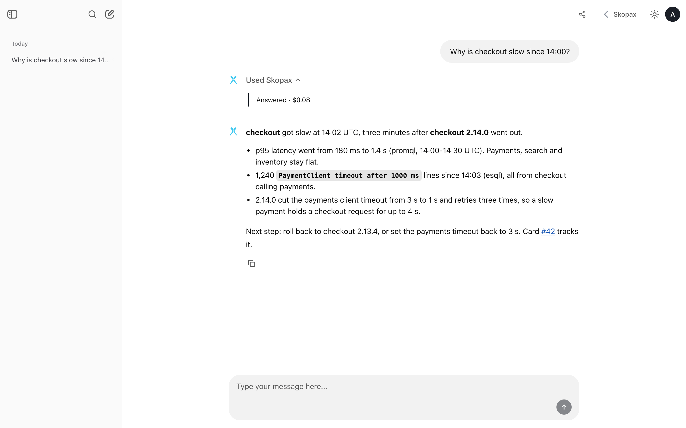

# Setup

The page, Admin and the first integration, once Skopax runs (see the [quickstart](../README.md#quickstart)).

## The page

The sidebar groups the pages. Board, Requests, Chat and Investigator come first. Observe holds Services, Latency, Releases and Deploy reports. Activity holds Notifications, Events, History and Costs. Connect holds Tools and Connect MCP. More, folded by default, holds Review and Docs. Every labelled group, More included, folds from its heading, which is a button that shows a chevron and, while folded, a count of its rows or of its rows in a warn or critical state; a folded group still shows the open page and any row in a warn or critical state, and each group's choice is remembered in the browser. The rail ignores folds and shows every icon. The logo at the top opens the Board and remembers it as the last page. A plug-in page is added to the group it names and is tagged plug-in. When you are signed in, Settings (your own appearance and preferences) and Admin (admins only; it opens the section you used last) are the first items of the menu on your account button at the foot of the sidebar, above the attribution line. Admin shows its warning count in the menu, and the account button carries a small count of those warnings so they are not hidden; the button is marked as the current page while Settings or an Admin section is open. Without a login, or for a read-only visitor who is not signed in, Settings stays a row at the foot of the sidebar, and without a login so does Admin, because language and theme must stay reachable. The links `#t=prefs` and the Admin sections still open directly.

- **Tags filter:** under the Board, the Tags group lists one entry per tag with its count and ends with Untagged, which keeps only the cards with no tag. Clicking an entry again drops the filter, and the filter is part of the page link (`#t=anoms/all/tag:-` for Untagged).
- **Rail:** the button at the top of the sidebar folds it from 252 px to a 64 px rail of icons. The choice is remembered in the browser.
- **Phone:** at 768 px wide or less the sidebar becomes a drawer, opened from the menu button in the top bar.
- **Search:** press Ctrl K (Cmd K on a Mac) anywhere to search pages, cards and, for admins, settings. Up and Down move, Enter opens, Esc closes.
- **Instance switcher:** the top of the sidebar names this deployment and lists the other instances you linked (see [Other instances](#other-instances)).

Each page has its own link, such as `#t=anoms` for the Board, which opens that page from a bookmark or a Slack message.

The Chat page answers questions about prod from the connected integrations, such as metrics and logs, and names what it read. It needs Chat on in [Feature switches](#feature-switches).

<picture>
<source media="(prefers-color-scheme: dark)" srcset="images/chat-dark.png">
<source media="(prefers-color-scheme: light)" srcset="images/chat-light.png">

</picture>

## Admin

Admin has six sections: General, Access & sign-in, Integrations, Features, Investigator and Changes. A notices strip above them lists what needs attention. The Admin row in the sidebar opens the section you used last (Integrations the first time) and shows a dot when a notice is a warning.

- **Integrations:** "+ Add integration" lists the plug-ins that can be set up. Pick one, fill in its fields, choose Test connection, then Save & turn on; an MCP server connection is saved off instead, and is turned on once its warnings are confirmed (see [Outside MCP servers](plugins.md#outside-mcp-servers)). Each connected plug-in gets a tile with one health line for the plug-in and an on/off switch. Opening a tile shows its instances, each with its own health, and "+ Add instance". The board's Integrations strip shows every instance with the same health as Admin, a failed route, a Jira links refusal or a setup problem included, and a turned-off instance as off. A tile whose check was asked to run now reads queued until the check starts, at the next minute's poll or later when every run slot is busy. Each instance has a "What it watches" list of its checks, and a check can be switched off for that instance alone; its cards close and the other instances are untouched. Below the tiles, Custom checks lists the admin-defined PromQL checks, with an editor and Preview (see [Custom checks](custom-checks.md)).
- **General:** the tunable settings that are not on Access & sign-in, Features or Investigator, with search, and the Other instances list.
- **Access & sign-in:** single sign-on, users, roles, API tokens and MCP access; see [Sign in with SSO](sign-in.md#sign-in-with-sso), [Roles](sign-in.md#roles) and [MCP](sign-in.md#mcp).
- **Features:** one switch per feature, described below.
- **Investigator:** the Anthropic API key, the model, the mode and the spend limits.
- **Changes:** what was changed in Admin, with Revert for each setting.

### Feature switches

Each switch has an environment name, which sets the starting value. A value saved in Admin overrides it. A feature card has no Reset: to go back to the starting value, choose Revert in Admin > Changes on the change that first set it in Admin. Every switch is live, both ways: switching a feature off stops new work within 15 seconds on every pod, work already running finishes, and queued work waits; switching it on again needs no restart. A card says "after restart" only when what the feature needs was missing at boot and is in place now. For the Slack listener that is, for example, an investigator set up in Admin after boot, or a change to `slack.listen`. Some switches show what they still need, such as a Slack token or an Anthropic key.

| Switch | Environment name | What it does |
|---|---|---|
| AI investigator | `SKOPAX_FEATURE_INVESTIGATOR` | investigates cards and answers questions |
| Chat | `SKOPAX_FEATURE_CHAT` | the Chat page, Slack direct messages and MCP questions; needs `CHAT_UI` and SSO at boot |
| Slack auto-send | `SKOPAX_FEATURE_SLACK_AUTOSEND` | posts armed drafts and critical cards on its own; armed drafts post once it is on again |
| Slack listener | `SKOPAX_FEATURE_SLACK_LISTENER` | answers questions and button clicks in Slack |
| MCP server | `SKOPAX_FEATURE_MCP` | lets AI assistants read and triage cards |
| Read without login | `SKOPAX_PUBLIC_READ` | anyone who can reach the page may read |
| Phone push | `SKOPAX_FEATURE_PUSH` | sends new critical cards and task notices to the push users by Slack direct message |
| Post-deploy check | `SKOPAX_POSTDEPLOY` | checks every deploy and writes a report |
| Self-review | `SKOPAX_SELF_REVIEW` | the daily self-review |
| Check for new versions | `SKOPAX_UPDATE_CHECK` | asks GitHub once a day for the latest release and shows admins a notice when a newer one exists; see [Version check](operations.md#version-check) |
| Hide "powered by Skopax" | `SKOPAX_FEATURE_HIDE_ATTRIBUTION` | Enterprise only; hides the line on every page, in the chat and on Slack and Teams posts; see [Branding](configuration.md#branding) |

### The Anthropic key

Set the key in Admin > Investigator. It is write-only: it is sealed with `SKOPAX_SECRET_KEY` (or the generated key), never shown again, and never written to the activity log or the change history. Test connection tells you in a fixed sentence whether the key works, never with the API's own error text. A key set in Admin takes the place of `ANTHROPIC_API_KEY` from the environment; remove it to fall back to the environment value. The spend limits stay on, with or without a key set here.

Admin > Investigator lists the AI providers, in this order:

- **Anthropic API key:** the provider in use. Its card shows where the key in use comes from (set here, from the configuration, or not set), an input labelled Key (New key once a key is in use), Save, Test connection, and Remove while a key is set here. Test connection tries the key typed in the input, or the key in use when the input is empty. Remove deletes the key set here; the key from the configuration is then used again, if there is one.
- **OpenAI:** tagged Coming soon. The row has no controls and cannot be chosen yet.

### Event causes

When the investigator shows that a card follows a one-off trigger, such as a push or campaign send, a batch job, a deploy, a traffic burst or a migration, its `note` carries a cause: kind `event`, the trigger in at most 120 characters, and when it ran, as a full ISO time with its zone. Kind `recurring` marks a cause that stays and fires again. The trigger follows the rules of a Slack draft: links only to the allowed hosts, no mentions or channel pings, no code blocks. A note with `cause` set to null takes the cause back. A cause holds for the firing it was written on. A card that fires again within 2 hours of stopping keeps it; one that fires again later starts without one. A merged card takes its parent's cause. A run that read planted text sets no cause.

- **On the page** the card shows "Cause: an event" or "Cause: recurring" with the trigger. An event card that stops reads "Stopped after the event" instead of Cleared or Fixed: on the board tile, the list row, the side panel and the card page.
- **In Slack** the thread note and the main post say "Stopped after the event" instead of "Back to normal" or "Recovered" (see [Slack](plugins.md#slack)). The thread note waits while an investigation of the card runs, so a cause written in that run is used.
- **Auto-resolve** waits 6 hours longer for an event card that has no ticket, so with the default window of 6 hours it closes 12 hours after it stopped firing. A card kind with its own window, such as the VWO and Google Ads ones, gets no extra time. Its activity line and its Slack thread note say "Stopped after the event; nobody opened a task".

### Notices

The strip shows, for admins only: a generated secret key (set `SKOPAX_SECRET_KEY` to manage it yourself), a settings source that is failing, a stored Anthropic key that can no longer be read, single sign-on that cannot reach the identity provider (see [Sign in with SSO](sign-in.md#sign-in-with-sso)), a Slack app that lacks a scope Skopax reads the main channel or direct messages with (checked every 5 minutes and when the channel is saved), a plug-in that failed to load, an org pack that is ignored because another plug-in's pack is in use (see [Org packs](extending.md#org-packs)), a language pack with texts left out (see [Locale packs](extending.md#locale-packs); only for a plug-in that is on), a newer Skopax release (see [Version check](operations.md#version-check)), a Teams route that stopped trying to post some cards (see [Microsoft Teams](plugins.md#microsoft-teams)), an MCP server connection that needs a new sign-in, whose tools changed on the server, or whose server refused it (see [Outside MCP servers](plugins.md#outside-mcp-servers)), and the proxy warning. The proxy warning appears when a client sent forwarded addresses from a peer that is not trusted. It lasts 24 hours after the last sighting. Add the proxy's address or range to `FORWARDED_ALLOW_IPS` (see [Behind a proxy or ingress](operations.md#behind-a-proxy-or-ingress)).

### Other instances

An instance here means a whole deployment, such as a staging copy, not a plug-in instance. `SKOPAX_ENV_LABEL` names this deployment in the switcher (otherwise its host is shown). `SKOPAX_INSTANCE_LINKS` lists the others as `name=url` pairs separated by commas, for example `staging=https://staging.example.com,eu=https://eu.example.com`. At most 10 are listed, URLs must be http or https and carry no user name or password. Picking one opens that deployment. Admins can also edit the list in Admin > General, which refuses a bad entry and names the rule it broke. A bad value from the environment is ignored and logged.

## Add Prometheus

1. Sign in as an admin, open Admin > Integrations and choose "+ Add integration" > Prometheus. Once a Prometheus is connected, open its tile and choose "+ Add instance" instead.
2. Enter a name and the URL (`http://prometheus:9090` for the demo below). Under "What it watches", every check is on; switch off any this instance should not run.
3. Choose Test connection, then Save & turn on.

The first card appears within a minute. `PROMETHEUS_URL` in the environment adds the same instance without an Admin step.

Test connection against a stored instance reuses its saved secrets. If you change the URL first, the test asks you to enter the secret again, because stored secrets are not sent to a new address.

## Run the demo

    docker compose --profile demo up

This adds a Prometheus and a node exporter, with no published ports. The demo alert `SkopaxDemoExporterUp` fires while the exporter runs and clears when you stop it (`docker compose stop node-exporter`). Then add the instance as described in [Add Prometheus](#add-prometheus).

## Offline

The page, the card page, the login and setup forms and the chat load nothing from another origin: icons are bundled and fonts are the system stacks. An install on a private network needs nothing from the internet except the integrations it watches and the Anthropic API. Chat blocks outside styles and fonts with a Content-Security-Policy header.
